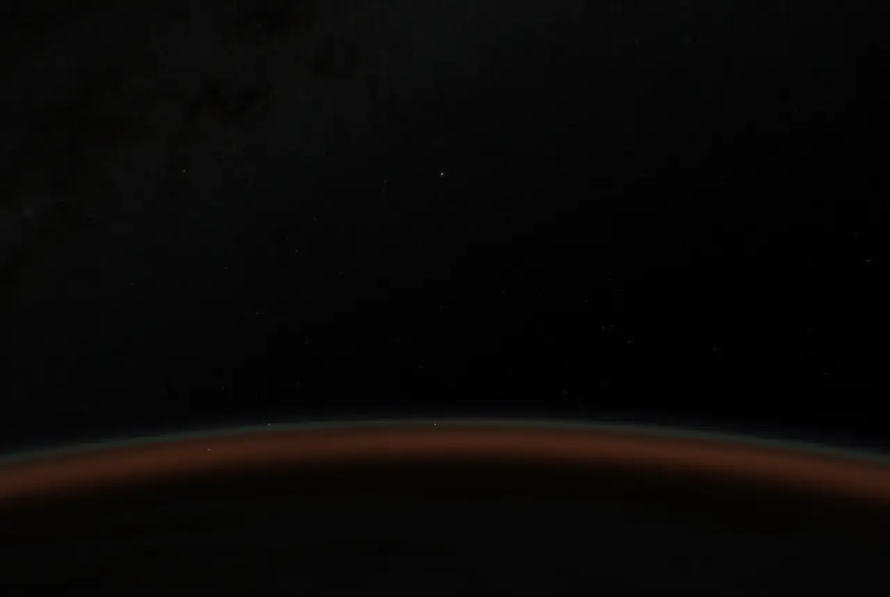

# Earthlight

Earth from low orbit, rendered in real time with raw WebGL. A custom element
draws the planet, atmosphere, stars and camera effects; Astro hosts the demo.
There is no Three.js dependency.

Created by [Max Vyshniakov](https://github.com/maxvyshniakov). The repository
is private; a code license has not yet been selected.



The scene uses saved ISS orbital elements with SGP4, single Rayleigh scattering,
airglow near 90/98 km, and an illustrative auroral oval based on the WMM2025
magnetic dipole. NASA day and night maps stream from 86,400 × 43,200 source
imagery. Terrain, clouds and sky detail load as needed. Weather and camera
effects are illustrative; the orbital elements are a saved snapshot.

## Run

Use Node 24, npm, and GitHub CLI authenticated for this private repository.

```sh
npm ci
npm run assets
npm run dev
```

Open `http://localhost:4321/`. `npm run preview` serves the production build,
including the same narrow terrain proxy as the development server.

## Verify

```sh
npm run verify
npm run preview -- --port 4325
npm run verify:scene -- http://127.0.0.1:4325 /tmp/earthlight-browser-proof
```

The browser suite uses `rtk proxy agent-browser`. Device-specific benchmarks
require their corresponding device tooling. Unit tests require the assets,
including the original DEM1 terrain maps used to check the DEM2 encoding.

## Assets and credits

The large scene data archive lives in a pinned GitHub Release. `npm run assets`
checks its SHA-256 before extraction. Release metadata is in
`source-snapshot.json`; small loading previews and attribution files remain in
Git. Fetching the full archive is a development step, not a page-load cost.

The four legacy Solar System Scope day/cloud maps are excluded. The historical
night-light comparison lab requires those separately attributed maps; it is
not part of the demo or verification suite.

See [NOTICE](NOTICE.md) and [data provenance](public/media/orbit/README.md) for
source credits, transformations and terms. Code and third-party data have
separate licensing.

## Source synchronization

Source: `personal-site@82f3c1c888b7de93ddc793962dfacdc53572b584`.

```sh
npm run sync:site -- /path/to/personal-site <commit-or-ref>
```

Synchronization resolves one full commit, imports the shared manifest, removes
retired imported files, reapplies privacy/path adaptations and reports the
diff. It refuses a dirty destination and never writes to the source checkout.
Review the result and run verification before committing. Changed binary
assets require a new release archive and checksum. The demo wrapper, package
metadata and Earthlight tooling remain locally maintained.
