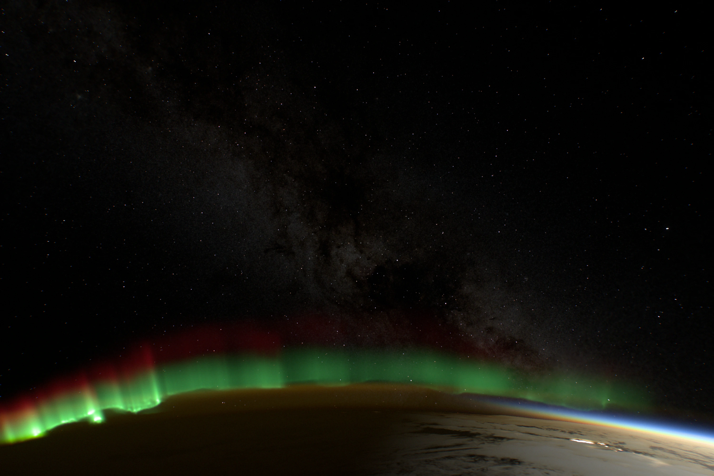
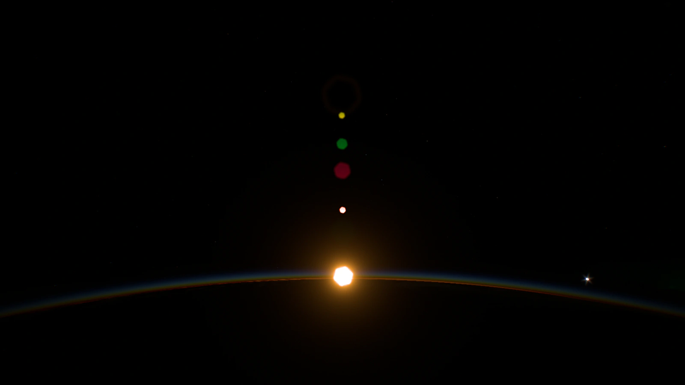
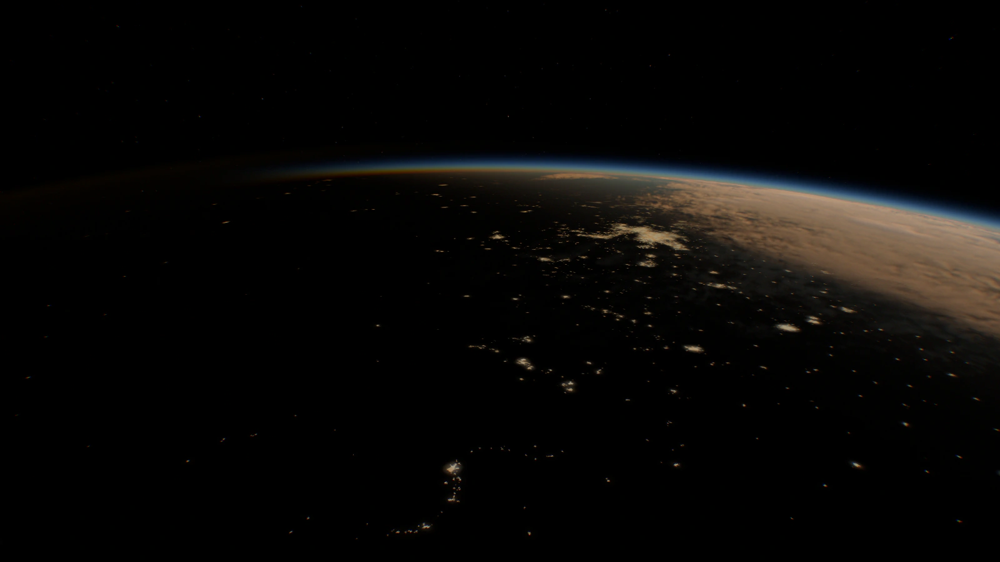
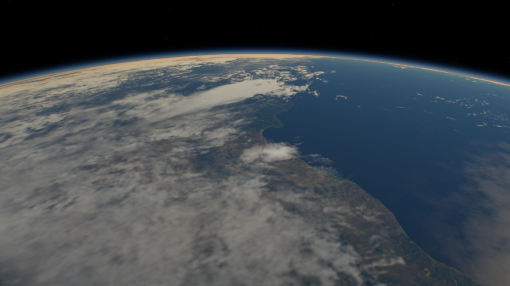
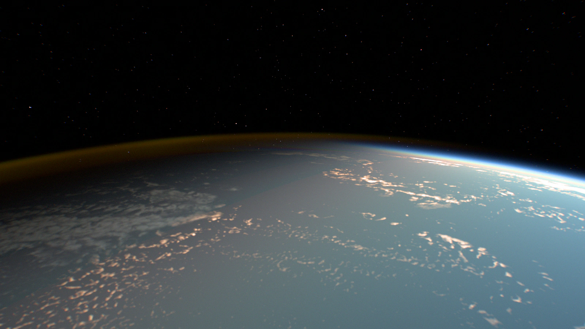

# Earthlight

**Earth from low orbit, rendered in real time in the browser.**

**[earthlight.maxvyshniakov.com](https://earthlight.maxvyshniakov.com)**



The International Space Station circles Earth every 93 minutes and sees about
sixteen sunrises a day. Earthlight renders that view in the browser: the thin
blue line of the atmosphere at dawn, auroral curtains over the poles, low sun on
the clouds along the terminator, city lights across the night side, and the
Milky Way behind the airglow.

All of it comes from one WebGL renderer: about 6,000 lines of TypeScript and
GLSL, with no Three.js. Real data drives it: an ISS orbit, NASA imagery at
native resolution, a star catalog, and ephemerides for the Sun, Moon and
planets.

<table>
  <tr>
    <td width="50%"></td>
    <td width="50%"></td>
  </tr>
  <tr>
    <td><sub>Sunrise over the Southern Ocean</sub></td>
    <td><sub>Before dawn over South Africa</sub></td>
  </tr>
  <tr>
    <td></td>
    <td></td>
  </tr>
  <tr>
    <td><sub>Morning clouds over southern India</sub></td>
    <td><sub>Evening sun on Pacific clouds</sub></td>
  </tr>
</table>

These are unedited frames from the demo. Each one is a URL, for example
[the aurora above](https://earthlight.maxvyshniakov.com/?t=1200&yaw=100&pitch=-4&motion=0&epoch=2026-10-06T01:32:27Z).

## What you are looking at

- **A real orbit.** A saved CelesTrak element set for the ISS (NORAD 25544) is
  propagated with SGP4. Earth rotates by apparent sidereal time. Sun, Moon and
  planet positions come from Astronomy Engine, with precession and nutation.
  Pick any date and the lighting follows it.
- **Atmosphere.** Single Rayleigh scattering through an exponential atmosphere,
  with Earth's shadow and wavelength-dependent extinction. That produces the
  blue limb by day and the orange band at twilight.
- **Airglow.** Emission shells at 90 and 98 km give the faint amber and green
  layer above the night-side horizon.
- **Aurora.** Curtains follow an auroral oval built from the WMM2025 magnetic
  dipole. The oval widens toward magnetic midnight. Green emission sits at about
  100–140 km and red at 250–330 km, and the rays fold and drift over time.
- **Clouds.** NASA cloud coverage is lifted into a 0.6–12 km volume. Clouds
  cast shadows, show parallax, catch low sun along the terminator, dim city
  lights beneath them and flicker with storm flashes.
- **Surface and cities.** NASA Blue Marble and Black Marble imagery at 500 m
  per pixel (86,400 × 43,200), streamed tile by tile into bounded GPU atlases.
  Relief comes from ETOPO 2022 and, close up, Copernicus GLO-90.
- **The sky.** 15,598 stars from the HYG catalog, with proper motion and color
  from their B−V index. NASA's Deep Star Maps provide the Milky Way, streamed at
  up to 16K. The Moon and the planets are in their correct places.
- **The camera.** Auto exposure, lens ghosts and a point-spread function
  computed by FFT from a simulated iris, color separation, sensor grain, and a
  short focus pull while detail loads.

## Explore

Follow the ISS, a polar or a high orbit, or grab Earth and fly freely. Drag
anywhere to fly over Earth, and with Shift or the middle button to look around;
the right button or Control circles the point under it, marked by a pin on the ground. A trackpad scroll flies
too, with Shift it looks, with Option it climbs, descends or rolls, and with Control it circles. The mouse
wheel or a pinch zooms the lens; Shift-wheel comes closer, Option-wheel rolls and Control-wheel circles. <kbd>W</kbd><kbd>A</kbd><kbd>S</kbd><kbd>D</kbd> fly, arrow keys look,
<kbd>F</kbd>/<kbd>R</kbd> come closer or back away, <kbd>Q</kbd>/<kbd>E</kbd>
roll, <kbd>+</kbd>/<kbd>−</kbd> zoom the lens and <kbd>0</kbd> takes it back to
1×, <kbd>\</kbd> resets the camera, <kbd>1</kbd>–<kbd>4</kbd> choose free flight
or an orbit and <kbd>Space</kbd> stops time.
Help lists every gesture for the mouse, trackpad, touchscreen and keyboard you
have. The tapes set the date, time of day, time scale and exposure; Settings
offer clouds, aurora, exposure mode and the camera's image effects. The Moon's phase follows
the date. Every view can be shared as a URL.

## How it is built

- `<earthlight-explorer>` is a framework-free custom element (`src/scripts/`). Astro
  only hosts the demo page.
- Startup shows a small poster, then reveals low-resolution overviews. Detail
  tiles for the visible region stream in afterwards. Failed requests fall back
  to the overview, not to a blank screen.
- Render resolution adapts to measured frame delivery. The renderer recovers
  from WebGL context loss and releases GPU memory when detached.
- WebGL1 is the default; a WebGL2 path can be enabled. Terrain decoding runs in
  workers.
- Data pipelines in `scripts/build-*.mjs` rebuild every texture and catalog
  from the original sources.

The [docs](docs/README.md) explain the model, the data and the measurements in
detail, including what is approximate.

## Honest limits

This is a replay, not live tracking: the orbit comes from one saved element
set. The clouds come from a single global composite, not the weather on the
chosen date. Aurora and storms are illustrative presets. The light is tuned to
look photographic rather than to match radiometric measurements. Do not
navigate with it.

## Run it locally

Requires [Bun](https://bun.sh) 1.3.14. Scene data is downloaded from a checksummed, versioned Static Assets release.
Private R2 archives preserve the releases; browser traffic does not access R2.

```sh
bun install --frozen-lockfile
bun run assets      # download and verify the pinned scene data
bun run dev         # http://localhost:4321/
```

`bun run verify` runs the unit tests, type checks and a production build. Unit
tests need the downloaded scene data. `bun run verify:scene <url> <output-dir>`
drives the rendered scene in an isolated agent-browser session.

## Embed the background

The `earthlight/background` Astro component uses the same renderer without
navigation or controls. It leaves page input alone and keeps a static poster
when reduced motion is requested. The full explorer lives on the Earthlight
subdomain.

```astro
---
import Background from 'earthlight/background';
import assets from 'earthlight/assets-manifest';
---
<Background assetBaseURL={`https://media.maxvyshniakov.com/earthlight/${assets.version}/`} />
<a href="https://earthlight.maxvyshniakov.com/">Explore Earthlight</a>
```

See [integration and releases](docs/integration.md) for local development,
package updates, asset publication and deployment.

## Credits

Imagery: NASA Earth Observatory (Blue Marble, Black Marble) and NASA/GSFC
Scientific Visualization Studio (Deep Star Maps, with Gaia DR2 from
ESA/Gaia/DPAC). Stars: HYG v4.1 by David Nash (CC BY-SA 4.0). Terrain: NOAA
ETOPO 2022 and Copernicus DEM. Magnetic field: WMM2025 (NOAA NCEI and BGS).
Orbital elements: CelesTrak. Libraries: satellite.js, Astronomy Engine,
geotiff.js. NASA, ESA and the other data providers do not endorse this project.
Full terms and the changes made to each source are in [NOTICE](NOTICE.md) and
the [data provenance notes](public/media/earthlight/README.md).

## License

The code is [MIT](LICENSE). The scene data keeps its sources' terms, listed in
[NOTICE](NOTICE.md); for example, the star catalog is CC BY-SA 4.0.

If you use Earthlight in something you make, I would appreciate a visible
credit near the scene, such as "Earthlight by Max Vyshniakov" linking to
[earthlight.maxvyshniakov.com](https://earthlight.maxvyshniakov.com).
The license does not require it, but it helps people find the project.

---

Made by [Max Vyshniakov](https://maxvyshniakov.com).
