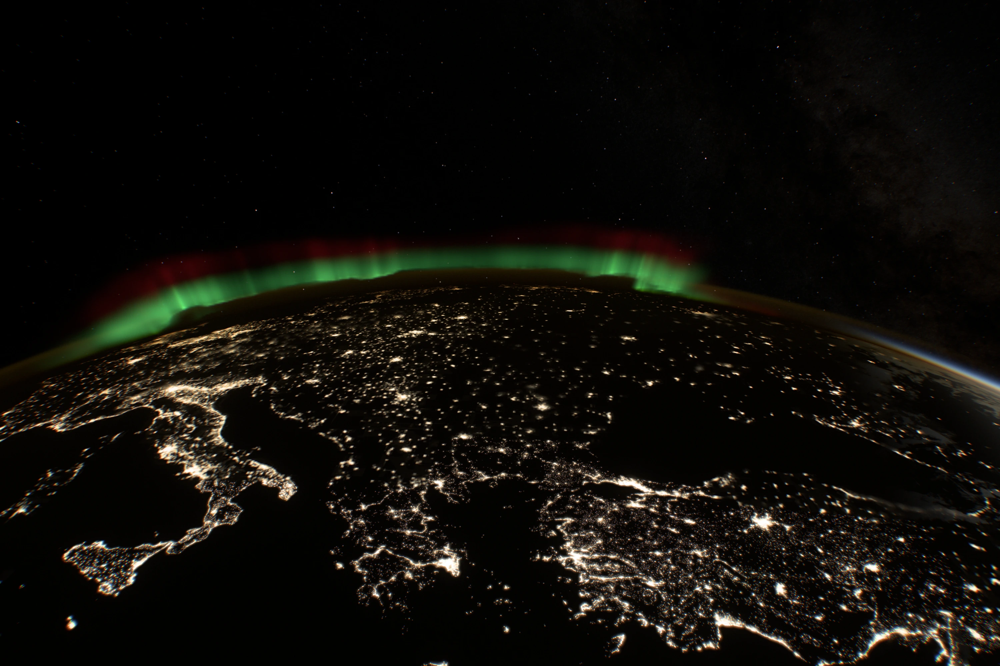
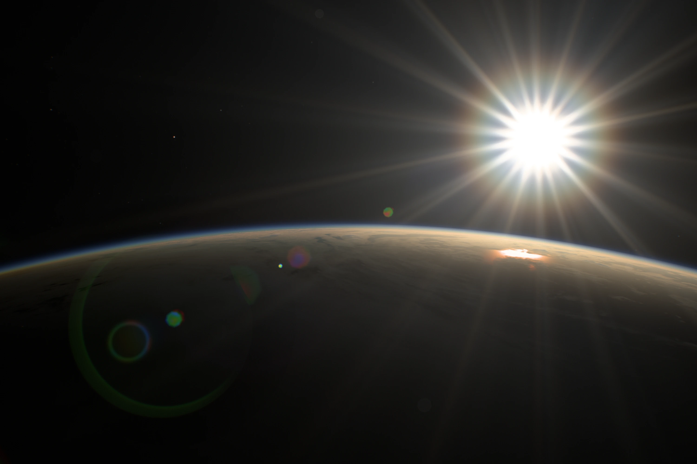
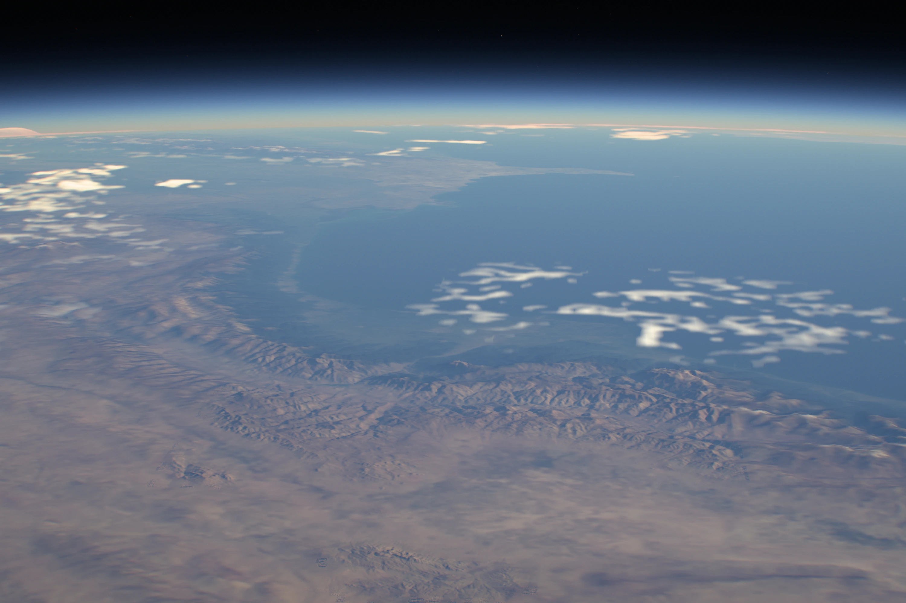
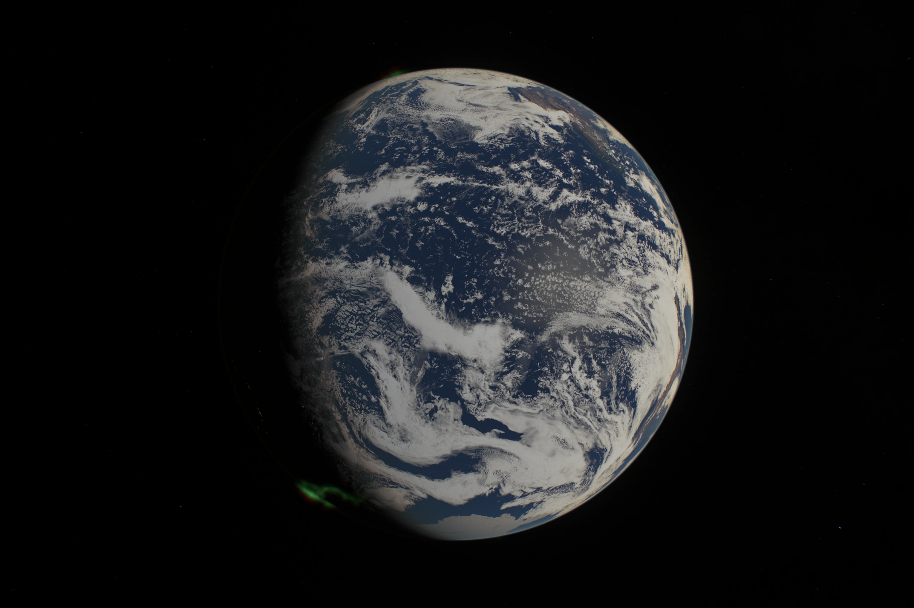
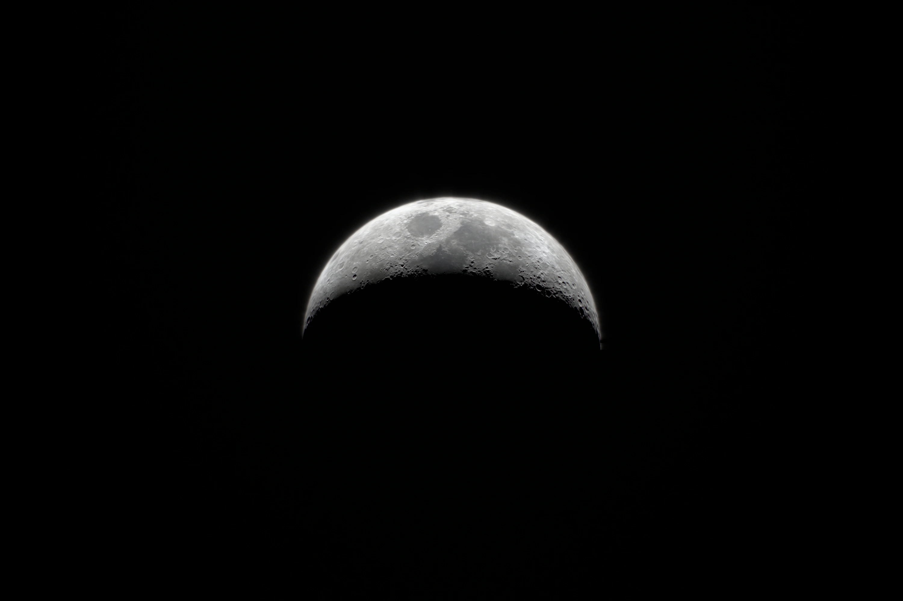
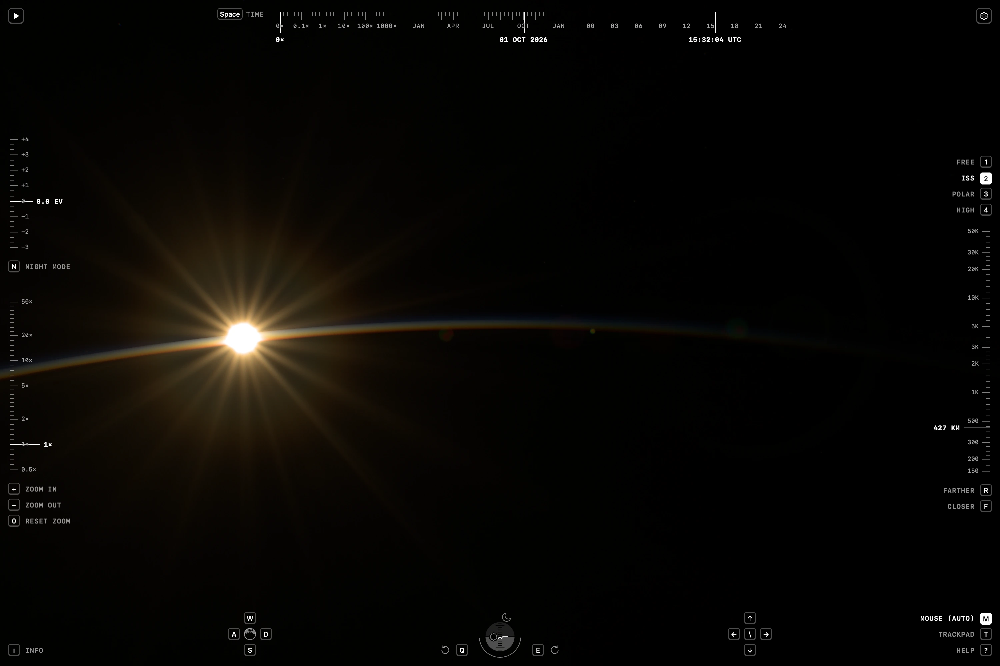

# Earthlight

**Earth from the International Space Station, drawn live in your browser.**

**[Open the scene](https://earthlight.maxvyshniakov.com)**, or read
[how it was made](https://maxvyshniakov.com/work/earthlight/).

[](https://earthlight.maxvyshniakov.com/?t=1227.09&epoch=2026-11-14T14%3A39%3A32.910Z&motion=0&look-exposure=2&flight=free&position=-0.58184030%2C-0.62239333%2C0.64313219&orientation=0.8626780101%2C-0.3581205042%2C-0.1815948337%2C0.3075055638)

It isn't a video. Every frame is rendered from the station's real orbit, a
catalog of 15,598 stars and NASA maps of the planet: sunrise on a thin blue
limb, aurora curtains over the poles, clouds catching the low sun, city lights
across the night side and the Milky Way behind the airglow. One WebGL renderer
in TypeScript and GLSL draws all of it, with no Three.js, and one simulated
camera exposes it.

<table>
  <tr>
    <td width="50%"><a href="https://earthlight.maxvyshniakov.com/?t=1227.09&epoch=2026-11-23T03%3A22%3A32.910Z&motion=0&look-exposure=2.5&flight=free&position=0.98932393%2C0.48345956%2C0.57890649&orientation=0.4430497632%2C0.7026208171%2C0.4899206080%2C0.2645915581"></a></td>
    <td width="50%"><a href="https://earthlight.maxvyshniakov.com/?t=3846.35&epoch=2026-05-10T14%3A23%3A53.647Z&look-exposure=2&flight=free&position=-0.51033160%2C0.44034422%2C0.82663848&orientation=-0.2621802236%2C0.7888604509%2C0.5554589426%2C0.0206417635&motion=0"></a></td>
  </tr>
  <tr>
    <td><sub>Europe before dawn</sub></td>
    <td><sub>Sunrise under an aurora</sub></td>
  </tr>
  <tr>
    <td><a href="https://earthlight.maxvyshniakov.com/?t=4080.30&epoch=2026-10-01T15%3A16%3A59.701Z&motion=0&look-exposure=2.8&flight=free&position=-0.81861161%2C-0.04155155%2C0.74563232&orientation=-0.4656562606%2C0.5439627349%2C0.6980464033%2C-0.0000943804"></a></td>
    <td><a href="https://earthlight.maxvyshniakov.com/?t=4080.30&epoch=2026-06-09T01%3A51%3A59.701Z&motion=0&lens=2.254&look-exposure=2&flight=free&position=0.55133791%2C0.65873108%2C0.55655901&orientation=0.3027146684%2C0.8489013502%2C0.4190072933%2C0.1102869684"></a></td>
  </tr>
  <tr>
    <td><sub>The Sun through the station's lens</sub></td>
    <td><sub>Relief and coast at 2.25×</sub></td>
  </tr>
  <tr>
    <td><a href="https://earthlight.maxvyshniakov.com/?t=3970.45&epoch=2026-10-01T16%3A24%3A49.546Z&motion=0&lens=1.711&flight=free&position=-4.00032570%2C-3.49669943%2C-1.83628062&orientation=0.7415779883%2C-0.3367316434%2C-0.2398971562%2C0.5283211542"></a></td>
    <td><a href="https://earthlight.maxvyshniakov.com/?t=4080.30&epoch=2026-08-17T12%3A16%3A59.701Z&motion=0&lens=50&look-exposure=-1&flight=free&position=-8.71067294%2C-1.07808571%2C-1.11801733&orientation=-0.6322632706%2C-0.0318575332%2C0.6804899288%2C-0.3690009634"></a></td>
  </tr>
  <tr>
    <td><sub>The Pacific from free flight</sub></td>
    <td><sub>The Moon at 50×</sub></td>
  </tr>
</table>

These are unedited frames. Every view is a URL that carries the time, position,
lens and exposure, so click any picture to open that exact view.

## What you are looking at

- **A real orbit.** A saved CelesTrak element set for the ISS (NORAD 25544),
  propagated with SGP4: about 93 minutes a lap at roughly 420 km, sixteen
  sunrises a day. Earth turns by apparent sidereal time, and Astronomy Engine
  places the Sun, Moon and planets with precession and nutation. Pick any date
  and the light follows it.
- **The sky.** 15,598 stars from the HYG catalog down to magnitude 7, with
  proper motion, colour from B−V and brightness from magnitude. Positions match
  NASA's Deep Star Maps to a median of 1.35 arcminutes. The Milky Way is NASA's
  map, streamed in tiles up to 16K. The Moon carries NASA's lunar maps, lit by
  the real Sun.
- **Atmosphere and airglow.** Rayleigh scattering through an exponential
  atmosphere, with Earth's shadow and wavelength-dependent extinction: the blue
  limb by day and the orange band at twilight. Sunlight grazing the limb is
  refracted and dimmed, and a thin aerosol puts a glow around the Sun. Airglow
  shells at 90 and 98 km add the faint amber and green layer above the night
  horizon.
- **Aurora.** Curtains follow an oval built on the WMM2025 magnetic dipole,
  wider toward magnetic midnight. The green lower edge varies between about 99
  and 137 km and the red layer peaks at 245–330 km. Thin rays, the curtain
  body and the diffuse glow between curtains are rendered as a volume.
- **Clouds.** NASA's July 2001 cloud-cover composite, lifted into a volume
  between 0.6 and 12 km whose tops and gaps come from the data, not from noise. Opacity is fitted to NASA's own
  composite to within 0.011 RMS over dark ocean. Clouds cast shadows, catch the
  low sun, dim the cities beneath them and flicker with lightning.
- **Surface and cities.** NASA Blue Marble at 500 m per pixel (86,400 ×
  43,200) and Black Marble night lights, streamed tile by tile into bounded GPU
  atlases; the night side loads only tiles that contain light. Relief comes from ETOPO 2022 and,
  close up, Copernicus GLO-90.
- **One camera for every light.** No object has its own brightness. A light
  meter reads the frame on the GPU and sets aperture and ISO at a fixed 1/48 s
  shutter. The lens is modelled on the 28–300 mm the crews use, with nine
  rounded blades: its eighteen diffraction rays, coated internal reflections
  and defocus follow from each source's real light. It zooms from 0.5× to 50×,
  about 15 to 1,500 mm. The sensor turns photons
  into electrons with shot and read noise, and the image is encoded once, in
  Display P3 where the screen supports it.

## Explore

[](https://earthlight.maxvyshniakov.com/?t=4080.30&epoch=2026-10-01T14%3A24%3A04.390Z&yaw=-26.902000000010958&motion=0&pitch=-16.32600000000559)

Follow the ISS, a polar or a high orbit, or leave orbit and fly freely. Tapes
around the frame set the time scale, date and time of day along the top,
exposure and the lens on the left, and altitude and the orbit on the right. The
horizon gauge at the bottom levels the camera, and its Sun, Moon and Earth
markers turn you to face them. Settings hold the clouds, aurora, exposure mode,
lens coating, flares, grain and Milky Way brightness. The address bar follows
the view, so copying it shares exactly what you see.

|                  | Keyboard                                     | Mouse and trackpad                                                                  | Touch                                     |
| ---------------- | -------------------------------------------- | ----------------------------------------------------------------------------------- | ----------------------------------------- |
| Fly              | <kbd>W</kbd> <kbd>A</kbd> <kbd>S</kbd> <kbd>D</kbd> | Drag, or scroll on a trackpad; flick to coast                                       | Drag; flick to coast                      |
| Look around      | Arrow keys; <kbd>&#92;</kbd> levels the horizon  | Shift-drag or middle-drag, two-finger press and drag, or Shift-scroll               | Drag with two fingers                     |
| Circle a point   |                                              | Right-drag, or drag, scroll or wheel with Control                                   |                                           |
| Roll             | <kbd>Q</kbd> <kbd>E</kbd>; <kbd>H</kbd> levels or flips | Option-drag around the centre, Option-wheel, or rotate two fingers in Safari        | Twist two fingers                         |
| Closer, farther  | <kbd>F</kbd> <kbd>R</kbd>                    | Shift-wheel or Option-scroll; double-click to fly in, Shift-double-click to back off | Double-tap to fly in, two-finger tap to back off |
| Zoom the lens    | <kbd>+</kbd> <kbd>−</kbd>; <kbd>0</kbd> for 1× | Wheel or pinch                                                                      | Pinch                                     |
| Orbit            | <kbd>1</kbd> free, <kbd>2</kbd> ISS, <kbd>3</kbd> polar, <kbd>4</kbd> high | Buttons on the right                                                                | Buttons on the right                      |
| Time             | <kbd>Space</kbd> pauses and plays            | The time tape                                                                       | The time tape                             |

Hold Shift to go faster. <kbd>N</kbd> switches night mode, <kbd>I</kbd> shows
what you are looking at, and <kbd>?</kbd> opens Help, which lists the gestures
for the devices you actually have.

## Performance

The scene is tuned on a weak GPU, an Intel UHD 630, rather than on a fast
laptop, so every effect pays for its milliseconds.

- **First light.** The first frame is a defocused poster of a few kilobytes,
  chosen by where the Sun is. Low-resolution overviews follow, then detail for
  the visible region, and the lens pulls focus as it arrives. On slow 4G first
  light is complete in 1.08 s.
- **Frame rate.** Render resolution adapts to measured frame delivery, and
  brief stalls don't count as overload. Swipes run at 51–54 frames per second
  on desktop, with motion blur on the Earth like a film camera's.
- **Robustness.** A failed tile falls back to the overview, not to a blank
  screen. The renderer recovers from WebGL context loss and frees GPU memory
  when detached. Terrain decodes in workers.

## How it is built

- `<earthlight-explorer>` is a framework-free custom element in
  [`src/scripts/`](src/scripts/). Astro only hosts the demo page.
- WebGL2 where it exists, WebGL1 as the fallback, compiled from one shader
  dialect.
- The pipelines in [`scripts/`](scripts/) rebuild every texture and catalog
  from the original sources, and [`docs/lab/`](docs/lab/) keeps 71 dated
  experiments with their measurements.

The [docs](docs/README.md) explain the model, the data and the measurements in
detail, including what is approximate.

## Honest limits

This is a replay, not live tracking: the orbit comes from one saved element
set. The clouds are a single global composite, not the weather on the chosen
date. The aurora is procedural on a real magnetic model, and the lightning is
illustrative. The camera is plausible, not calibrated, and the default night is
many times brighter than a real camera would see it; night mode (<kbd>N</kbd>)
draws night light at its physical brightness through a camera set like ISS
night video, much darker. Do not navigate with
it.

## Run it locally

Requires [Bun](https://bun.sh) 1.3.14. Scene data comes from a checksummed,
versioned release.

```sh
bun install --frozen-lockfile
bun run assets      # download and verify the pinned scene data
bun run dev         # http://localhost:4321/
```

`bun run verify` runs the unit tests, type checks and a production build. Unit
tests need the downloaded scene data. `bun run verify:scene <url> <output-dir>`
drives the rendered scene in an isolated agent-browser session.

## Embed the background

The `earthlight/background` Astro component uses the same renderer without
navigation or controls. It leaves page input alone and keeps a static poster
when reduced motion is requested. It runs behind the homepage of
[maxvyshniakov.com](https://maxvyshniakov.com).

```astro
---
import Background from 'earthlight/background';
import assets from 'earthlight/assets-manifest';
---
<Background assetBaseURL={`https://media.maxvyshniakov.com/earthlight/${assets.version}/`} />
<a href="https://earthlight.maxvyshniakov.com/">Explore Earthlight</a>
```

See [integration and releases](docs/integration.md) for local development,
package updates, asset publication and deployment.

## How it was made

Earthlight started as a homepage background and a wallpaper made from an ISS
photograph, and grew over two weeks with AI agents into what you see here. The
wallpaper stayed the bar the whole time. The
[case study](https://maxvyshniakov.com/work/earthlight/) tells the story: the
first-evening rollback, the camera rebuilt around one light meter, eight rounds
of notes on the aurora, and a weak GPU as the benchmark.

## Credits

Imagery: NASA Earth Observatory (Blue Marble, Black Marble) and NASA/GSFC
Scientific Visualization Studio (Deep Star Maps, with Gaia DR2 from
ESA/Gaia/DPAC, and the CGI Moon Kit from LRO LROC and LOLA). Stars: HYG v4.1
by David Nash (CC BY-SA 4.0). Terrain: NOAA ETOPO 2022 and Copernicus DEM. Magnetic field: WMM2025 (NOAA NCEI and BGS).
Orbital elements: CelesTrak. Libraries: satellite.js, Astronomy Engine,
geotiff.js. NASA, ESA and the other data providers do not endorse this project.
Full terms and the changes made to each source are in [NOTICE](NOTICE.md) and
the [data provenance notes](public/media/earthlight/README.md).

## License

The code is [MIT](LICENSE). The scene data keeps its sources' terms, listed in
[NOTICE](NOTICE.md); for example, the star catalog is CC BY-SA 4.0.

If you use Earthlight in something you make, I would appreciate a visible
credit near the scene, such as "Earthlight by Max Vyshniakov" linking to
[earthlight.maxvyshniakov.com](https://earthlight.maxvyshniakov.com).
The license does not require it, but it helps people find the project.

---

Made by [Max Vyshniakov](https://maxvyshniakov.com).
