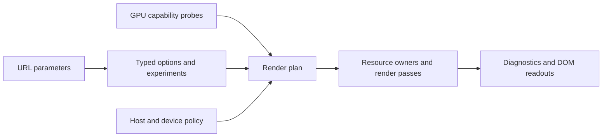

# Architecture

Earthlight owns the renderer, interactive explorer, passive background and data
formats. The personal site consumes the package; it does not own another copy
of the scene. Astro provides markup and packaging. The browser hosts are custom
elements, and the renderer uses WebGL directly.

## State and commands

`ExplorerSession` owns the explorer's photographic settings, playback clock,
calendar and navigation. HUD, Settings and keyboard handlers submit commands to
that state and display its values. Hidden controls may remain as markup adapters,
but are not a command bus or the source of application state.

`scene-control-model.ts` defines the shared ranges and time-scale mapping.
`explorer-url.ts` reads and writes photographic/control settings; navigation and
calendar retain their own codecs. Unknown URL parameters survive writes, so
sharing a view does not discard a rendering experiment. Pose restoration must
retain URL precision even when a slider displays a rounded value.

Time scale is expressed in scene seconds per real second. The time slider uses
a separate 0–1000 position mapped onto that scale. Its legacy URL key remains
`rate`; internal names distinguish the position from the time scale and from
physical camera speed. DOM identifiers and saved links retain compatibility.

There are distinct clocks: `SceneClock` maps monotonic time to simulation time;
`SceneCalendar` maps simulation time to a date; `SceneFrameClock` decides when a
frame is due. A delayed frame must not change simulation speed, and a hidden
page must not catch up the time it was suspended.

## Host lifetime

`SceneHostLifecycle` owns the recurring and invalidated animation-frame requests,
visibility and resize listeners, context events and restoration generations.
The explorer and background supply their policies for activity, cadence, focus
and exposure. A synchronous resync during first light must not start a second
animation-frame chain. A restore completing after disposal or another loss
must not reactivate an old host.

`NightCrossfade` owns the held night hand-over frame and its completion listener
and timeout. A new hold or host disposal cancels the older fade; its queued
completion cannot clear a newer frame. Explorer retains the photographic
settling policy and the existing dissolve timing.

The background is a separate passive host. It installs no navigation handlers,
keeps a poster for reduced motion or an unavailable context, and only runs while
its containing content is visible. Sharing runtime machinery must not import
explorer controls into that path.

## Renderer configuration



`readSceneRenderOptions` is the compatibility boundary for rendering URL
parameters. It normalizes one immutable snapshot and separates retained lab
experiments from ordinary scene settings. A live night change uses the explicit
renderer operation rather than rereading the address.

`readSceneRenderCapabilities` probes context facts. `createSceneRenderPlan` is a
pure function resolving those facts and host policy into eligible paths. It
expresses restrictions such as save-data/background streaming, measured versus
photographic clouds, and texture-unit conflicts between ocean and galaxy or
cloud depth and noise. Allocation and compilation may still fail: the existing
runtime fallbacks remain necessary after planning.

Diagnostics are a one-way projection of options, the plan and runtime results.
Their string representation supports the HUD and browser checks; it must never
be read back to choose shader variants or resources.

The renderer owns GPU lifetime and pass ordering. Night handover retains maps
and exposure state while replacing compiled programs. Pending compilation,
asset uploads and context restoration must respect their owning generation.
Shader modules export reusable GLSL blocks and explicit source builders for
scene, volume, cloud and ocean variants. GPU fixtures compile production blocks
directly, including solar, city, sensor, defocus and tile sampling. Browser
probes replace complete exported blocks and verify that a replacement occurred;
they do not discover function boundaries by comments or string offsets.
GLSL dialect conversion remains a text transformation. Comparisons against
frozen historical sources retain local adapters for those old formats; they do
not define the assembly contract for current production code.

## Streaming and data contracts

`AssetRequest` describes one source URL and its loading stage; an asset plan is
a list of requests. `SceneWork` supplies shared network, decode and upload job
budgets. The day-pyramid index uses the same network admission as tile metadata,
including preview priority, motion deferral and cancellation on disposal.
Its request starts only after admission; late results cannot publish into a
disposed owner.

Deep day-tile requests hold network tickets while sharing their pack fetches.
Pack fetching must not take another ticket while a tile holds one waiting for
that same pack: the one-slot case must remain live. This is a job budget, not a
strict limit on open HTTP streams: an incremental pack can deliver its first
tile while its remaining bytes continue downloading. Default limits remain
four network and two decode jobs; explicit positive limits make bounded
admission tests possible without replacing the scheduler.

- `tile-layout.ts` defines dimensions, gutters and addressing shared by the
  runtime and data builders.
- `surface-tile-selection.ts` chooses visible detail independently of loading.
  `surface-tile-shader.ts` owns the corresponding GLSL sampling code.
- `surface-tiles.ts` loads tiled map layers: day, night, clouds, the spherical
  galaxy map and coarse numeric terrain. Published `night-tiles` asset paths
  remain unchanged.
- `AtlasResidency` owns paired atlas cells and LRU eviction. A reserved cell
  cannot be evicted while an asynchronous upload might still write it. Only the
  owning job can finish or release its reservation.
- `TileRequests` owns request identity, cancellation and retry deadlines.
  Source-specific concurrency, timeout and fallback policies stay with the
  source loader.
- `DayPyramidSelection` operates on an explicit index without networking or GL.
  `DayPyramid` owns pack fetching, incremental availability and its byte-bounded
  cache.

Image radiometry, numeric terrain decoding, page-table representation and
source-specific fallback remain separate. Shared layout does not imply that
cloud opacity, city emission, galaxy radiance and height bytes can use the same
filtering or encoding.

## Verification

`bun run test` discovers `scripts/*.test.mjs`; adding a test file does not require
updating a second allowlist. The suite includes pure-model tests, bounded fake
resource tests, local HTTP pack tests and checks against downloaded scene data.
`bun run verify` adds type checking and the production build.

After building, start `bun run preview --port 4321`, then run:

```sh
bun run verify:scene http://127.0.0.1:4321 /tmp/earthlight-scene-proof
bun run verify:hosts http://127.0.0.1:4321 /tmp/earthlight-host-proof
```

The scene suite exercises actual GPU output, loading/fallback, context recovery,
input ownership and shared URLs. The host suite bundles the production
background element into an isolated fixture and checks passive input, suspension,
restore, detach/reconnect and explorer night handover. The background retains
its production GPU eligibility policy, so the active lifecycle checks need a
usable hardware context.

For renderer-preserving refactors, serve an immutable build of the parent beside
the candidate and use `scripts/verify-renderer-cleanup.mjs`. It fixes the camera,
date, exposure, grain, viewport and profile, and verifies actual pose and buffer
dimensions. A passing unit suite alone does not establish visual equivalence.

Asynchronous tile completion assigns different atlas slots across page loads.
Even identical texels can then produce a few different output bytes through
floating-point atlas-coordinate rounding. The comparator retains raw frames
and measurements, then compares repeated frames with fixed geographic placement
of the same resident tiles. Temporary GPU textures preserve the actual page-to-
payload mapping and metadata; every copied texel is verified by readback. The
capture helper rejects fading, malformed, changing or unsupported layouts and
restores bindings, transfer state and temporary resources after use.
The temporal cloud path first refreshes both alternating column histories in
two retained warmup frames. All three subsequent same-time captures must be
byte-identical within each loaded scene, for both raw and fixed placement.

This verifies shader/pass output with fixed residency, not the correctness of
production allocation or scheduling. Real loading, cancellation and lifecycle
tests cover those boundaries. Run baseline-versus-baseline and candidate-versus-
candidate controls as well as parent-versus-candidate; keep raw results beside
the fixed-residency results. Do not widen the pixel threshold to make a refactor
pass. A declared tolerance is not byte identity.
