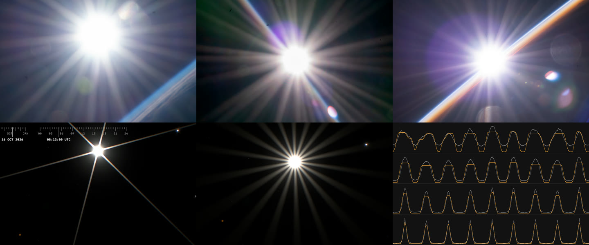
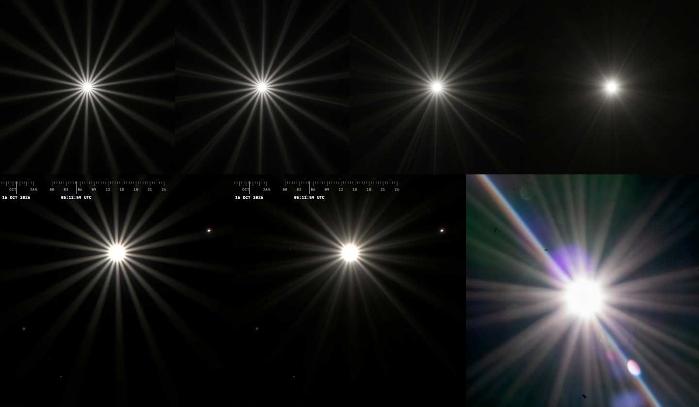

# Aperture rays from a rounded nine-blade iris, 2026-10-16

The Sun's starburst read as a decal. Its six rays were straight lines of
constant width that crossed the whole frame, all equally bright, and the star
slid over the scene unchanged as the Sun moved. The physics behind it was
consistent but described the wrong lens: six perfectly straight blades. A
straight edge diffracts into a line whose brightness falls as 1/r², so
nothing ends it before the frame edge.

The fix took two iterations. The first gave the iris nine rounded blades with
perfect circular edges and an analytic ray model. Its rays fell off correctly
but formed an even, rhythmic flower of 18 identical fans with clean edges:
still geometric. The second gives every blade edge a micron-scale waviness
and takes the rays' angular profile straight from the FFT of that iris.

Top: NASA ISS photographs with the Sun in frame (public domain), iss066e152099
(Nikon D4, 28–300 mm at 56 mm, f/18), iss068e054893 (65 mm, f/45),
iss067e124188 (56 mm, f/14). Bottom: the 0.5× view of the complaint; the first
iteration; its far-field profile r³·I against angle, 0–180°, from the iris FFT
(grey) and the analytic fan model (orange) at f/3.2, 5.5, 9.4 and 16.

Top: the same iris at f/9.4 with ideal arcs and with edge waviness of 0.0003,
0.0008 and 0.002 apothem, each rendered from its FFT far field the way the
shader draws it. Bottom: the first iteration, the second (waviness 0.0008 with
per-blade roughness), and iss068e054893 (f/45) for comparison.

## References

About 300 ISS photographs from the NASA Image and Video Library were sampled
for the Sun in frame, with EXIF. Nearly all were taken on Nikon D4, D5 or Z 9
bodies, most with the AF-S 28–300 mm f/3.5–5.6G VR (nine rounded diaphragm
blades) stopped down to f/11–f/45. For motion, ESA's
[Horizons orbital sunrise timelapse](https://www.esa.int/ESA_Multimedia/Videos/2018/07/Horizons_mission_timelapse_an_orbital_sunrise)
(Alexander Gerst, two photographs per second, 4K source, ESA/NASA) was cut
into frames: every 20th frame from 140 to 1000, and frames 300–311 and
150–270 consecutively. Its frames are not committed.

| Observed feature | Reference and capture context | Mechanism | Discriminating render |
| --- | --- | --- | --- |
| 18 rays, unequal in length and brightness, with a barely visible rhythm | iss066e152099, iss067e124188; Horizons frames 300–311 | Nine blades: each edge lights its normals and the opposite directions, which fall between two other blades. Edges differ in shape and roughness | Fixture: the strongest point of each 20° sector varies by more than 25% |
| Rays split into parallel needles; some edges sharp, others soft | Horizons frames 300–311; iss066e152099 | A blade edge wavy at the micron scale has curvature that changes along it, so several points share each normal and its fan breaks into needles. A perfect arc gives one even fan | Edge candidates rendered from their FFT (second evidence image) |
| Rays fade within about a quarter of the frame | All stopped-down frames | A curved edge spreads its light over a fan, so the ray falls as 1/r³ instead of the straight edge's 1/r² | FFT: r³·I is flat from 12 to 200 px at every f-number |
| Rays are as wide as the solar disk at f/18, not wider | iss066e152099, Sun clear of the limb: FWHM 6° at 600 px, the disk alone gives 5.8° | Each blade's fan is narrower than about 3°: the blades are only slightly curved | Fan width per f-number from the arc geometry |
| Thin needles near the core that widen outwards | Horizons frames 300–311 | An arc acts as a straight edge until its Fresnel zone covers it, then as a fan | Ray profile along r: 1/r², then 1/r³ |
| Rays from a rising sliver are thin | iss067e124188, Horizons frame 150 | Only the visible part of the disk throws rays | Rays from a disk of the visible area |
| The star keeps its shape and orientation over consecutive frames | Horizons frames 300–311 (0.5 s apart) | Aperture diffraction is fixed to the sensor | Sweep of the camera: rigid star |
| Nonagonal ghost with blotchy rainbow colours, opposite the Sun through the image centre | Horizons frame 300 | Aperture image after two reflections; coating phase varies over the pupil | Not changed here, see below |
| Vertical streak through the Sun, also when it leaves the frame | Horizons frames 600–960 | Window or sensor artefact, not the lens | Not modelled |

The ESA video does not show the Sun near a frame corner, so it says nothing
about field-dependent vignetting of the pupil (cat's eye).

## What changed

- **One iris** (`src/scripts/camera-iris.ts`): nine blade disks whose edges
  cross unit apothems, inside a circular stop. The arc radius relative to the
  opening is f/1.0 ÷ f/N: it would close into a circle at f/1.0 and flattens
  as the camera stops down. The stop is the opening at f/3.2 and recedes
  beyond the corners by f/4. Each blade has fixed errors of ±0.34° in angle,
  ±1.5% in apothem and ±25% in arc departure. Lens ghosts and defocus draw
  this outline.
- **Wavy blade edges.** Each edge is displaced along its arc length by ten
  octaves of sinusoids, wavelength 0.025–0.57 apothem, amplitude
  0.0008·(wavelength/0.1) times a random 0.5–1.5, and a roughness factor per
  blade of e^±1. On a blade about 1.5 mm across that is a micron. Everything
  comes from a fixed seed. The outline that ghosts and defocus draw leaves
  the waviness out; only diffraction can see it.
- **PSF atlas** (`scripts/build-optical-psf.mjs`): four tiles at f/3.2, 5.5,
  9.4 and 16, evenly spaced in log f, each scaled to equal pupil area. Below
  them, each f-number's far-field angular profile: r³·I averaged over rings
  60–160 CSS px at f/4 (2048² FFT, 430–670 nm), 1020 angles in RGB, stored
  at eight semicircle blurs from 0 to 32°. The shader picks tiles by
  f-number. New files `optical-psf-iris9.bin` (256 × 1152) and the gzipped
  `optical-psf-v3.bin`.
- **Rays** (`src/scripts/solar-disk.ts`, `apertureRays` in
  `optical-psf.ts`). The profile is blurred by the disk's angular radius seen
  from the pixel and by the straight-edge width 1/(k·0.36). The second term
  merges the needles near the core, where the ray falls as 1/r². Each lookup
  takes four texture samples: two blur levels for two f-number tiles. The
  radial factor is q(r) = r (r³ + c³)^(−4/3) integrated over the disk. Its
  share of the flux, 2π·P̄·Γ(3/4)/window, 2.6%, is taken from the disk.
- **Occlusion**: rays come from a disk of the visible area, so a rising
  sliver throws narrower bands at the same flux.

## Measurements

First iteration, ideal arcs. Stationary phase predicts r³·I = C·P(θ), where
P(θ) is the edge's radius of curvature at the points with normals ±θ. A fit
to the iris FFT over rings at 27–200 px:

| f-number | C (R, G, B) | Profile correlation | Measured mean | Model mean |
| --- | --- | ---: | ---: | ---: |
| 3.2 | 0.0180, 0.0163, 0.0140 | 0.94 | 0.0374 | 0.0330 |
| 5.5 | 0.0184, 0.0167, 0.0144 | 0.95 | 0.0360 | 0.0344 |
| 9.4 | 0.0179, 0.0163, 0.0144 | 0.97 | 0.0359 | 0.0338 |
| 16 | 0.0172, 0.0159, 0.0141 | 0.96 | 0.0359 | 0.0329 |

C grows with wavelength (R/B ≈ 1.27, 610/460 nm = 1.33). The total far-field
light is nearly independent of f-number: stopping down only gathers it into
narrower, brighter fans. Blade fans span about 10–14° at f/4, 3–6° at f/9.4
and 2–3.5° at f/16. The model was right, but its perfect arcs were the
problem: the rays it drew were too even.

Second iteration, wavy edges, tabulated from the FFT. Mean r³·I (R, G, B):
0.0390, 0.0350, 0.0304 at f/3.2 and 0.0401, 0.0358, 0.0310 at f/16. The rings
moved from 150–350 to 60–160 px, because farther out the antialiased pupil
edge suppresses the far field by about 15%.

The browser fixture (`scripts/solar-disk-browser-fixture.mjs`) integrates a
40 px Sun through the atlas. It checks that disk + rays stays within 1% of
one (0.998, 0.995, 0.992, 0.999 at f/4, 9.4, 16, 3.2), that ray contrast
rises from f/4 to f/16, and that the 18 ray peaks differ. Under the fixture's
blur, ideal arcs leave a peak spread of 0.05 (every ray within about 5% of
the others) and the wavy edges 0.23.

## Motion

Over consecutive frames of the timelapse, the real starburst does not change
at all. It is rigid in sensor coordinates, as aperture diffraction must be,
so animating its shape would be wrong. It reads as optics rather than as a
decal for other reasons:

1. The rays are needles and fans of unequal length that fade into the frame,
   not lines cut off by its edge.
2. Ray length follows the source's flux against the fixed exposure. During
   sunrise the star grows from nothing: first a thin, sharp star from the
   sliver, then the full one.
3. The ghosts move through the image centre, opposite the Sun, and have the
   iris's shape.
4. Near the frame edge veiling glare dominates, and a source just outside
   the frame still lights the lens.

The first two are now in the renderer, and the third had only the wrong
shape. Our automatic exposure falls as the Sun enters the frame. That keeps
the star's size more constant than the fixed exposure of the timelapse.

## Emerging from an edge, sunset colour and lens dirt

Two timelapse shorts, viewed at 2160 and 1080 px wide in a browser, not
downloaded (sources unknown, frames not committed):
[Sun through the ISS](https://www.youtube.com/shorts/EzPBWvqmfM4) (0–7 s:
the Sun emerges from behind a solar array edge) and
[Sunset from orbit](https://www.youtube.com/shorts/YQRsRvOySXQ) (0–10 s and
10.5–18 s: two sunsets behind Earth's limb).

| Observed feature | Where | Mechanism | Status |
| --- | --- | --- | --- |
| While the Sun is a sliver, only the open side's rays show | Array short, 1.0–3.4 s | The rays are centrosymmetric (a real pupil gives \|F(k)\| = \|F(−k)\|); the lower ones fall on the sunlit array and vanish in its clipped highlights. They reappear faintly over the array at 6.3 s | Rays add in linear light before the tone curve, so this comes for free |
| Rays are crisp, near parallel-edged bands of unequal brightness | Both shorts | Disk-wide bands from slightly curved, uneven blade edges | Second iteration |
| A large, irregular glow on the side where the Sun still is, reddening as it sets | Sunset short, 12.6–15.2 s | Forward scattering by aerosols along lines of sight through the limb: real scene light, so only where the view crosses the atmosphere | Not modelled: the atmosphere is single Rayleigh, without aerosols or refraction |
| Sun white, then orange, then red and flattened as it sets; rays and glow share the colour | Sunset short, 0–10 s and 10.5–15 s | Extinction along the grazing path, refraction | Extinction only, Rayleigh only |
| Irregular haze patch around the core, not a smooth disk | Array short at 6.3 s; sunset short at 0.4 s | Wide-angle scatter from contamination on lens surfaces: its shape is fixed to the lens and travels with the Sun | Veil is a smooth two-scale Moffat |
| Soft round discs, one dark-ringed, and small bright dots that appear only in heavy flare | Sunset short, 0.1–0.8 s | Out-of-focus dust on an element near the sensor modulates whatever light reaches it; invisible on a dark frame | Not modelled |
| Rainbow streaks in the glow and ghosts | Both shorts | Coating phase across ghost paths; diffraction rings from dust | Ghost colour in a separate session |

## Open questions

- **Blade curvature and waviness** are choices within bounds. The f/18
  reference only limits the fan to 3° or less, and f/1.0 matches the
  tapering needles of the timelapse. The waviness amplitude was chosen by
  eye among four candidates; nothing measured fixes it.
- **Exposure context.** Next to the Horizons frames, our star sits on a
  much smaller overexposed core with less veiling glare. The references are
  exposed for the night limb with the Sun far beyond clipping; ours meters
  the scene. That is a question of exposure and sensor bloom, not of the
  ray shape.
- **Wide open is not round.** At f/3.2 the stop only rounds the corners and
  the blades still give weak 18-ray modulation. A lens whose blades fully
  retract would be round there.
- **Field dependence.** Off axis, the lens barrel clips the pupil (cat's
  eye) and makes the star asymmetric towards the corners. No reference in
  this set shows it. Answered in
  [aperture rays across the field](aperture-rays-field-2026-10-16.md): at
  f/16–f/20 the star is unchanged from centre to corner.
- **Ghost colour.** The reference ghost is a nonagon filled with blotchy
  rainbow colours, like oil on water: a coating phase that varies across the
  pupil with angle of incidence and film thickness, plus a slightly
  different ghost size per wavelength. `ghostCoating` varies its phase only
  gently along one axis, so our ghosts have nearly uniform colour.
- **Assets.** The new PSF files exist locally and in the manifest only.
  Publishing them to R2 is a separate step.
