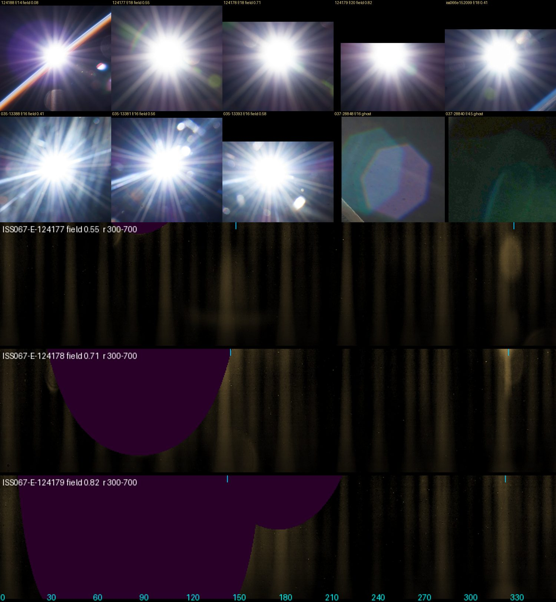

# Aperture rays across the field, 2026-10-16

Follow-up to [aperture rays from a rounded nine-blade iris](aperture-rays-2026-10-16.md),
whose open question was field dependence: off axis, the lens barrel can clip
the entrance pupil (mechanical vignetting, the "cat's eye"), which would change
the Sun's diffraction star towards the corners. The question here is whether
real photographs show that, and if so, how the analytic rays should change.

**Result: no renderer change.** In consecutive frames with the same lens and
f-number, the star keeps its rays, their angles, widths and relative strengths
from field 0.55 to 0.82 towards a corner. At the f-numbers where the explorer
shows the Sun, a real lens is stopped down far enough that its barrel does not
clip the pupil. The one field-dependent clipping the references do show is in
a lens ghost at f/4.5, which is outside this question (see the end).

Top row: ISS067-E-124188 (f/14, centre), 124177, 124178 and 124179 (f/18, f/18,
f/20; the Sun moving into the top-left corner), all Nikon D4 with the AF-S
28–300 mm at 56 mm; iss066e152099 from the earlier note for comparison.
Second row: ISS035-E-13388, 13381 and 13393 (AF-S 14–24 mm at 24 mm, f/16,
portrait frames turned back to the sensor's orientation); ghosts in
ISS037-E-28848 (AF-S 50 mm f/1.4G at f/16) and 28840 (same lens at f/4.5),
brightened. Bottom: 124177–124179 unwrapped around the Sun, angle 0–360°
anticlockwise from +x across, radius from 700 px at the top to 300 px at
the bottom; purple is outside the
frame; blue ticks mark the radial axis (the line through the image centre).
Sun crops are 1200 px of the original (900 px for ISS035), ghost crops
1400 and 900 px. Images courtesy of
the Earth Science and Remote Sensing Unit, NASA Johnson Space Center
([Gateway to Astronaut Photography of Earth](https://eol.jsc.nasa.gov/)),
public domain. Field is the Sun's distance from the image centre over the
half-diagonal. The frames are not committed.

## References

The 521 ISS photographs returned by NASA Image and Video Library searches for
the Sun from the station were located automatically (a compact saturated disk
on a dark surround) and sorted by field. Most of the 30 detections beyond
field 0.7 were bright station hardware; for the real ones, and for the
earlier note's references, the neighbouring frames were fetched at full
resolution from the Gateway to Astronaut Photography, which keeps every frame
of a sequence with its EXIF. Four sequences show one lens
with the Sun at different field positions within minutes:

| Sequence (camera time) | Lens, f-number | Sun field | Use |
| --- | --- | --- | --- |
| ISS067-E-124177–124179, 2022-06-10 22:09:39–22:11:12 | 28–300 mm at 56 mm, f/18, f/18, f/20, 1/1250–1/1600 s | 0.55, 0.71, 0.82 towards the top-left corner | Main test: the lens most ISS Sun photographs use |
| ISS067-E-124188, 2022-06-13 | the same, f/14 | 0.08 | Centre; the Earth's limb crosses the star |
| ISS035-E-13380–13393, 2013-04-01 09:08:35–09:09:26 | 14–24 mm f/2.8G at 24 mm, f/16, 1/250 s | 0.41–0.71 | Second lens, ten frames |
| ISS037-E-28839–28851, 2013-11-09 06:58:00–06:59:31 | 50 mm f/1.4G, f/3.5 to f/16 | 0.60–0.83, right edge | Wide apertures off axis; ghosts |
| ISS042-E-15777–15787, 2014-11-25 14:17–14:19 | 17–35 mm f/2.8D at 17 mm, f/10 | 0.2 to 0.75, both side edges | Not usable: through a cupola window whose frame vignettes the corners and whose dirt scatters more than the lens |

The rays were measured on a ring of 300–700 px, green
channel, clipped pixels excluded, relative to the 20th percentile around the
ring at each radius. An 8° running median was subtracted around the ring so
that only needles remain; ghosts and glare are broader. The Sun's centre was
fitted, and for frames whose star is partly outside the frame, centre and a
small rotation were searched together against 124177.

| Frame | f-number | Field | Needle profile vs 124177 | Ray FWHM (median) | Rays in frame |
| --- | --- | ---: | --- | ---: | ---: |
| 124177 | f/18 | 0.55 | — | 3.0° | 28 of 28 peaks |
| 124178 | f/18 | 0.71 | r = 0.86 (0.72 without rotation) | 2.75° | 19 of 28 |
| 124179 | f/20 | 0.82 | r = 0.84 (0.67 without rotation) | 2.5° | 15 of 28 |

The 18 rays fall at the same sensor angles in all three frames (4.5°, 24.8°,
45.2°, 66.0°, 84.8°, 107.0°, 125.0°, 146.5°, 163.8°, 184.3°, 203.8°, 224.5°,
245.2°, 265.0°, 286.8°, 305.5°, 327.2°, 344.2°: 20° apart within the blades'
tolerance). The ray at 327°, on the radial axis of 124179, is still a needle
next to the frame corner. The best match allows 1° (124178) and 2° (124179)
of rotation. Half of each star is outside the frame there, so rotation and a
centre error of a few pixels are nearly interchangeable; 124179 is also a
third of a stop smaller, which turns a pivoting-blade iris slightly. It is not
a field effect the data can identify. The two broad bumps near 150° and 330°
in the unwrapped strips are ghosts: round, at a fixed radius, on the radial
axis, as ghosts must be.

ISS035 (log intensity on a 120–700 px ring, 30° high-pass; portrait frames
turned by +90°, since −90° leaves the landscape frame 13393 uncorrelated with
the rest, r ≈ 0 instead of 0.47) shows the same: across field 0.41 to 0.57
the profiles correlate at 0.56–0.72, as well as frames at the same position
correlate with each other (0.45–0.92). In 13391 and 13392 (field 0.64–0.71)
too much of the ring is outside the frame for this test. A strong
single streak to the left of the Sun stays in the same sensor direction in
every frame.

| Observed feature | Reference + capture context | Mechanism | Discriminating render |
| --- | --- | --- | --- |
| 18 rays at the same sensor angles, centre to corner | ISS067-E-124177–124179 (f/18–20, field 0.55–0.82); ISS035-E-13380–13393 (f/16, 0.41–0.71) | Fraunhofer diffraction of the iris; the iris is fixed to the sensor and, stopped down this far, nothing else bounds the beam | Sun crop at centre and in a corner: identical rays. Holds: `solarRays` has no field input |
| Rays keep width and relative strength off axis; the radial ray stays a needle | 124177–124179: FWHM 3.0°, 2.75°, 2.5°; ray at 327° in the corner frame | A clipped pupil would replace the blade arcs facing the field direction by one large-radius arc: a weak, broad fan along the radial axis instead of two needles | Cat's eye on: the ray pair nearest the radial axis widens into a fan. Not seen, so not added |
| Nothing one-sided about the star | All sequences | The intensity of a real pupil's far field is centrosymmetric, I(−k) = I(k); clipping cannot make a comet. Coma (a phase error) can, but only in the core, which is clipped here | None; the LUT core's comatic wing (`lensPsf`) is not tested by these frames |
| Ghosts off axis at f/8–f/16 are complete nonagons | ISS037-E-28847–28850 (50 mm, Sun at field 0.64–0.79) | A ghost is an image of the beam that passes the stop; a complete outline means nothing clipped it | Ghost at field 0.75, f/9–16: full aperture outline |
| A ghost at f/4.5 has a circular-arc edge with a bright rim | ISS037-E-28840, 28841 (Sun at field 0.82) | Near full aperture a ghost path's beam is wider than an element's clear aperture | Ghost clipping that fades as the lens stops down |

## Why stopped down means unclipped

The barrel clips a beam when its footprint on a front or rear element,
centred d·tan ω from the axis, reaches past the element's clear radius. The
footprint is about as wide as the entrance pupil, f/N, while its offset does
not depend on the f-number. Lenses are designed so that the corner beam is
only partly clipped wide open; a few stops down the footprint fits inside. The
28–300 mm f/3.5–5.6 opens to about f/4.5 at 56 mm, so f/18 is four stops down.

The explorer's automatic exposure meets its −3.0 EV floor whenever the Sun is
in frame: f/9, ISO 178 ([pyramid metering](pyramid-metering-2026-10-16.md)).
The virtual iris opens to f/3.2, so that is three stops down, about where the
references sit. With manual exposure the Sun can be framed at f/3.2–f/6, a
grossly overexposed picture; no reference shows the star at both centre and
corner at those apertures, and the only wide-aperture frames (ISS037 at
f/3.5–f/5.6) have the Sun at the edge only. Adding clipping there would be a
guess, so the rays stay as they are.

## Open questions

- **Ghost clipping and f-number.** `apertureGhost` (`lens-reflections.ts`) clips every ghost off axis by
  the same fraction of its outline at any f-number
  (`clip=1.-smoothstep(1.05-edge,1.05+edge,length(q+radial*field*.34))`). For
  the Sun at field 0.75 of a 3:2 frame, as in ISS037, that trims about an eighth of the
  outline's radius on one side, also at f/9–f/16, where the ISS037 ghosts are
  complete. The f/4.5 frames suggest the clipping is real wide open. Scaling
  the clip offset by the pupil size (f/3.2 ÷ f/N) would match both; it needs
  its own check against ghost energies.
- **Pupil foreshortening.** Seen from a field angle ω, the pupil is
  compressed by cos ω along the radial axis, so the star stretches radially
  by 1/cos ω and rays near 45° to the radial axis turn towards it. At 56 mm
  the corner (20°) gives at most 2°, below what partly visible stars resolve.
  A wide-angle reference (14–17 mm, about 50° in the corner) with a clean
  window could show it.
- **Wide-open stars off axis.** A sequence at f/3.5–f/5.6 with the Sun at both
  centre and corner would settle whether the explorer's manual exposure range
  needs cat's-eye rays.
