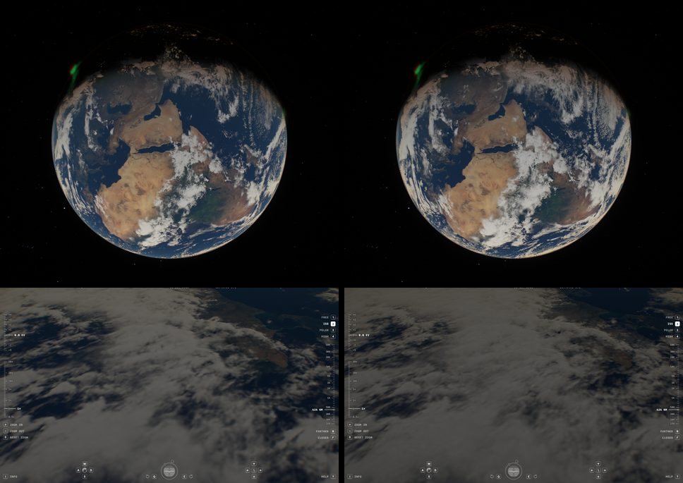

# Cloud opacity calibrated to NASA's composite, 2026-10-17

With the Sentinel-2 surface the clouds read as soft and thin, and the full
globe looked short of cloud next to whole-disc photographs. This note measures
why, and adds `clouds=calibrated` (Clouds → Calibrated), an opt-in preset.

Top: `/?orbit=high&t=1800&epoch=2026-10-08T12:00:00Z&motion=0`. Bottom:
`/?t=2400&epoch=2026-10-08T06:00:00Z&motion=0&pitch=-40`, 424 km.

## Findings

- **The plates are dim, and we read them thinner still.** In the 16K cloud
  field (latitude-weighted) 39.7% of the globe exceeds 0.2, 14.4% exceeds 0.5,
  and 0.7% exceeds 0.8. The renderer maps a value v to
  `coverage = smoothstep(.025,.94,v)` and a column optical depth of
  `1.4·coverage^1.35` (Balanced: ×0.72 for weak columns). At nadir that hides
  13% of the ground at v = 0.31, 42% at 0.51 and 70% at 0.75.
- **NASA composited them far more opaquely.** `land_ocean_ice_cloud_2048.jpg`
  and the same surface without clouds, `land_ocean_ice_2048.jpg` (Blue Marble
  2002), against our 4K cloud overview: per value bin, the white fraction
  a = (C − S)/(1 − S) agrees over dark ocean and bright land when computed on
  display values (0.35/0.34, 0.52/0.51, 0.66/0.65, …), and disagrees when
  computed in linear light. The data's authors therefore mixed white over the
  surface in display space with alpha 1 − (1 − v)^2.6 (least squares over
  |latitude| < 60°). Over dark ocean that is a linear opacity of 0.34 at
  v = 0.31, 0.68 at 0.51 and 0.94 at 0.75: two to three times ours for thin
  cloud.
- **The 43,200-pixel plates hold little beyond the 16K field.** The source
  hashes match the tile manifest. In three 2,640-pixel crops a Lanczos
  downsample by 2.64 (to the 16K grid) and cubic upsample loses 0.7–1.4% of the
  variance (RMS 4–5 of 255), almost all of it already lost at ×2. By 8× the loss
  is only 2–6%: most structure is coarser than 5–8 km. Native-resolution tiles
  would cost about seven times the 14 MB of cloud tiles for almost no visible
  detail, so they were not built. There are no 2 × 2 blocks of the kind found in
  the night plates (parity split 0.500 on both axes).

## What changed

- **`clouds=calibrated`** (`src/scripts/earth-clouds.ts`, `CALIBRATED_CLOUDS`):
  the column optical depth becomes `−ln(1 − 0.998·coverage^0.7)`. This fits the
  composite's linear opacity over dark ocean to within 0.011 RMS across the
  value range (`scripts/cloud-calibration.test.mjs` checks it within 0.05 at
  every bin). Coverage, heights, relief and lighting are unchanged. The density
  is shared by view integration, shadows, the lighting cache, source
  attenuation and lens transmission, and slant rays integrate the same column.
- Balanced stays selectable; Original and Off are unchanged. After owner
  review the same day, Calibrated became the default.

## Artifacts the denser preset exposed

Owner review of Calibrated found straight edges that Balanced had hidden. None
is new; denser thin cloud made them visible.

- **Plate joins.** Across the W/E join the mean step between columns 21599 (W)
  and 0 (E) is 7.0 levels at 10–20° N against 0.6 inside the plates, 70 at
  70–80° N, and 14–35 at the date line from 10° N to 20° S. The existing seam
  blend only ran south of 50° S. It now runs at every latitude, with a band
  of constant ground width (±4.3° of longitude at the equator, widening as
  1/cos latitude up to ±17°). This removes the radial "fold" seen from above
  the North Pole and the straight Sahel line.
- **Terminator.** Clouds took sunlight as a geometric step, so the Earth's
  shadow cut the cloud field along a straight line near the equinox. Cloud
  sunlight now passes a Chapman air column at the sunward ray's lowest point
  (550 nm extinction, half-column ahead approximated by a logistic fit of
  erfc). Daylit clouds are unchanged (mean full-disc difference 0.26 levels);
  near the terminator they dim over about 20 km of tangent height, and self
  shadows are traced while any light remains.
- **Not the lighting cache.** An early comparison blamed the 30° cloud
  lighting patch, but `localhost` then reached two different servers. On one
  server the line persisted with `cloudLighting=raymarch`, `cloudDetail=0` and
  `terrain=0`; the cache is unchanged.
- **Flicker near the limb** is the same in both presets: a sub-pixel camera
  turn changes limb pixels by 3.2–3.3 levels and the disc by 1.9–2.0.
  Foreshortened cloud and surface detail is under-filtered at grazing view.
  This needs anisotropic footprints and is not addressed here.

## Limits and judgement

At full-disc scale Calibrated restores connected bands and veils close to the
composite NASA made from this data. At ISS altitude the same calibration turns
the plates' low values into a wide grey veil. Many of those pixels are
fractional fields of small cumulus, not a uniform haze: a 2.4 km sample at 30%
should look like separate bright cells over clear ground. The renderer has no
honest source for that sub-sample structure (an earlier attempt to threshold
noise into opacity drew a camouflage pattern, see
`cloud-morphology-2026-10-11.md`). Cloud types, heights and optical thickness
remain a reconstruction from one coverage image of one day in July 2001.

Next candidates:

- Measured cloud properties for one date: MODIS/VIIRS cloud-top height,
  optical thickness and phase, globally, extending the regional MODIS study.
  This is the only honest route to distinct cirrus, stratocumulus decks and
  deep convection.
- Made the default after owner review on 2026-10-17.

## Reproduce

Sources: `cloud.{W,E}.2001210.21600x21600.png` (hashes in
`cloud-tiles/manifest.json`), and
`https://eoimages.gsfc.nasa.gov/images/imagerecords/57000/57735/land_ocean_ice_cloud_2048.jpg`
with `.../57730/land_ocean_ice_2048.jpg`. Resize all three to 2048 × 1024,
bin by cloud value, and average (C − S)/(1 − S) separately over dark
(S < 0.15) and bright (0.35 < S < 0.7) surfaces in display and linear values.
