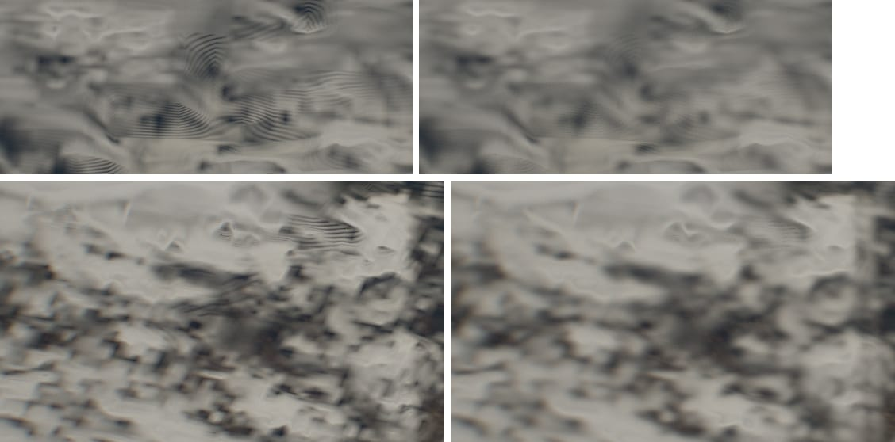
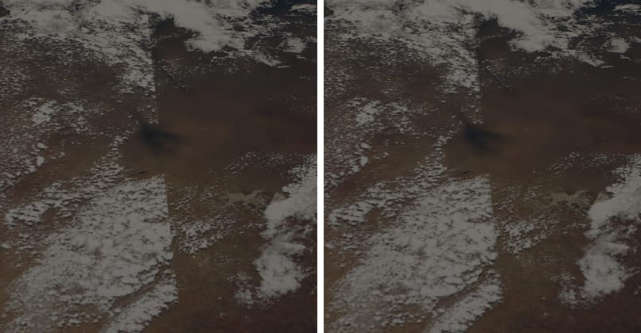
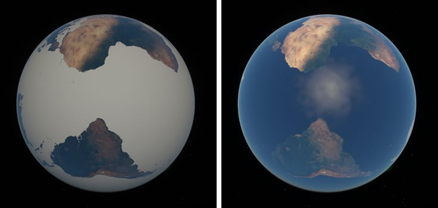

# Measured clouds: ripples, a swath edge and white seas while loading, 2026-10-17

The owner reported three artefacts in the measured clouds
(`cloudStudy=global`, NOAA-20 VIIRS, 22 September 2026): rippled striations
and blocky texture at moderate zoom, a straight-edged strip, and white oceans
at high orbit while the data load. Each is traced to its cause below. All
changes compile only with `CLOUD_PROPERTIES`; the default renderer and the
background are unchanged. Nothing was published.

Views (scene state from the owner's links):

| Name | Query |
| --- | --- |
| Ripples, 500 km | `?t=0.00&epoch=2026-09-22T11:13:13.000Z&motion=0&lens=3.487&cloudStudy=global&flight=free&position=1.02357251,0.33593412,-0.05394768&orientation=0.5684373265,0.7709201178,0.2454635852,0.1493613272` |
| Blocks, 500 km | `?t=0.00&epoch=2026-09-22T11:13:13.000Z&motion=0&lens=8.823&cloudStudy=global&flight=free&position=0.98472122,0.46403186,-0.55769341&orientation=0.6012176583,0.7703817426,0.2122300456,0.0027759236` |
| Strip, 3,800 km | `?t=0.00&epoch=2026-09-22T11:13:13.000Z&motion=0&lens=2.564&cloudStudy=global&flight=free&position=1.05022089,0.61104650,-1.04420328&orientation=0.5944136104,0.7794005796,0.1980075912,0.0004359852` |
| Loading, high orbit | `?t=1800.00&epoch=2026-09-22T12:00:00.000Z&motion=0&cloudStudy=global&orbit=high&flight=free&position=4.26938491,-2.13617726,-0.49589646&orientation=0.3286589164,0.6638236718,-0.0038793600,0.6717934206` |

Frames are 1,280 × 800 from the explorer's canvas, settled (tiles loaded,
nothing fading), the owner's own settings. The loading state is held by
aborting the request for `overview-v2.avif`.

## 1. Ripples and blocks

**Cause: the view ray read each measured column at the step's centre.**
The candidates were tested one at a time on the ripple view:

| Change | Ripples |
| --- | --- |
| Raymarched self-shadows instead of the lighting atlas (`cloudLighting=raymarch`) | unchanged |
| No cloud tiles (`cloudDetail=0`), overview only | unchanged, coarser |
| Light held constant in the view integral (temporary shader edit) | unchanged |
| `cloudSteps=full` (0.65 km steps instead of 1 km) | finer and fainter |

So the ripples are in the view ray's optical depth and scale with its step.
Mip choice is not involved (the footprint is below one texel, lod 0), the
ellipse filter of the limb-flicker work is not either (measured columns take
the isotropic footprint; the five-argument `cloudIntegratedDensity` returns
`cloudPropertiesDensity`), and 8-bit quantization of opacity would terrace
along iso-opacity contours at any step length.

`cloudPropertiesDensity` averages a column's 6z(1-z) profile exactly over the
step's interval of height, but reads the column (opacity, top, inferred base)
at the step's centre. At oblique views the centre lies up to half a step,
about 0.5 km horizontally, beside where the ray actually crosses a thin deck,
and the ground distance, with the whole step grid, shifts by a step every
pixel or two. Wherever the column changes over that distance, the centre
read draws the grid's phase as contours: broken cloud, whose inferred deck
thickness follows its opacity (0.25 + 0.04 τ km), and tops ramping between
low and high cloud across a 9.8 km overview texel.

**Fix.** `cloudPropertiesStep` reads the column once at the centre, finds the
height centroid of its layer inside the step's interval, moves the point
there along the ray and reads the column again; density and lighting use the
second read. Re-reading only the opacity there left the ripples; the
geometry is what aliased. In a 1-D mirror of the step (in the tests) a level
0.4 km deck with a cloud edge one texel wide, crossed 12° above the horizon
by 1 km steps, varies 6% with the step phase instead of 19%. The cost: the
step treats the deck as level, so a deck whose top climbs 80 m per km loses
up to a fifth of its depth there (the centre read lost a sixth and varied
twice as much).

**Blocks.** Cloud tiles were magnified bilinearly: 2.4 km opacity texels
spanning 35 pixels at the 8.8× lens became squares through −ln(1 − R) and the
lighting. Measured clouds now magnify them with the cubic B-spline the day,
night and galaxy tiles use (four bilinear taps, positive kernel, no detail
beyond the data). The plates' cloud tiles keep their bilinear reads.



## 2. The strip: a swath edge

**What it is.** The strip in the owner's view is the eastern edge of NOAA-20's
pass at about 13:05 UTC over Botswana (23° S, 24.4° E): GIBS draws a day's
later pass over the earlier one, so where swaths overlap the earlier ends on
a straight line. West of it, dense afternoon cumulus at the edge of scan of
the later pass; east of it, sparse cumulus 101 minutes earlier, seen
about 1,000 km from that pass's track.

**Where the edges are.** The build's orbit model (circular, sun-synchronous,
first ascending node fitted to the day's glint) now also gives the renderer
each point's nearest swath edge (`cloudPropertiesSwathEdge`, mirrored in the
shader). The day's own opacity steps lie east of the model's 1,520 km
half-swath by an amount that depends on latitude, measured as the peak of the
mean overview step |R(s + 5 km) − R(s − 5 km)| across about 450 modelled
edges per 8° band, both sides observed
(`scripts/fit-cloud-swath-edges.mjs`):

| Band | 60–52° S | 44–36° S | 28–20° S | 4° S–4° N | 20–28° N | 44–52° N | 60–68° N |
| --- | --- | --- | --- | --- | --- | --- | --- |
| Peak east of the model (km) | 63 | 55 | 44 | 38 | 35 | 30 | 28 |

The edge offset 35.8 − 19.8 sin φ + 14.3 sin² φ km fits these within 5 km
(rms 2 km); with it, every band's residual peak lies within ±5 km, except
32–40° N, whose profile has no clear peak. Beyond
70° the passes turn and crowd and no edge is modelled.

**Part of the step is the sensor.** The day's mean stored opacity against the
signed distance from the nearest edge, 50° S to 50° N, rises from 0.18 near
nadir to 0.27 at the later pass's edge of scan and is 0.23 just across it.
Weather is random with respect to the edges, so most of the step at an edge,
0.04 of mean opacity, is the retrieval's view-angle dependence (more partly
cloudy pixels and higher τ at large view zenith; the clear fraction falls
from 0.39 to 0.26 in the tropics) and the later local time east of a track,
not the sky. Correcting it is a calibration by scan angle that belongs in the
build, where each pixel's view zenith is known; it is not attempted here.

**Treatments tried.** No cross-fade over the overlap (the third iteration's
argument stands: it would superimpose two skies 101 minutes apart).

- *Wider filter near the edge* (mip footprint widened to 2 × 30 km, then
  2 × 8 km, tapering to the pixel's): rejected. A broken field read through a
  wide filter becomes a uniform sheet of its mean opacity, which at oblique
  views is brighter than the broken field. The edge became a straight grey
  veil, more conspicuous than the cut.
- *Mirrored average within 6 km* (adopted): where both sides were observed,
  opacity is averaged with its mirror image across the edge, half and half at
  the edge, none 6 km away, never across the date line. The cut, sharper than
  any pass draws a cloud field, softens to about two tile texels, and no
  value travels farther than 12 km. The difference in cloud amount between
  the passes, a real difference between two observations, stays.



At 3,800 km the change is subtle by design: the line is no longer
pixel-sharp, the texture step remains. The diagnostic
(`cloudStudyView=quality`) now draws the bands in cyan on the ground.

## 3. White seas while loading

**Cause.** Every Earth map starts as a 1 × 1 opaque black texel,
(0, 0, 0, 255). For the measured clouds the cloud map's alpha carries
observation and sea ice (0.3 + 0.7 c where observed), so alpha 1 read as
observed, full sea-ice cover, and the surface shader laid ice on every sea
until the 4.3 MB overview arrived. Opacity 0 meant no cloud, so only the
seas turned white.

**Fix.** With `cloudStudy=global` the cloud map's placeholder is
(0, 0, 0, 0): no cloud, unobserved, no sea ice. Cloud tiles, which refine
opacity only, wait for the overview (`cloudMapWidth > 1`): at ISS altitude
they would otherwise have drawn cloud without its measured height. Loading
now shows the clear Earth, as the study's plan intends (it has no
photographic preview).



## The default renderer

All changes sit under `#ifdef CLOUD_PROPERTIES` (and `CLOUD_PROPERTIES_SWATHS`,
defined only with it) or behind the study's flag in the renderer. The scene,
cloud and tile shaders with those blocks removed hash identically before and
after; a test asserts that nothing measured survives that removal. Renders of
the ISS, region and deck views with the Balanced and Calibrated plates differ
from main in at most 64 pixels by one level, within the run-to-run spread of
the same build (up to 186 pixels by one level).

## Cost

Each view-ray step with cloud makes a second column read, magnified tile
reads take four taps instead of one, and detailed reads within a footprint
of 12 km evaluate the swath model. GPU time could not be measured reliably
here: the host ran at a load average of about 120, and the same build's
frames varied two- to three-fold between runs. The study is opt-in.

## Reproduce

```bash
bun scripts/fit-cloud-swath-edges.mjs 2026-09-22
```

```bash
CLOUD_VIEWS=iss,region,deck CLOUD_VARIANTS=global,balanced,calibrated bun scripts/compare-cloud-properties.mjs http://127.0.0.1:4431 /tmp/cloud-properties
```
