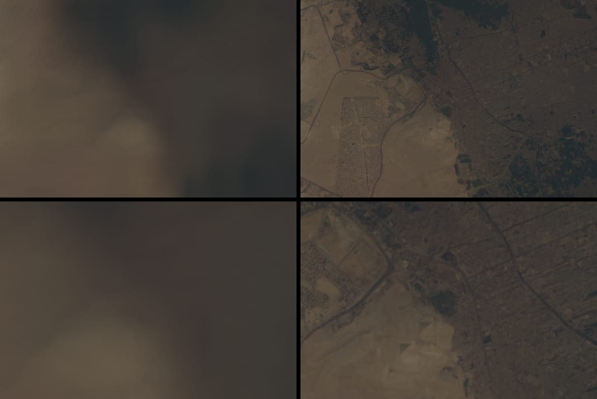
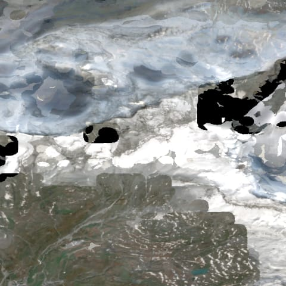
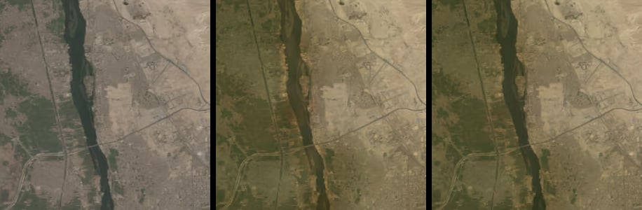

# Day pyramid: Sentinel-2 detail below BMNG, 2026-10-17

With the 50× lens (1500 mm equivalent), a long-lens daytime view from 420 km
spans about 8 m per pixel at nadir in an 800 px tall view. The day tiles stop at
BMNG's 15″ grid (463 m north–south), so one BMNG texel covers about 55 pixels
and the ground is a soft wash. This experiment adds five deeper levels from a
10 m Sentinel-2 composite for one region, behind `dayDetail=sentinel`.



`/?epoch=2026-10-08T09:30:00Z&t=0&flight=free&position=.7902,.4774,.5326&heading=0,0,1&elevation=0&roll=0&pitch=-90&motion=0&clouds=off&lens=50&dayDetail=sentinel`,
1280 × 800, centre crops of 600 × 400. Clouds are off so both columns show the
ground; the 50× captures used the 50× lens limit from the
[night-light note](night-light-reconstruction-2026-10-16.md).

## Verdict

**Go for a wider second experiment; no-go for publication.** The sparse
pyramid, footprint-driven streaming and photometric transfer work: the deep
levels resolve the Giza pyramids, the golf course east of them, main roads,
canals and field patterns at 20× and 50×, and they average back to BMNG within
3.7 sRGB steps per channel. The WorldCover composite is not usable worldwide as
is (snow and ice fail, see the Alps below), a 5.2 million-file pyramid does not
fit the per-file asset manifest, and frame cost could not be measured on the
shared GPU. Each is listed under "Before publishing".

## Source

| Candidate | Licence found | Decision |
| --- | --- | --- |
| EOX Sentinel-2 cloudless (now "EOxCloudless") | The license page names the "EOX Commercial Attribution-RestrictedUse 1.2 License": direct redistribution is prohibited "both for sale and for free", and a service published under your own name needs its own license. The per-edition statements (2016 reportedly CC BY 4.0, later years CC BY-NC-SA 4.0) are no longer on the site. | Rejected without a written licence from EOX. |
| Copernicus Sentinel-2 Global Mosaic | Copernicus open licence; distributed through Copernicus portals that need an account. | Not evaluated (no account). |
| **ESA WorldCover 2021 v200, Sentinel-2 median L2A RGBNIR composite** | **CC BY 4.0**, in the [AWS Open Data registry](https://registry.opendata.aws/esa-worldcover-vito-composites) and in every GeoTIFF's own metadata. | **Used.** |

WorldCover: 1° Cloud-Optimized GeoTIFFs at 0.3″ (EPSG:4326, the BMNG grid's
own latitude/longitude, so no reprojection), bands B04, B03, B02, B08 as
reflectance × 10⁴, anonymous `s3://esa-worldcover-s2/rgbnir/2021/`, DOI
[10.5281/zenodo.7254221](https://doi.org/10.5281/zenodo.7254221). Required
attribution, from the files:

> ESA WorldCover project 2021 / Contains modified Copernicus Sentinel data (2021) processed by ESA WorldCover consortium

At 30° N the 0.3″ grid is 8 m east–west and 9 m north–south, resampled from
Sentinel-2's 10 m UTM pixels by nearest neighbour: neighbouring samples repeat
along longitude. The level-5 area average (below) removes the repeats.

**Region.** The Alps came first. Around the Matterhorn the median composite
is broken above the snow line: grey cloud-like blobs, no-data holes (4% zero
samples) and blocky compositing seams. Valleys such as Aosta are clean.



The experiment therefore covers the south-east quadrant of BMNG tile 4253:
30.375–31.5° E, 29.25–30.375° N (Cairo, Giza, the Nile valley, the edge of the
Faiyum), one level-1 tile. Its composite has 0.007% zero samples.

**Provenance.** `scripts/fetch-sentinel-mosaic.mjs` reads only the region's
byte ranges from four 1° files (N29/N30 × E030/E031), recording URL, size,
ETag and Last-Modified of each, and area-averages 25 × 25 source samples to
16 × 16 level-5 texels in linear reflectance. The 9600 × 9600 result
(553 MB, SHA-256 `35538b05…a789`) stays outside the repository; the tile
manifest carries the attribution, the source list and the mosaic checksum.
Fetching took 5 min 23 s.

## Pyramid

Level *L* splits each 2.25° BMNG tile into 2^L × 2^L tiles with the BMNG
layout (540 px interior, 16 px gutters of real neighbouring ground, AVIF
4:4:4), so level 5 is 0.469″ per texel: 14.5 m north–south and 12.5 m
east–west at 30° N. Files are `day-pyramid/{L}/{x}-{y}.avif` in global
level-*L* tile coordinates. The region has 1 + 4 + 16 + 64 + 256 = 341 tiles.

**Shared atlas.** All sixteen fragment samplers are taken, so deep tiles live
in the day atlas (unit 6), share its slot allocator, its explicit four-mip
upload and its 650 ms fades, and fill at most half of its wanted list (15 of
31 tiles on desktop, 8 of 17 on mobile), ahead of BMNG tiles. Deep tiles that
fall out of the list stay resident until a newer tile needs their slot. GPU memory is
unchanged: 83.8 MB for the desktop atlas with or without deep levels.

**Sparse page table.** Slot 0 already holds the 160 × 80 BMNG page table and
its fade rows. The green channel of a BMNG entry, unused until now, holds a
directory index. Each index names a 64 × 32-texel block at x 160–543 of the
same slot (thirty blocks). The block's 32 × 32 cells are the level-5 tiles of
that BMNG tile, two texels each: the deepest resident tile covering the cell
(slot, level, fade) and the tile it replaced (slot, level). So:

- a missing child falls back to its nearest resident ancestor, and a cell
  without any to BMNG, by construction;
- a newly loaded tile cross-fades from its ancestor, not from BMNG;
- one lookup in the directory and one in the block find the level. On top of
  the BMNG sample that `pyramidDay` refines, a deep pixel makes 3–4 fetches
  when settled (directory, cell, one or two mip levels) and 5–7 while it
  fades from its ancestor. Outside the region it makes one (the directory),
  and at a footprint of two or more BMNG texels per pixel none.

`write()` rebuilds the 245 KB block table on the CPU only when the set of
resident deep tiles changes or one of them is fading, and the table is
uploaded with one `texSubImage2D` of 384 × 160 RGBA only when it changed.

**Requests.** The selection reuses the BMNG ground-ray grid (64 × 28 rays) and
the scene shader's footprint (BMNG texels per pixel). A ray asks for the level
that gives one to two texels per pixel, steps up to the deepest level present
in the manifest, then requests that tile's parent first, the tile, and a
one-tile guard ring. Deep detail blends in over the octave from two BMNG
texels per pixel to one, matching the BMNG mip bias, so nothing deep is
wanted at 0.5×; at 1× straight down the region asks for its one level-1 tile.
Without the switch neither the deep manifest nor any tile is requested, and
background never streams detail.

## Detail transfer

BMNG stays the photometric reference. Per channel, in linear light:

```
tile = S2 · gain,   gain = (blur(BMNG) + ε) / (blur(S2 averaged to the BMNG grid) + ε)
```

with a Gaussian of σ = 1 BMNG texel, ε = 0.005 reflectance, the gain clamped
to [1/8, 8] (0.006% of texels) and interpolated bilinearly to each deep
texel. BMNG is decoded from the same tile files the renderer streams. Only
0.001% of output samples clip at white.

`scripts/measure-day-pyramid.mjs` box-averages each level in linear light back
onto the 500 m grid (72,900 BMNG texels) and compares it with BMNG, in 8-bit
sRGB steps per channel:

| Variant (level 5) | Mean | Median | 99th percentile |
| --- | --- | --- | --- |
| Sentinel-2 as is (`--raw`) | 13.8 | 11.4 | 49.8 |
| gain, σ = 0 | 1.8 | 1.0 | 10.2 |
| **gain, σ = 1** (used) | **3.7** | **2.1** | **21.0** |
| gain, σ = 1, AVIF Q65 | 3.7 | 2.1 | 21.0 |

Levels 1 to 4 differ from level 5 by at most 0.25 in each row.



Without the gain the deep levels would change tone where they take over from
BMNG. σ = 0 matches BMNG more closely on average, but every misregistration
between the 2004 and 2021 images becomes a texel-sized gain spike: orange
halos along both Nile banks, lighter water and horizontal banding from the
interpolated 500 m grid. σ = 1 leaves the 99th-percentile error at sharp
edges (river banks, the desert margin) but no visible pattern. In the renders
the region's edge at 31.5° E shows a change in sharpness and no change in tone.

## Encoding

AVIF effort 2, 4:4:4, as the BMNG tiles. Per tile, level 5 / level 4:

| Quality | Mean | 10th | 50th | 90th | Region |
| --- | --- | --- | --- | --- | --- |
| **Q50** (used) | 14.4 / 16.8 KiB | 4.4 / 5.8 | 16.2 / 18.3 | 22.6 / 25.5 | 5.04 MiB |
| Q65 | 22.7 / 27.6 KiB | 6.7 / 9.0 | 25.5 / 29.6 | 36.1 / 42.0 | 8.05 MiB |

Q65 keeps more street texture in Giza's blocks for 58% more bytes; Q50
already holds the pyramids, roads and field boundaries. Desert tiles are the
small ones.

## Against the ISS

[ISS032-E-9123](https://science.nasa.gov/earth/earth-observatory/pyramids-at-giza-egypt-79253/)
(25 July 2012, Nikon D3X, effective 1200 mm, roughly 2 m per pixel at full
resolution; the
published image is a contrast-enhanced crop of about 3 km) was viewed in a
browser, not stored. At the same ground extent, the 50× render shows:

- the three pyramids as triangles with shaded north-west faces (the
  composite's late-morning overpasses shade the same faces as the
  photograph), the golf course, the main roads and the plateau's tracks,
  where BMNG shows one bright blur;
- no streets inside Giza's blocks, mastaba fields, the Sphinx or the pyramid
  edges' sharpness: these need the photograph's 2 m, not 10 m;
- lower contrast than the enhanced photograph, from the scene's atmosphere
  and exposure, which this experiment does not change.

At 50× in a 1280 × 800 view a level-5 texel spans about 1.6 pixels at nadir,
three on a DPR 2 display: Sentinel-2 is itself the limit at this lens.

## Cost per view

Cold page load straight into each view, 1280 × 800, day atlas only:

| Lens | BMNG only | With deep levels | Deep tiles | Deep bytes |
| --- | --- | --- | --- | --- |
| 1× | 276,847 B, 24 tiles | 298,363 B | 1 | 21,516 B |
| 5× | 137,356 B, 12 tiles | 452,606 B | 16 | 315,250 B |
| 20× | 85,807 B, 9 tiles | 586,214 B | 22 | 500,407 B |
| 50× | 85,807 B, 9 tiles | 371,663 B | 15 | 285,856 B |

The 20× load includes tiles requested while the view settled; its 15 wanted
tiles are about 300 KB. The atlas filled (31 resident) at 20×; deep tiles never
exceeded half of it in the wanted list.

**Frame time: not measured reliably.** GPU timer queries around each frame
(`quality=fixed`, six interleaved rounds per view, 180 frames each) gave
medians of 19–56 ms for the *same* BMNG-only view, because other sessions'
browsers shared the GPU. The paired differences (deep minus BMNG) had medians
of −4.4 ms at 50× and −7.1 ms at 20× and ranged from −19 to +7 ms: no cost is
detectable above that noise, and neither a cost nor a saving should be claimed
from it. The analytic cost is the 3–4 fetches per deep pixel above, against
2–8 for the BMNG sample it refines. Measure on an idle GPU with `bun run benchmark:scene` before going
further.

## Global estimate

WorldCover's 2021 RGBNIR composite has 19,359 one-degree files (60° S to
82° N, 8.35 TiB). Equirectangular level-5 tiles are a constant 202.3 per
square degree, and levels 1–4 add a third:

| | Q50 | Q65 |
| --- | --- | --- |
| Tiles | 5.2 million | 5.2 million |
| Storage (this region's mean to its 90th percentile) | 75–115 GiB | 120–180 GiB |
| R2 storage at $0.015 / GB-month | $1.2–1.9 per month | $1.9–2.9 per month |
| R2 Class A uploads, one per tile, $4.50 / million | $23 once | $23 once |
| R2 Class B reads, $0.36 / million after 10 million free | about 15–22 per zoomed view | same |

Coastal one-degree cells count as full, so tile counts are an upper bound;
skipping uniform ocean tiles, as the BMNG build does, lowers them. Egress is
free. Processing is the larger cost: the region took 5.4 minutes to fetch and
65 s to build single-threaded in Bun, about 1,400 CPU-hours for the world, and
reads 8.35 TiB from the open-data bucket. Prices are R2's published list
prices on 2026-10-17; nothing was published and no billing setting changed.

## Before publishing

- **A better composite for snow, ice and cloud.** WorldCover's annual median
  fails above the snow line (and likely in persistently cloudy tropics, not
  checked). Options: EOX under a written licence, a Copernicus mosaic, or our
  own seasonal composite with cloud and snow masks from Sentinel-2 L2A COGs.
- **Packs, not files.** The asset release lists every file with its checksum;
  5.2 million entries do not fit it. One pack per BMNG tile (1,364 tiles plus
  an index, read with HTTP ranges) gives 6,615 objects, and its index doubles
  as the availability mask that replaces the single manifest here.
- **Attribution in the explorer**, with the text above, whenever deep tiles
  are on screen.
- **Tone from 2004.** The gain keeps BMNG's October 2004 colour at 500 m and
  above. Districts built since then (west of Giza) show their 2021 streets
  with the desert's 2004 tone. A newer reference would need its own
  photometric match to the rest of the globe.
- **Baked illumination.** Sentinel-2's late-morning shading is in the
  texels, as BMNG's is, and the renderer lights the terrain again. At 10 m it
  shows on pyramid faces and steep slopes.
- **Level transitions.** Neighbouring cells can sit at different levels while
  tiles load; the guard ring limits this but a sharpness step can show for
  a moment along a tile edge. BMNG's neighbour averaging is not applied to deep
  tiles: they share one continuous source, so their gutters already agree.
- **Depth 5 only.** The fallback assumes a resident tile is at most four
  levels deeper than the pixel needs (its own mips); deeper pyramids need a
  per-cell level clamp.

## Verification

`bun run verify`: 249 tests (four new ones for keys, levels, selection and the
page table), Astro check and build pass. `bun run verify:scene` failed twice
on this branch inside the swipe-recovery fixture (once the passive cadence
read 39.5 fps against at most 30, once its inspection wait timed out) and
failed at the same wait on an untouched checkout of the base commit in the
same session, while other sessions' browsers shared the GPU. Those scenes do
not use `dayDetail=sentinel`, which compiles to a passthrough without the
switch. Re-run it on an idle machine.

## Reproduce

```bash
bun scripts/fetch-sentinel-mosaic.mjs /path/outside/repo/s2-cairo
```

```bash
bun scripts/build-day-pyramid.mjs /path/outside/repo/s2-cairo public/media/earthlight/day-tiles
```

```bash
bun scripts/measure-day-pyramid.mjs public/media/earthlight/day-pyramid public/media/earthlight/day-tiles
```

Then open the URL above with and without `dayDetail=sentinel`. The explorer's
`data-day-tiles` adds `deep`, `deepWanted` and `deepBytes` with the switch on.
`--sigma`, `--quality` and `--raw` build the other variants.
