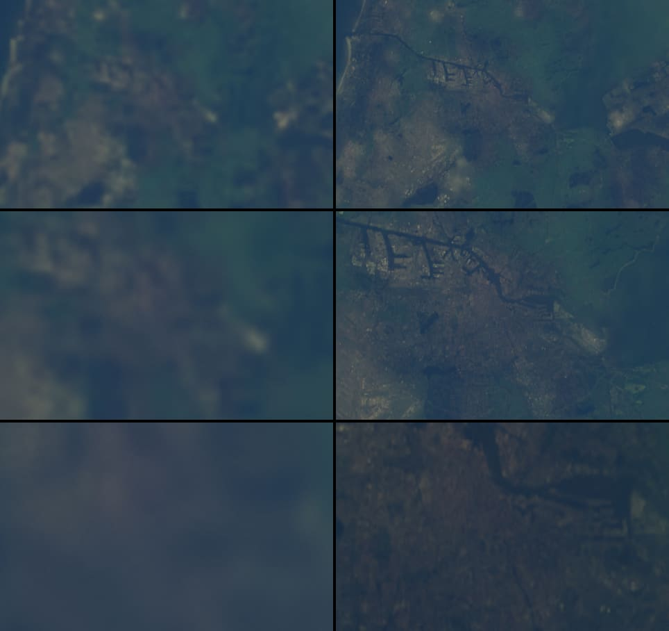
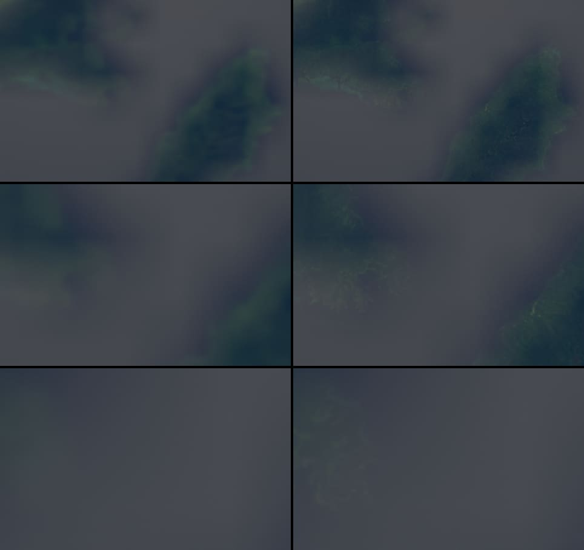
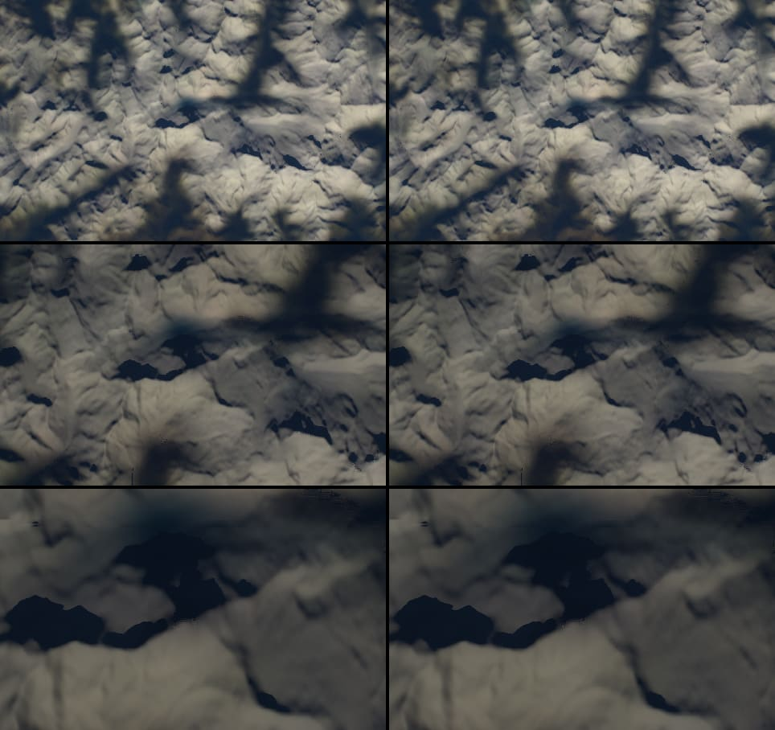
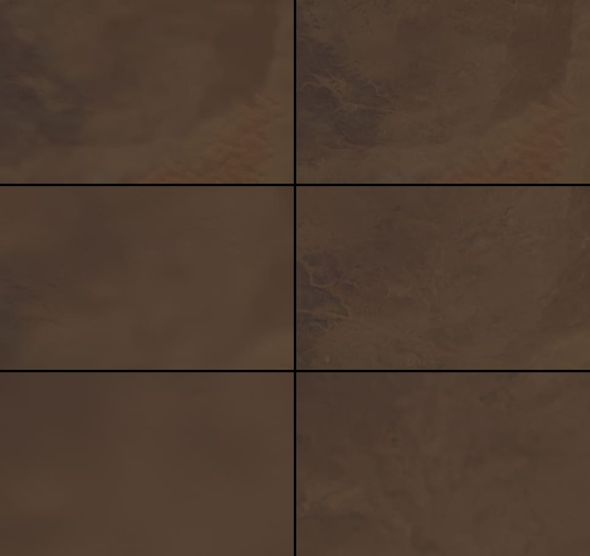
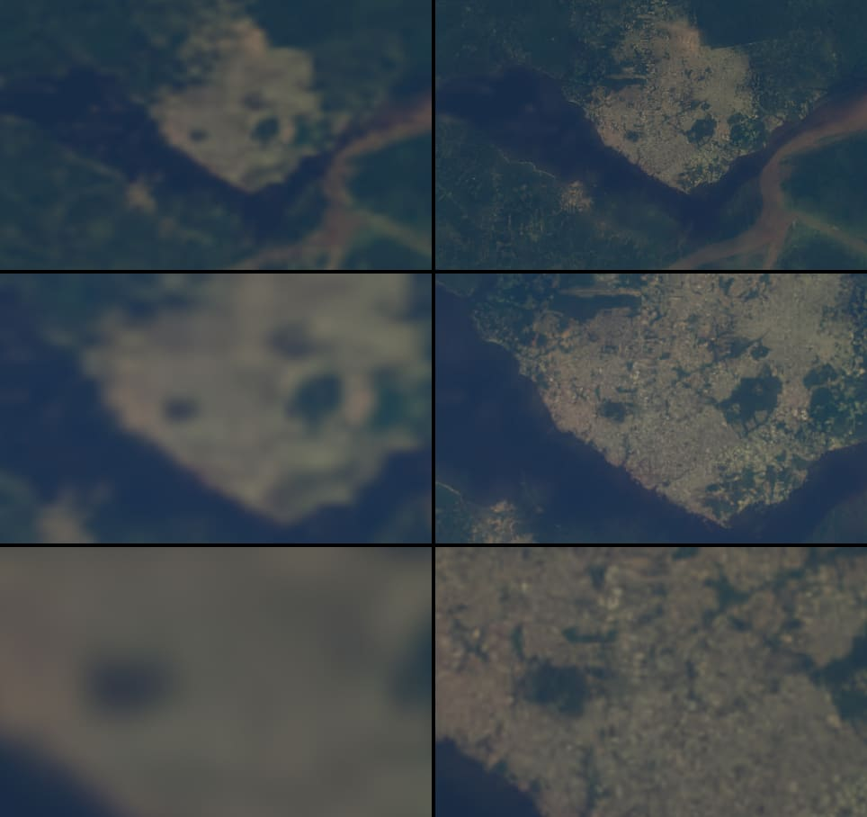
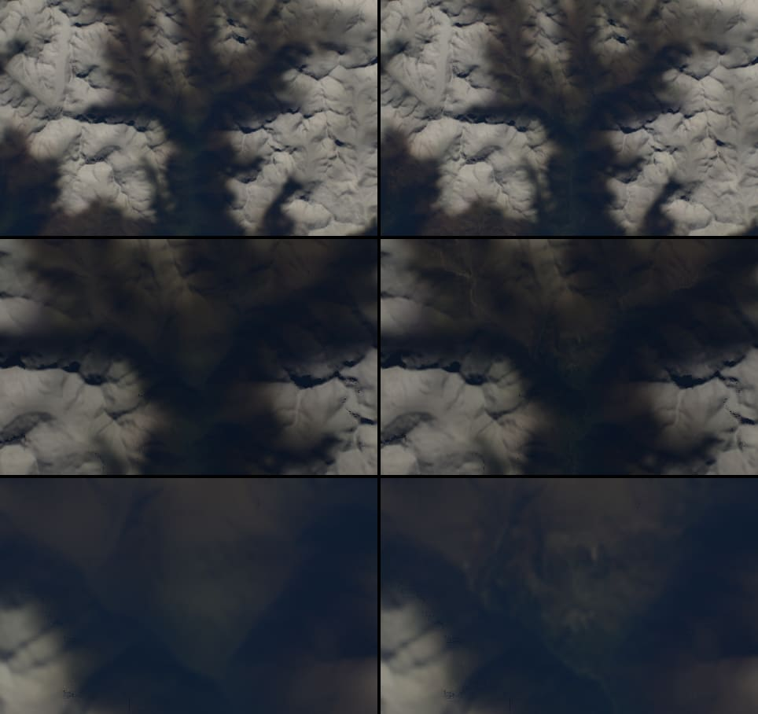
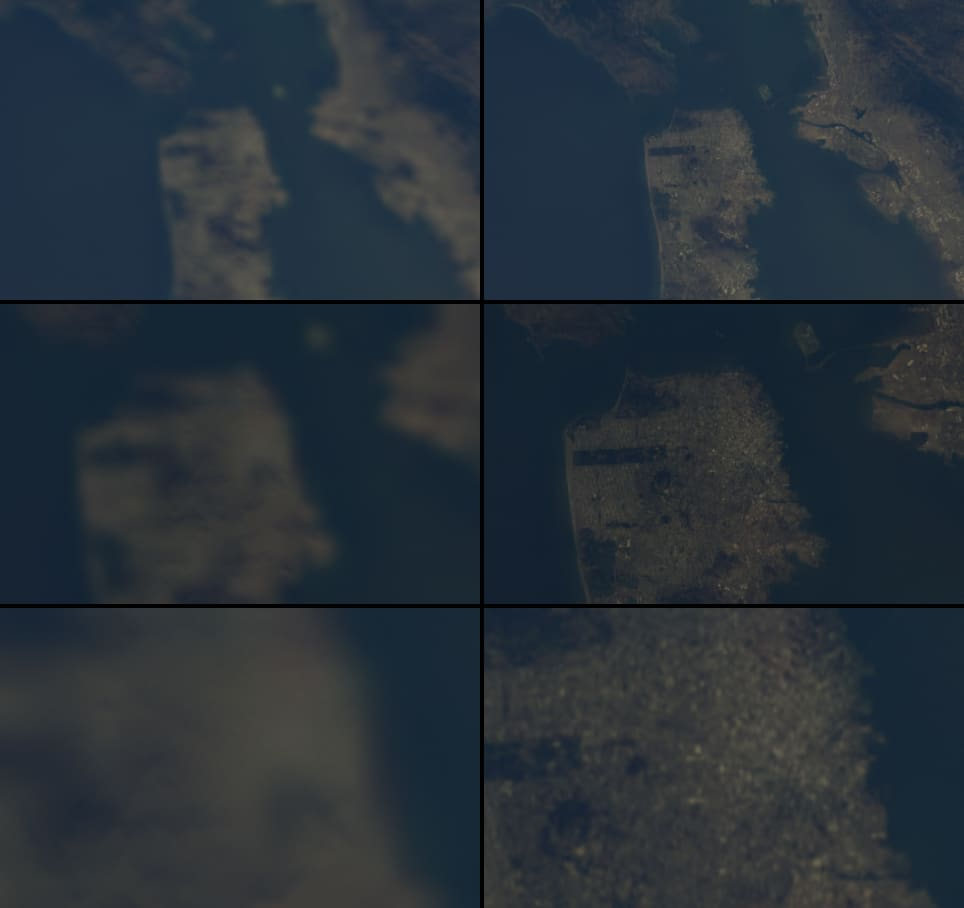

# Day pyramid, worldwide to 62.5 m, 2026-10-17

The [Cairo experiment](day-pyramid-2026-10-17.md) went to 15 m for one
region. Global 15 m was rejected as too costly, so this build takes only the
three levels below BMNG's 500 m (250, 125 and 62.5 m) over all land that the
ESA WorldCover 2021 Sentinel-2 composite covers, 60° S to 83° N. The day
colour then matches the 90 m Copernicus relief that the explorer already
streams. Everything is packaged and wired into the asset release behind
`dayDetail=sentinel`; nothing is published.



## Verdict

**Release-ready; propose it as the default once the packs are served with
HTTP ranges.** Frame time shows no cost above the shared GPU's noise, and a
zoomed view costs 0.04–0.5 MB more with ranges. The current media host
answers range requests with the whole object (checked below), so on it the
same views would cost 0.2–11 MB more. Until the packs are behind a host that
honours `Range`, or the owner accepts that cost, `dayDetail=sentinel` stays
opt-in. North of about 60° N, BMNG's own October 2004 snow removes most of
the detail (below).

## Totals

| | |
| --- | --- |
| Packs | 4,266 (one per day tile with detail; 155 more touched the composite and kept BMNG throughout) |
| Tiles | 259,740: 14,839 at level 1, 52,855 at level 2, 192,046 at level 3 |
| Bytes | 3,117,658,150 (2.90 GiB), 11.7 KiB per tile at Q50; largest pack 2.3 MB |
| Index | `index.bin` 68 KiB; `provenance.json`; `sources.json` 2.8 MB (every object read, its ETag and byte range) |
| Release | 16,381 files, 3.17 GiB (version `e92d3e4e89fb519d`, not published), from 12,112 files and 0.26 GiB |
| Bytes read | 173.0 GiB of Sentinel-2 overviews (all 19,359 files, 2.1% of their 8.35 TiB), 0.98 GiB of land-cover overviews (2,651 files); 194.8 GiB with re-reads |
| Requests | 25,472 overview reads, each a 64 KiB header and one byte range |
| Build | 2.56 h of row builds (3.23 h with the rows rebuilt below); 3 h 42 min wall clock, fetching overlapped |

The owner's estimate was about 320k tiles and 4.7–7.1 GiB. Fewer tiles exist
because a deep tile is only written where some of it is trusted, and they are
smaller than Cairo's (14–17 KiB) because snow, water and fallback areas
compress to almost nothing. Reads came to 173 GiB rather than 1/64 of the
files (130 GiB): each 1500 px overview is stored as four padded 1024 px
tiles, about 2.1% of a file.

The build ran on a shared 12-core M2 Max whose load average stayed between
50 and 150 from other sessions, with eight build processes and 24 concurrent
range requests (21–23 MiB/s from `eu-central-1`). Rows 3–9 (83.25–67.5° N)
were built first with the gain alone and rebuilt with the final method;
their sources were read twice.

## Sources

- **Sentinel-2:** ESA WorldCover 10m 2021 v200 S2RGBNIR, 1° COGs in
  `s3://esa-worldcover-s2/rgbnir/2021/`, CC BY 4.0. Only the 1500 px internal
  overview (2.4″, about 72 m) is read: the header with one range request, then
  the overview's four compressed tiles with a second. The files are never
  downloaded whole.
- **Land cover:** ESA WorldCover 10m 2021 v200 map, 3° COGs in
  `s3://esa-worldcover/v200/2021/map/`, CC BY 4.0, read the same way at its
  2250 px overview (4.8″, about 144 m).
- **Attribution** (both): "ESA WorldCover project 2021 / Contains modified
  Copernicus Sentinel data (2021) processed by ESA WorldCover consortium",
  DOI [10.5281/zenodo.7254221](https://doi.org/10.5281/zenodo.7254221). It is
  in the explorer's Image credits (also in Info), in
  `public/media/earthlight/README.md` and in `provenance.json`, with the
  changes made (resampled, colour-matched, blended, AVIF-encoded). Nothing in
  the licence blocks publication.

**The overviews are nearest-neighbour decimations, not averages.** In
N46E007, every sample of the 1500 px overview equals full-resolution pixel
8k exactly (mean |Δ| 0 against 236 for the 8 × 8 mean). A 72 m overview
sample is therefore a 10 m point sample: fine texture aliases (fields,
streets), and the sample sits 1/16 of an overview pixel from the cell
corner, not at the pixel's centre. The builder places samples where they
were taken, which keeps the imagery registered to within a few metres of
the GLO-90 relief. Level 3 (58 m) is a bilinear upsampling of the 72 m
samples by 1.28; levels 2 and 1 are 2 × 2 means of level 3. The 3000 px
overview (36 m) would allow a real area average at about 3.5 times the reads.

**Disk.** Sources went to `~/earthlight-sources/worldcover`, one row of day
tiles (2.25°) at a time: the next row was fetched while the current one was
built, and every overview no later row needed was deleted after its row. The
largest row held 7.4 GiB of compressed overviews. Free space never fell below
200 GB (the build pauses under 60 GB). The sources are all deleted.

## Method

`scripts/fetch-worldcover.mjs` lists both buckets and reads one row's
overviews; `scripts/build-day-pyramid.mjs all` runs the rows, `index`
writes `index.bin` and the provenance. Per day tile, on its 572² window of
BMNG texels (the tile and its 16-texel gutters):

```
tile   = mix(BMNG, S2 · gain + offset, trust)
gain   = (low(BMNG) + ε) / (low(S2) + ε),   clamped to [1/8, 8]
offset = low(BMNG) − low(S2) · gain
low(x) = blur(q · x) / blur(q),  Gaussian σ = 1 texel (463 m), ε = 0.005
```

in linear light per channel. This is the Cairo lab's detail transfer with
two changes. The **offset** makes the low-pass exactly BMNG's even where ε
and the clamp bend the gain: over dark water the gain alone left the
composite's sea up to twice BMNG's brightness, and holes in it showed as
dark rectangles. **q**, the trust before smoothing, keeps snow, cloud and
holes from bending the gain of their neighbours. BMNG under a deep texel is
its cubic B-spline, the renderer's own magnification, so a texel without
trust is the picture the renderer would draw anyway, and a deep tile whose
interior has no trust is not written at all. BMNG is read from the release's
own day tiles, interiors first, so both sides of a pack edge share one
reference.

### Where BMNG stays

Trust is zero on the 500 m grid where any of these holds, then the bad
texels are dilated by two texels and blurred (σ = 1): the fallback is smooth
and at least a kilometre wide.

| Test | Rule | Land texels |
| --- | --- | --- |
| Snow and ice | land-cover class 70 covers 2–12% of the texel or more (ramp), dilated by one texel | 5.25% |
| BMNG snow over the composite | BMNG bright (luminance 0.12–0.25) and the composite at 0.4–0.6 of its usual ratio to BMNG or less | 14.47% |
| Open water | no land (any class but 80, or outside the map) within 3 km | 3.00% |
| Cloud or snow left in the median | the composite 2–3 times brighter than usual relative to BMNG and grey, or 12–35% of its samples cloud-like (blue ≥ 0.15, flat in visible and near-infrared) where BMNG is dark; built-up land (class 50) exempt | 0.44% |
| Empty composite | fewer than 60–90% of the samples hold data | 0.10% |

"Usual" is the local ratio of composite to BMNG luminance: medians of clean
texels in 16 km blocks, interpolated and held within [0.5, 2.5], the range
of snow-free tiles (Sahara 0.85, Himalaya 1.5, Alps 1.8, Amazon 1.9). Without
the hold, a tile where BMNG is snow-covered reads as normal and the summer
forest gets BMNG's snow colour: the first Siberian test showed pastel
forest texture under a white gain.

**BMNG's October snow is the largest fallback.** From 60° N to 75° N it
covers 40–70% of the land texels of each row (Scandinavia, Russia, Canada
and Alaska), and the land-cover snow class adds Greenland, the Alps, the
Himalaya and Patagonia. In the tropics the cloud tests remove 0.05–0.4%;
the WorldCover median is clean there at this scale. Built-up land had to be
exempt: before that, the cloud test removed central Manaus.

## Seams and photometry

`scripts/measure-day-pyramid.mjs`, 300 packs sampled evenly across the
index, in 8-bit sRGB steps per channel:

| Comparison | Mean | Median | 99th percentile |
| --- | --- | --- | --- |
| Level 1 averaged to 500 m against BMNG | 2.27 | 1.24 | 16.0 |
| Level 2 against BMNG | 2.49 | 1.37 | 16.7 |
| Level 3 against BMNG | 2.67 | 1.53 | 17.1 |
| Level 1 against level 2 averaged 2 × 2 | 1.84 | 1.25 | 8.7 |
| Level 2 against level 3 averaged | 1.83 | 1.25 | 8.7 |
| Level-3 gutter against the neighbouring pack | 2.38 | 2 | 10 |
| The same across 180° (8 pairs of packs) | 2.43–2.63 | 2 | 11 |
| Level-1 gutter against a BMNG-only neighbour | 0.29 | 0 | 2.2 |

Cairo's level 5 gave 3.7 / 2.1 / 21.0 against BMNG with the gain alone. The
99th percentiles sit at sharp edges (coasts, river banks, the snow line),
where 2004 and 2021 disagree by more than σ = 1 can carry.

Pack edges differ by compression (median 2) and, in about 1% of edge
samples, by up to 10 steps where the per-pack statistics (block medians)
put a trust boundary differently on the two sides. The renderer does not
average deep tiles across edges, so such a step can show as a faint line at
a 2.25° boundary near snow or cloud fallbacks. Aligning the block medians to
a global grid would remove it on a rebuild. No seam was visible in the
renders: Amsterdam's view crosses a pack edge at 4.5° E and the Fiji view
crosses 180°.



**Poles.** At 83° N (Peary Land) deep tiles load and match BMNG, which is
mostly ice there; the composite ends at 83° N with a smooth fallback.
WorldCover stops at 60° S: South Orkney (60.6° S) loads no deep tile and
draws BMNG as before.

## Renders

Straight down from 420 km at local solar noon on 8 October 2026, clouds off,
1280 × 800, centre crops of 480 × 300; BMNG only left, with the day pyramid
right; 4×, 8× and 20× from top to bottom.
`bun scripts/measure-day-pyramid-views.mjs <base> <dir> <regions> 4,8,20 --frames --compose`
reproduces them.



The Matterhorn's snowfields keep BMNG entirely, as intended: the composite's
grey blobs and holes there (Cairo note) no longer show. Valleys gain detail.





Manaus resolves its blocks, the Rio Negro shore and the meeting of the
waters; BMNG shows one blur.



BMNG's October snow covers most of the Khumbu, so most of this view keeps
BMNG; the forested valley floors gain detail at 8× and 20×.



The coast keeps the composite's water within 3 km of land, so the shoreline,
the Golden Gate and the city grid are sharp; the open Pacific is BMNG.

At 20× and 50× a level-3 texel spans several pixels and the renderer
magnifies it with the BMNG tiles' B-spline. The 72 m point samples show as
a slightly crunchy texture in towns and fields, not as blocks.

## Runtime

`src/scripts/day-pyramid.ts` caps the pyramid at three levels
(`PYRAMID_DEPTH = 3`, an 8 × 8 cell block per day tile in the page table).
Deep tiles still share the day atlas and fill at most half of its wanted
list. The renderer loads `day-pyramid/index.bin` (68 KiB) only with
`dayDetail=sentinel`; a pack's 688-byte header is read with one range request
the first time a tile of it is wanted, then each tile with one more. A host
that answers 200 instead of 206 sends the whole pack, which is sliced and
kept for the eight most recent packs; a cross-origin host that rejects the
`Range` header is asked for the whole pack. Deep tiles now use the B-spline
when magnified, like the BMNG tiles.

**Default renderer unchanged.** Without the switch the shader compiles the
same `pyramidDay` pass-through as before and no index or pack is requested;
the only change on that path is a refactored `fetch` call with the same URL.
Four views (Sahara and Amazon at 1× and 20×) rendered with the base and with
this branch differ in at most 1.1% of samples by one 8-bit step, the same as
two renders of one build (up to 1.1%, one step).

**Range reads.** The Astro dev server answers 206 (every render here used
it). `scripts/day-pyramid.test.mjs` checks a 206 host (R2 and S3 behave so;
the build's 51,000 range reads from S3 all came back 206) and a host without ranges. The
current media host, Workers Static Assets on `media.maxvyshniakov.com`,
returned 200 with the whole body to `Range: bytes=0-99` for four release
files of 0.5–107 KB.

### Frame time and bytes per view

GPU timer queries around every frame, 42 frames per view, median of the
last 36, as `bun run benchmark:scene` does, Amsterdam at nadir, three
interleaved rounds of BMNG only and with the pyramid:

| Lens | BMNG only (ms) | Day pyramid (ms) | Paired Δ, median (range) | Day bytes, BMNG only | Day bytes, pyramid (deep) | Ranges in packs | Whole packs instead |
| --- | --- | --- | --- | --- | --- | --- | --- |
| 1× | 12.8–13.4 | 13.0–15.7 | +0.33 (−0.22 … +2.88) | 504,939 | 706,922 (201,983) | 22 in 7 | 7.4 MB |
| 4× | 12.6–13.4 | 12.6–13.3 | +0.03 (−0.11 … +0.05) | 161,561 | 477,326 (315,765) | 30 in 6 | 6.8 MB |
| 8× | 13.4–14.5 | 12.8–14.2 | −0.31 (−0.64 … +0.04) | 161,561 | 473,470 (311,909) | 27 in 3 | 2.5 MB |
| 20× | 13.2–14.4 | 12.6–14.8 | +0.42 (−0.73 … +0.62) | 128,394 | 338,475 (210,081) | 17 in 2 | 0.97 MB |
| 50× | 13.4–14.2 | 11.7–15.7 | +1.24 (−2.20 … +1.58) | 128,394 | 278,140 (149,746) | 11 in 1 | 0.88 MB |

The other regions, one round each, at 4×, 8× and 20×: 0.04–0.50 MB of deep
tiles per view (Alps 4×: 0.50 MB in 8 packs), 0.24–11.0 MB as whole packs,
and paired differences from −2.4 to +3.4 ms on 12–24 ms frames. No cost is
detectable above the ±1–3 ms that other sessions' GPU work adds; the
analytic cost is the Cairo note's 3–4 fetches per deep pixel. During part
of the session headless Chrome delivered no animation frames, so these
views ran with `AGENT_BROWSER_ARGS="--disable-gpu-vsync,--disable-frame-rate-limit"`;
the timer queries measure GPU time, not cadence.

## Before making it the default

- **Serve the packs with ranges.** The release fits the current
  Workers Static Assets budget (16,382 files of the 19,000 safety limit,
  largest 13 MiB of 25 MiB) but that host ignores `Range`. Options for the
  owner: a range-capable host for `day-pyramid/` (an R2 custom domain, which
  `publish-assets.mjs` deliberately forbids today), a small Worker that
  slices the static asset, or accepting whole packs (0.2–11 MB per view).
- **Publishing budgets.** `scripts/publish-assets.mjs` refuses archives over
  512 MiB and a bucket over 2 GB; this release is 3.17 GiB. Raising them is
  the owner's decision; nothing was changed.
- **A snow-free reference north of 60° N** (another BMNG month, for
  example) if detail is wanted where October 2004 is white.
- **Pack-edge statistics** on a global grid at the next rebuild, and the
  3000 px overview if the point-sample texture shows.

## Verification

`bun run verify`: 283 tests (eight for the day pyramid: keys and pack slots,
the three-level cap, pack and index round trips, selection with fallback,
the date line and the poles, the page table, and loading from a 206 host and
from a host without ranges), Astro check and build pass.
`bun run verify:scene` against this branch's dev server passes. A first
`bun run verify` run timed out two terrain tests at 5 s under the load
average of about 100; they pass alone and in the full run that followed.

## Reproduce

```bash
bun scripts/fetch-worldcover.mjs inventory ~/earthlight-sources/worldcover
```

```bash
bun scripts/build-day-pyramid.mjs all ~/earthlight-sources/worldcover public/media/earthlight/day-tiles public/media/earthlight/day-pyramid
```

```bash
bun scripts/build-day-pyramid.mjs index ~/earthlight-sources/worldcover public/media/earthlight/day-pyramid
```

```bash
bun scripts/measure-day-pyramid.mjs public/media/earthlight/day-pyramid public/media/earthlight/day-tiles --sample=300
```

`bun run assets:prepare` then lists the packs, the index and the provenance
in the release manifest. `pack … --tiles=<id> --debug=<dir>` writes a day
tile's masks (trust, snow, valid, cloudy, ratio) beside BMNG and the
composite.
