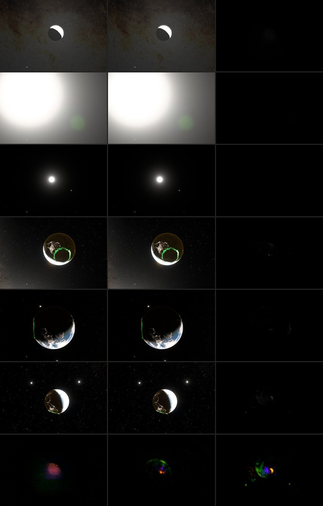

# Lens reflections of the whole frame, 2026-10-16

Lens reflections came only from the Sun, the Moon and three bright points,
each stamped as an aperture image. A sunlit Earth, a bright limb or a resolved
Moon reflected nothing, or reflected as a point. They now reflect from the
glare pyramid ([previous note](veiling-glare-2026-10-16.md)), with the same
seven paths, tints and coated-lens reflectance
([reflection calibration](lens-reflections-2026-10-16.md)).

Six rows: off (`fieldReflections=off`), on, 8× luminance difference. Bottom
strip: 64× colour difference of the Moon at 20×, the crescent and the wide
view.

## Model

Path i forms an image of the scene scaled by its conjugate c_i, convolved with
its aperture of radius ρ_i (scaled with f-number and focal length, as in the
stamps):

    G_i(p) = R_i / c_i² · (L ⊛ K_i)(p / c_i)

- **Scene at any spread.** The pyramid's level images are copied into one
  atlas, so a single sampler reads any level. A level read bilinearly spreads
  about 0.76 · 2^k pixels per axis. The read is trilinear at the level whose
  spread matches the aperture's (σ = ρ/2 for a disk), in the source plane
  (ρ/|c|). As for the Sun's stamps, the aperture shape is replaced by its
  variance: the reflections are soft copies, without hexagonal edges.
- **Energy.** 1/c² keeps each path's flux at R_i times the source's. The
  weights, tints and conjugates come from one table (`LENS_PATHS`) that also
  generates the stamps.
- **No double counting.** The Sun is capped out of the pyramid and keeps its
  stamps. The field covers the picture, fading over its outer 4%. The Moon's
  and the points' stamps keep only the share outside it, so a source is
  reflected once whether it is inside the frame, outside, or at the edge.
- **Not modelled:** barrel clipping and off-axis stretch (stamps have them),
  sources outside the picture other than the Sun, Moon and selected points,
  and the rim profile of the ring path (filled here).

## Measurements

GPU fixture (`scripts/field-reflection-browser-fixture.mjs`, in
`verify:scene`): a 6 px white disk at (0.10, 0.06) through the production
pyramid and shader. Total reflected luminance is 0.9994 of
`LENS_REFLECTION_FRACTION` times the disk's flux. The brightest image lies
0.0023 frame heights (1.2 px) from the c = 0.21 conjugate, the path that
concentrates its image 23-fold.

Scene views, captured as in the previous notes. Peak is the 9 × 9
box-filtered luminance difference in 8-bit output levels.

| View | Peak | p99 | Raised > 2 levels |
| --- | ---: | ---: | ---: |
| Moon 20× | 1.2 | 0.7 | 0% |
| Sun 15× | 0.1 | 0.0 | 0% |
| Sun 1× | 0.1 | 0.0 | 0% |
| Crescent +2.4 EV | 4.9 | 0.3 | 0% |
| Earth + Moon +2.4 EV | 3.8 | 0.2 | 0% |
| Wide 0.758×, +2 EV | 6.2 | 0.7 | 0.1% |

At 64× the reflections are what the optics predict: on the wide view a small
upright orange copy of the lit crescent (c = 0.21), a blue one (0.48), large
inverted green copies of Earth, and green images of the two bright points. On
the Moon at 20× an orange copy overlaps the disk. Banding at 64× is
amplified 8-bit steps.

At about 2.5 × 10⁻⁵ per path, a reflection is at most R / c² ≈ 4 × 10⁻⁴ of
its source's radiance. A sunlit Earth or a resolved Moon would have to be
overexposed some 500-fold for one to reach a visible level; the glare from
the same source is one to two orders larger. This confirms the estimate in
the reflection note: for extended sources, glare is the visible artefact.
The reflections slider scales these with the stamps for a stylized look.

So the field reflections fade in only above the default: their weight rises
smoothly from 0 at 100% Lens flares to 1 at 125%, and the stamps of the Moon
and points inside the picture give up the same share. At 100% nothing is
computed and the picture matches `fieldReflections=off` (wide view: largest
difference 0.3 levels, capture noise); at 200% the wide view's reflections
peak at 8 levels. The measurements above were taken with the term at full
weight and 100% strength, before this gate.

## Cost

At the default 100% the term is skipped and costs nothing. When enabled,
the field term alone, as a full-screen pass against an empty pass (timer
queries, Apple GPU, median of 40): +0.17 ms at 1200 × 800, +0.60 ms at
2400 × 1600. In the finish shader it adds 14 texture reads per pixel. The
atlas copy did not change the pyramid's median (0.39 ms at 1200 × 800,
0.49 ms at 2400 × 1600). Memory: one atlas of all levels, 3/8 of a full-resolution
half-float target.
