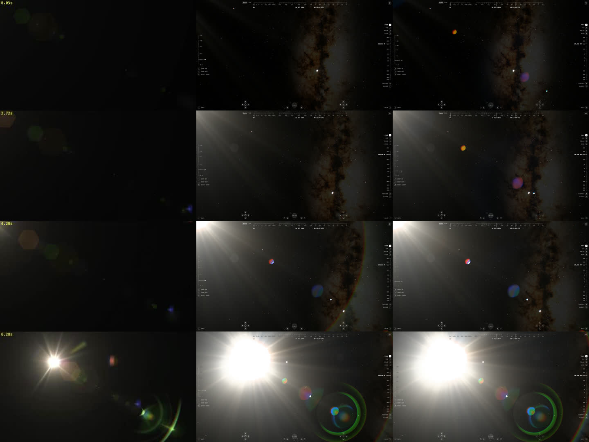

# Flare phases: ghosts beyond the frame and the veil's tail, 2026-10-17

The [Free Lens Flare Overlay](https://www.youtube.com/watch?v=Se2F79r_JTw)
shows a source entering the frame from beyond its top-left corner, crossing
to near the centre in 7 s. It was cut into 32 frames, the source tracked
(estimated along the ghosts' line before it enters at 4.5 s), and the
explorer rendered at the same 32 positions: lens 1, 16:9, manual +4 EV
(ghosts as bright as the reference's) and −1 EV (core and veil as bright as
the reference's).

Rows at 0.05, 2.72, 4.28 and 6.28 s; the reference left, the explorer before
and after the change at +4 EV. The reference is an overlay on black; the stars
and the Milky Way are the explorer's own sky.

## Findings

| Phase | Reference | Explorer before | Cause |
| --- | --- | --- | --- |
| 0–1.8 s, source about 49° off axis | Hexagonal ghosts already glow, p99 output ≈ 18 | Nothing | Ghosts were faded to zero by field 1.05 and by 1.55 half-widths off screen, an edge the lens never sees |
| 2–4.3 s, source nears the corner | Ghosts brighten (p99 20 → 44); almost no veil in the corner | Ghosts only from about 4 s, grey | The same fade |
| In frame, 6.28 s | Veil at 0.1, 0.2, 0.4 frame heights: 136, 67, 32 | At −1 EV: about 150, 62, 21 | Smudge lobes and the cleaning swirl drained up to 0.2 of 0.35 from the broad kernel, its tail half as bright and falling as θ^−2.6 in linear light instead of θ^−2 |
| Everywhere | Ghosts at p99 ≈ 101 with a 0.046 frame-height core | At matched core, ghosts p99 ≈ 20 | Not changed: the explorer's coated ISS lens reflects about 2.5·10⁻⁵ per path; the overlay's lens is roughly 30 times more prone to flare |

## What changed

- **Front barrel** (`frontBarrel`, `FRONT_BARREL` in
  `src/scripts/lens-reflections.ts`): a fixed aperture ahead of the stop,
  radius 1.5 stop radii, whose edge the chief ray reaches at field 1.3. The
  opening passes the overlap of the two circles: at f/4 0.85 at the
  picture's corner, 0.53 at field 1.16, nothing past 2; stopped down to
  f/16 1 to field 1.0 and nothing past 1.45. It replaces the fixed fade, and
  the picture's edge no longer matters. Each path's field now runs past 1,
  so its element rim cuts the ghost into a cat's eye. The off-axis stretch
  saturates at field 1.3.
- **Front element's arc** (`edgeLit`): its outward fall is 0.02 edge radii
  instead of 0.08, a thin glint; the longer tail washed a quarter of the
  frame grey once the source left the picture. The barrel's lip shades the
  edge towards the corner, so the arc fades between field 0.5 and 0.8, as in
  the overlay, which shows it only well inside the frame.
- **Veil tail** (`solarVeil` in `src/scripts/camera-finish.ts`): the smudge
  lobes and the cleaning swirl take their share from all three Moffat
  kernels alike. The round veil keeps its profile, about θ^−2 between 0.08
  and 0.3 rad; at −1 EV the ring at 0.4 frame heights rises from 21 to 24
  output levels, the core and the inner rings unchanged (blown radius 0.047,
  rings 142 and 63). The veil integral test is unchanged.

## Open questions

- **Ghost strength.** At the reference's core and veil the ISS lens's ghosts
  are about 30 times fainter. That matches coated ISS lenses
  (ISS067-E-124177, [ghost overlay](ghost-overlay-2026-10-16.md)), so the
  default stays. The `flare` lens preset (`LENS_PRESETS`) returns 7.5·10⁻⁴
  for the strongest path, 30 times as much. At −1 EV it matches the overlay
  in the ghost zone below right of the Sun: p99 92 and 102 output levels at
  6.28 and 6.95 s against the reference's 102 and 119, p999 214 and 185
  against 196 and 175. Its p90 is higher, 58 against 34: the explorer's
  ghosts are filled nine-sided discs, the overlay's thin six-sided outlines.
- **The far veil.** At 0.4 frame heights the explorer is still 24 against
  32. The overlay's angular scale is unknown, its rays and processing are
  unknown, and this ring passes near our vignetted corner, so the residual is
  not fitted.
- **Veil beyond the frame.** Before the source enters, the explorer shows a
  broad haze from the corner, the overlay almost none. The ISS window's dirt
  scatters light that never reaches the lens barrel, so the haze is kept; a
  studio overlay has no window.
