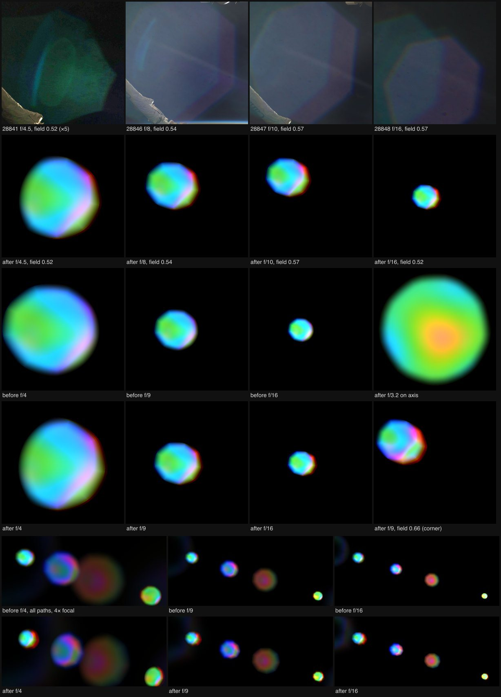

# Ghost clipping and f-number, 2026-10-16

`apertureGhost` cut every off-axis ghost by the same fraction at every
f-number, on the side towards the source. A circle 1.05 aperture radii wide was
offset by 0.34 × field. ISS photographs of one sunrise, taken at f/4.5 to f/16
within a minute, show a different pattern. Near full aperture an element rim
cuts the ghost on the side away from the Sun. The cut has gone by f/10 at the
same field.



Top row: ISS037-E-28841, 28846, 28847 and 28848 (NASA, public domain), crops
around the ghost opposite the Sun. 28841 is ×5 in brightness. Second row: the
green conjugate −0.92 path rendered alone after the change, at the reference
f-numbers and fields. It is drawn at 0.13 frame heights at f/4, about the
reference ghost's size, instead of its normal 0.009. Third and fourth rows:
the same path before and after at f/4, f/9 and f/16, field 0.52; the on-axis
f/3.2 tile shows that nothing is cut on axis. The last tile is f/9 near the
corner. Bottom two rows: all seven paths at 4× focal scale, Sun at
(0.66, −0.20) frame heights, before and after. Every tile is scaled to its own
99.8th-percentile luminance.

## References

All frames are from ISS037 on 2013-11-09, 06:58:30–06:59:31 UTC. Camera:
Nikon D3S with the AF-S 50 mm f/1.4G (nine rounded blades), 1/500 s, ISO 200,
aperture priority. EXIF is in the full-resolution files at
`eol.jsc.nasa.gov/DatabaseImages/ESC/large/ISS037/ISS037-E-<n>.JPG`. The
downloads are not committed. The Sun's position is the centroid of the
saturated core. Field is in the shader's units, |source| / 1.25 frame heights,
so the middle of a 3:2 frame's side is 0.60.

| Observed feature | Reference and capture context | Mechanism | Discriminating render |
| --- | --- | --- | --- |
| A green nonagon whose outer side is cut by a circular arc about 0.6 of its radius from the centre. The arc has a bright cyan rim, and beyond it the fill drops to about 45% (green excess 4 against 9 levels). The side towards the Sun keeps straight blade edges | 28840 and 28841, f/4.5, Sun at field 0.52 near the right edge. The ghost sits at about −0.9 × the Sun's position, so it is this renderer's green conjugate −0.92 path | Wide open, the reflected beam's footprint on some element is larger than the element's clear aperture once it is displaced by field, so the element's rim, not the iris, bounds that side | After, f/4.5 field 0.52: round on the side away from the source, blade edges towards it, cut at 0.71 radius. Before, f/4: cut on the source side |
| The arc is a bright line only. The fill on both sides of it is the same, (83, 98, 117) against (85, 99, 121) | 28846, f/8, field 0.54. A larger lavender ghost from another path | Onset: the footprint just reaches the rim | After, f/8 field 0.54: complete. The rim is at 1.21 radii, just outside the opening. The glint is not modelled |
| Complete nonagons, straight blade edges all round, no arc | 28847 (f/10, field 0.57), the same lavender ghost 12 s after 28846; 28848–28850 (f/16, field 0.45–0.57) | Stopped down, the footprint shrinks as 1/N while the rim and the field displacement stay put, so the beam passes clear | After, f/10 and f/16: complete. Before, f/9 and f/16: a fixed cut on the source side |
| From f/8 to f/10 the same ghost shrinks to 0.84 of its radius | 28846 → 28847 | The ghost is an image of the iris, ∝ 1/N | Unchanged: `cameraPupilScale` already dilates every path |
| The f/4.5 cut lies on the side away from the Sun | 28841 | Which side a rim vignettes depends on where along the path it sits. For this path it is the far side | All paths are now cut away from the source. Before, they were cut towards it |
| Large ghost rings in the far corner show arcs on the Sun's side only. Their rims stay thin and sharp, with rainbow edges | [Video frame at about 5.9 s](https://www.youtube.com/watch?v=Se2F79r_JTw), Sun at about (−0.48, 0.27) frame heights; camera and f-number unknown. Frames not committed | The same rim cut, on the side away from the source. The sharp rim is the ring ghost's focus and dispersion, not the clip | Ring path (conjugate −1.16) with the Sun there, f/4: after, the arc is on the Sun's side and the far side is cut; before, the far side was the brightest. The rendered rims stay soft and thick, which this change does not address |

Search: the full sequence 28820–28875 was downloaded. 28824–28837
(f/1.4–f/7.1) precede the sunrise and have no Sun. 28852–28875 (f/4.5–f/16)
look down at Earth with the Sun out of frame. f/6.3 frames 28842–28844 show
nonagonal ghosts near the Sun, but they are not on the Sun's radial line, so
they are probably window reflections, and they are left out. So f/4.5, f/8 and
f/10 at field 0.52–0.57 pin the end of clipping. It ends between f/8, where
only a glint is left, and f/10.

## What changed

`src/scripts/lens-reflections.ts`, one line in `apertureGhost`:

```glsl
float elementRim=1.03*irisStop(4./cameraPupilScale);
float clip=1.-smoothstep(elementRim-edge,elementRim+edge,length(q-radial*field*elementRim));
```

The clip is a fixed physical circle, like the iris stop. In opening apothems
(q) it is therefore `1.03 × irisStop(N)` = 1.05 × max(1, N / 3.2), so it
grows against the opening as the lens stops down. The chief ray reaches its
edge at field 1, so its centre is offset by `field × elementRim` towards the
source. The cut edge on the far side lies at

    e = 1.05 × max(1, N / 3.2) × (1 − field)

aperture radii from the ghost's centre, and there is a cut wherever e < 1.

| f-number, field | e | Reference |
| --- | --- | --- |
| f/3.2, 0 (axis) | 1.05 | — (no cut, the stop is 1.02) |
| f/4.5, 0.52 | 0.71 | 28841: arc at about 0.6 |
| f/8, 0.54 | 1.21 | 28846: glint, no loss |
| f/10, 0.57 | 1.41 | 28847: complete |
| f/16, 0.57 | 2.26 | 28848: complete |
| f/9, 0.60 (frame side) | 1.18 | explorer auto exposure: complete |
| f/9, 0.72 (frame corner) | 0.83 | — (ghost acceptance fades from 0.70) |
| f/3.2, 0.60 | 0.42 | — (manual exposure only) |

The brief suggested scaling only the offset by f/3.2 ÷ N. With a fixed 1.05
circle that leaves e = 1.05 − k × field × 3.2 / N. Fitted to the f/4.5 cut
(k = 0.92), it still cuts 15% of the radius at f/8 and 11% at f/10 for
field 0.55, which 28846 and 28847 rule out. A rim of fixed physical size gives the steeper change with N that the
sequence shows. The edge softness is unchanged.

The clip is still at most 1. The area normalization, which divides by the
unclipped support's conservative integral, is therefore still an upper bound
on each path's flux.

## Measurements

- **Lens energy fixture** (`scripts/lens-energy-browser-fixture.mjs`, Sun at
  field 0.29, 16 cases). Every case is at most 0.514 of
  `LENS_REFLECTION_FRACTION`. Against the values in the
  [ghost coating](ghost-coating-2026-10-16.md) evidence, flux is 0.90–0.92
  at f/2 (cut more, since the rim stays at 1.05 below f/3.2), 1.05–1.06 at
  f/4, and 1.17–1.20 at f/6.7, where nothing is cut any more. Other
  uncommitted lens work in the same tree may account for part of these
  ratios.
- **Path −0.92 alone**, Sun at field 0.52, luminance integral after / before:
  0.91 at f/4, 1.12 at f/9 and 1.14 at f/16. The path is cut more wide open
  and not at all stopped down. Unclipped it integrates to 0.36–0.385 of the
  same units at f/8–f/10 and on axis.
- **All paths, 1× focal scale**, Sun at (0.66, −0.20): after / before is 0.94
  at f/4, 1.25 at f/9 and 1.32 at f/16. At 4× focal scale it is 0.93, 1.24
  and 1.29.

## Effects and limits

- Moving the cut off the source side uncovers the dispersion fringe there. At
  f/9–f/16 the old clip removed most of the red crescent on that side. It is
  now drawn as `apertureGhost` defines it (bottom rows of the figure).
- The side rule rests on one path. 28841 shows the cut away from the Sun for
  the conjugate −0.92 ghost. No frame here shows a positive-conjugate ghost
  near full aperture, so for those paths "away from the source" means the
  side facing the frame centre. That is a choice, not an observation.
- The rim's bright cyan glint, and the roughly 45% fill left beyond the arc at
  f/4.5, are not modelled. The cut goes to zero.
- The iris model is round at f/3.2, and the Nikkor 50 mm still has straight
  blade edges at f/4.5. At f/4 the rendered cut therefore reads as a rounder
  side, not as a chord across a polygon.
- One rim serves all seven paths, and its position along each path is not
  traced.

## Verification

- `bun run verify` passes: 245 tests, check and build. It does not compile
  the shaders. A first version named the new circle `rim`, which clashes with
  the profile's `vec3 rim`, and only the render harness caught it.
- `bun run verify:scene` passes end to end in an isolated agent-browser
  session, including the lens energy and field reflection fixtures. It ran
  against a dev server already serving this working tree, because the
  per-folder server limit was reached.
- The crops come from a standalone WebGL2 page that compiles
  `lensReflectionShader` as is ("after") and with the old clip line
  substituted ("before"). It renders 1200 × 800 float frames in an isolated
  agent-browser session, with `ghostSourceRadius` = solar radius × focal and
  `cameraOpening` = 0.5.
