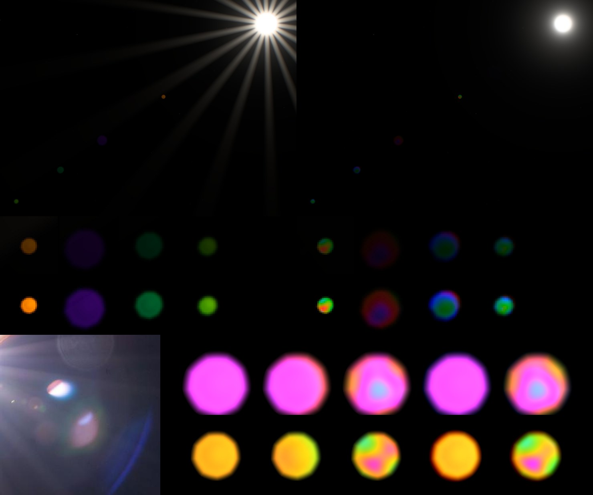

# Ghost coating colour, 2026-10-16

Lens reflections (ghosts) had the iris's nonagonal outline but one colour
each. Their thin-film tint changed only with the source's field angle and,
very gently, along one axis of the ghost. Real ghosts look like soap bubbles:
a nonagon filled with blotchy, oil-on-water colours, often with a coloured
rim on one side.

Top: the 1× view with the Sun in frame, before (left) and after, 1:1 crops of
1200 × 800 captures. Middle: the four visible ghosts of that view at 4×,
before (left four) and after; under them the reflections alone
(`look-ghosts=1` minus `look-ghosts=0`, ×3). Bottom left: NASA
iss067e124188 (public domain), ghosts beside the Sun. Bottom right: one path
rendered alone at 4× focal scale with the Sun at (0.25, 0.07) frame heights,
each frame scaled to its own peak. Columns: no pupil variation, incidence
only, thickness only, dispersion only, all. Rows: conjugates −0.26 and 0.21.

The Sun's rays differ between the two top crops because the starburst was
being reworked in parallel. That change is not part of this one; the
reflection-only row isolates this one.

## References

| Observed feature | Reference and capture context | Mechanism | Discriminating render |
| --- | --- | --- | --- |
| Nonagonal ghost with green, red and magenta patches inside, not one tint | ESA Horizons orbital sunrise, frame 300 (Alexander Gerst, two photographs per second, 4K source); iss067e124188 (Nikon D4, 28–300 mm at 56 mm, f/14, 1/800 s), the pink ghost with a pale blue patch | Each pupil point meets the coated surfaces at its own thickness. Scaling a stack's thickness shifts its whole reflectance spectrum, so the hue changes across the ghost | Thickness-only column: patches inside a fixed outline; the no-variation column stays one colour |
| Colour changes outwards in rings | iss067e124188, the large blue arc and green rims | Angle of incidence grows towards the pupil rim on curved elements; the film's optical thickness goes as cos θ, a blue shift | Incidence-only column: a smooth gradient whose centre is offset from the ghost's |
| Coloured rim on one side only (blue, cyan or red) | Horizons frame 300, blue rim on the outer side; iss067e124188, small ghost red on one edge and blue on the other | Dispersion: each colour's ghost sits at a slightly different conjugate, and its defocus, so its size, differs | Dispersion-only column: a one-sided blue or red fringe, the interior unchanged |
| Pattern stays put over consecutive frames | Horizons frames 300–311 (0.5 s apart) | Coating thickness is fixed on the glass; nothing is animated | By construction: inputs are pupil position, field and fixed per-path constants |
| Colours are pastel and the ghost faint | All references | Two reflections at ~0.5% each; the colour varies, the flux does not | Lens energy fixture: integrated flux unchanged within 4% |

The ESA frames are not committed. The previous note
([aperture rays](aperture-rays-2026-10-16.md), "Open questions: Ghost
colour") found the Horizons ghost; iss067e124188 has two more within 0.2 of
the frame height of the Sun.

## What changed

All in `src/scripts/lens-reflections.ts`; the outline is still `ghostAperture`
from the shared iris.

- **A spectrum per surface.** A path's tint is now its colour on axis at
  nominal coating thickness. `coatingSpectrum` fits a coated surface's
  reflectance as a + b·cos(2πσ/P) + c·sin(2πσ/P) in wavenumber σ, through the
  square root of the tint at 630, 535 and 460 nm, so two such surfaces
  reproduce the tint exactly. P = 0.9 µm⁻¹ is the period of a multilayer stack
  about 0.55 µm thick optically. It puts the three samples about a third of a
  period apart, so the fit is well conditioned and never negative for the
  seven tints. Scaling the film by s samples the same spectrum at σ·s:
  thicker shifts it to the red, steeper incidence to the blue.
- **Film scale over the pupil** (`coatedFilm`), for each of the path's two
  surfaces. The incidence term is the chief ray's field angle, as before,
  plus the pupil ray's tilt (0.4 and 0.15 of the field scale), so each
  surface's gradient has its own offset centre. The thickness term is
  thinning by 3% towards the beam footprint's rim, as deposited on a curved
  element, and three low-order sinusoids (±4% each, 1–1.5 cycles across the
  footprint) with fixed per-path directions and phases. The footprint walks
  across the element with field. As the Sun moves, the patches therefore
  drift slowly through the ghost; they never animate.
- **Dispersion.** Each colour's outline is scaled and shifted to first
  order in the signed distance, without extra iris evaluations. The radius
  differs by ±0.25% of the frame height at f/4 and 1× (pupil slope × focal
  shift f/V), not by a fixed fraction. Nearly focused, small ghosts therefore
  get the widest fringes for their size, clamped at ±15%. The conjugate
  differs by ±1.2% × a per-path factor along the radial line, which puts the
  fringe on one side.
- **Energy.** Each colour is divided by its size², so its flux is its
  reflectance whatever its size. Each colour's support grows with it, and
  the area bound still holds per colour. `ghostCoating` still normalizes
  luminance.
- **Field reflections** use the same spectra with the field-angle film scale
  only: the scene-wide reflection is already blurred over the aperture.

Squares replace `pow(x, 2.)` in the profile, whose result is undefined in
GLSL for negative x.

## Measurements

Raw numbers are in
[evidence/ghost-coating-2026-10-16.json](evidence/ghost-coating-2026-10-16.json).

- **Lens energy fixture kernel** (16 cases: f-number scale 0.6–2, focal
  1–4, point and solar source, point and full chain). Integrated luminance
  after / before is 0.963–0.973, at most 50% of
  `LENS_REFLECTION_FRACTION`. The few-percent drop comes from per-colour
  supports and luminance weighting, not from new energy.
- **Field reflections fixture:** 0.9994 of the reflection fraction, unchanged.
- **1× scene** (1200 × 800, DPR 1, grain off, replay paused, `t=1500`,
  `epoch=2026-10-08T04:00:00Z`, `yaw=17`, `pitch=7`). Reflection-only
  luminance, mean 0.0165 → 0.0161 levels, peak 53.3 → 54.0, no clipped
  pixels before or after. At 1× the ghosts are 10–25 px across. Each now
  shows two or three colours and a one-sided rim instead of a flat tint.

`bun run verify` passes (245 tests, check, build). See Verification for
`verify:scene`.

## Choices and limits

- The tints, their period and the blotch amplitude are photographic choices.
  Production coatings typically hold ±1–2% thickness on flats; ±4% per term
  (up to ±12% combined) is generous. The references need about a third of a
  period of hue change across a ghost. Steep incidence and edge thinning
  together supply about half of that.
- Three wavelengths alias real spectra. A thin film's colours wash out to
  white above the third order, but three samples on a sinusoid never do.
  Across one ghost the film scale varies by about ±15%, well short of that
  regime; the field term, unchanged, still shifts the whole ghost by up to
  40% towards the frame corners.
- The ghost-to-pupil mapping is one footprint per surface, scaled and
  walked by field, not a ray trace of a named lens.

## Verification

- `bun run verify` passes.
- `bun run verify:scene`, against the dev server: the lens energy and field
  reflection fixtures pass. The run then stops at the solar-disk fixture's
  new ray-strength assertion (0.23 against 0.25), part of the starburst work
  running in parallel, which does not use lens reflections.
- The same script with only that fixture skipped passes end to end,
  including the full-scene captures and the WebGL1 fallbacks. Its first
  attempt timed out once in the swipe fixture's 25 s wait.
