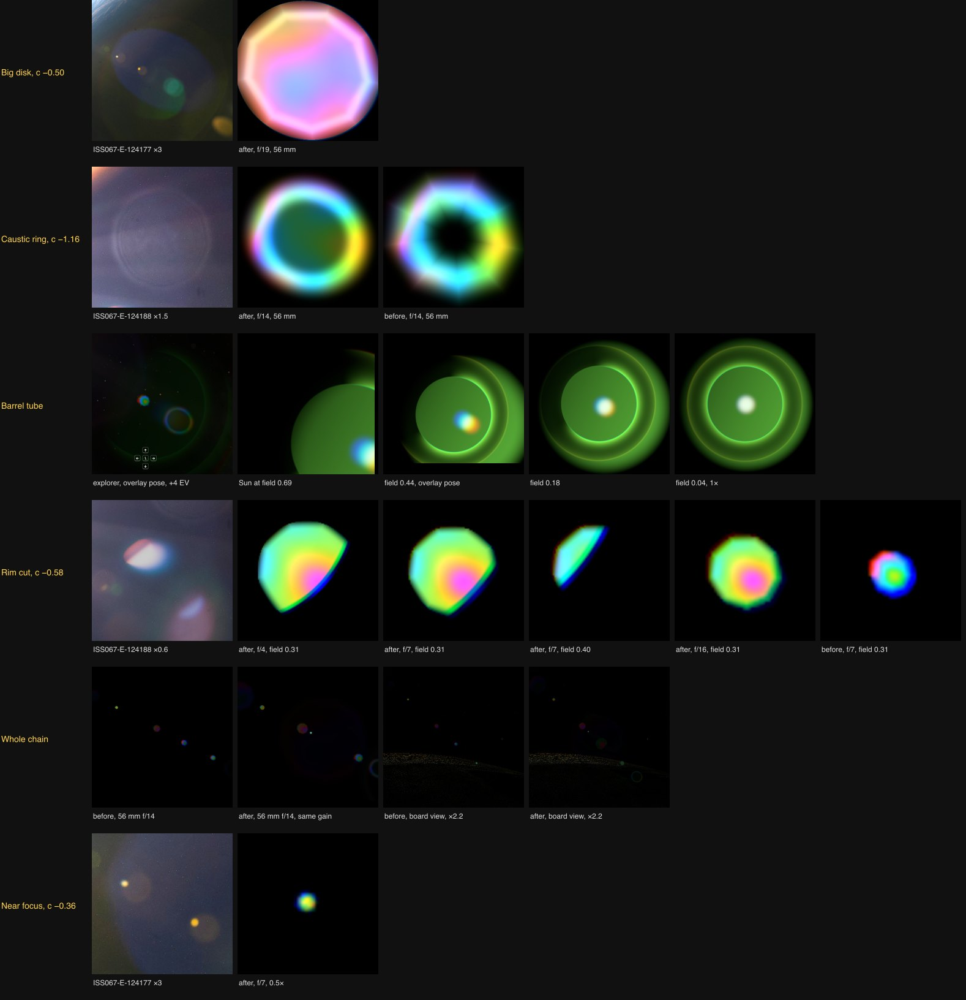

# Overlay ghosts on a 28–300 mm lens, 2026-10-16

The goal was the ghost set of the "Free Lens Flare Overlay" video: a chain of
large, translucent polygons through the centre of the frame, a tube of thin
rings with a rainbow arc at the frame edge, a ghost cut almost straight by the
barrel, small nearly focused ghosts, and ghosts that appear before the source
enters the frame. That overlay was shot through another lens, with a
six-blade iris. The question here was which of these a coated Nikon 28–300 mm
class zoom produces, at what size and brightness, and how to draw it with the
nine-blade iris this renderer already has.

Before this change, seven paths drew small dim points at 0.5× and 1×. Their
radii were three to ten times smaller than the 28–300 mm ghosts in ISS
photographs, and they had no barrel reflections.

Each row is one mechanism. The left tile is a crop from a NASA photograph
(public domain) taken with the Nikon 28–300 mm at 56 mm; the factor is a
linear brightness gain. The rest are this renderer's paths, drawn alone with
the production `lensReflectionShader` in an isolated agent-browser session,
with the Sun's disk at the given focal length and f-number. Each tile is
scaled to its own 99.8th-percentile luminance, except in the "Whole chain"
row. That row shows the whole chain at 56 mm f/14 before and after at one gain,
then the board view with reflections alone (`look-ghosts=1` minus
`look-ghosts=0`, ×2.2) before and after.

## What the 28–300 mm shows

ISS067-E-124177 (Nikon D4, 56 mm, f/18–20) and ISS067-E-124188 (56 mm, f/14,
1/800 s, ISO 400) carry the clearest ghosts of this lens. Radii, in frame
heights, and the strength of each ghost:

- 124177: a large dark-blue disk of 0.165 with a green ring just outside it;
  ghosts of 0.036 and 0.038 at conjugate about −0.5 and −0.85; two points of
  0.004–0.013, each beside a soft disk of its own colour.
- 124188: a saturated ghost of 0.017 cut by a red crescent on one side; ghosts
  of 0.028, 0.044 and 0.045, the last two with thin bright rims around a
  darker interior; a blue disk of 0.074; a blue crescent arc of radius about
  0.09.

The ghost radius is the defocused image of the iris, its defocus over the
f-number. Converted to this renderer's units (f/4 at 1×, kernel ∝ focal ÷ N),
these radii are 0.03–0.42, against 0.009–0.098 before. ISS035-E-13380
(14–24 mm at 24 mm, f/16) gives 0.025–0.12, so the ∝ focal scaling that
`ghostFocalScale` already applies holds across these lenses.

A ghost's surface brightness is its reflectance R times the source's radiance
times (Sun image radius ÷ ghost radius)². With 124188's exposure (saturation
at 120 N²/(S t) ≈ 47 000 cd/m², the Sun at 1.6 × 10⁹ cd/m²) the five clear
ghosts give R ≈ 3.1, 2.9, 1.2 and 1.1 × 10⁻⁵ and ≥ 6 × 10⁻⁵ for the saturated
one. The camera's tone curve makes this uncertain by about a factor of two.
That is the coated level of `LENS_STRONGEST_PATH` (2.5 × 10⁻⁵), so the
reflectance per path stays. The weak paths, 1 to 6 × 10⁻⁶ before, are raised
towards it. Not every ghost in 124188 lies on the Sun's radial line; those that
do not are probably reflections in the station window and are left out.

## Observations

| Observed feature | Reference and capture context | Mechanism | Discriminating render |
| --- | --- | --- | --- |
| Large translucent polygons of different sizes and colours in a chain through the centre | Overlay, 5.9 s, Sun at the top left; ISS067-E-124177 and 124188, the ghosts listed above | Each path images the iris defocused by its own amount, radius ∝ defocus ÷ N. Energy is R × the source flux, so a larger ghost is fainter by the area | "Whole chain" at 56 mm f/14: after, a chain of 0.02–0.17 frame-height polygons and rings; before, points. The paths' radii now come from the ISS list |
| A tube that reads as a solid part of a lens: a large soft green disk, a dark band with halftones across it between a bright green rim and a faint reddish one, the disk showing again outside the band on the far side, a rainbow spot (blue towards the Sun, red away), the side towards the Sun dark. It moves with the source like a solid object | Overlay at 5.92 s, viewed in the browser: the Sun at (−0.48, 0.28) frame heights; circle fits give rims of 0.177 and 0.273 round (0.48, −0.26) and (0.47, −0.25), c ≈ −0.97 and −0.94; the spot 0.04 frame heights across, 0.4 rim radii from the centre away from the Sun. 4.6–7.0 s: off axis the rims separate, near the centre they close | One path's beam is wider than the barrel between two edges, a spacer ring and the next element's rim. Its image, a defocused pupil disk, is vignetted: the bore between the edges casts a shadow across it, a transmission factor, not missing light, so the band is darker than the disk around it. The edges sit at different depths and the disk at a third conjugate, so all three separate with field, as a tube seen at an angle. The wall is lit unevenly, so the shadow has halftones; where the beam grazes an edge its bevel returns a thin glint, sharp on one side and fading into the bore. A lens surface down the tube gives a small image split by its dispersion | `after-ghost-solid.jpg` on the board: reference, the previous glowing rings, the vignetted disk; then the explorer at the same pose and +4 EV with reflections on and off, where the band is darker than the disk round it. The "Barrel tube" row shows the tube at field 0.69, 0.44, 0.18 and 0.04. Before: absent; the first two versions, thin rings and then rings with a glow, read as neon circles |
| A ring with a glowing rim, a dark interior and a thin reddish ring outside | Overlay tube, 5.9 s; 124188, ghosts of 0.044 and 0.045; 124177, the green ring around the blue disk | Spherical aberration of the reflected beam piles its rays at the edge, a caustic; an element edge just beyond it returns a second, thinner ring | "Caustic ring" row: after, a round rim around a dim interior with a faint outer ring; before, a thick nonagonal band with a black centre |
| Rims thin, sharp and in rainbow colours, a sharp rainbow arc at the frame edge | Overlay tube; 124188 blue crescent arc | A caustic's radius changes by about 1/V across the visible, V ≈ 40. Its width cannot be less than the source's image at its conjugate, ghostSourceRadius × c | At 56 mm the Sun's image at c = −1.16 is 0.013 frame heights, 30% of that ring's radius, so its rim stays wide; the barrel rings at 1× and the front-element arc (radius 0.36 at 1×) are wide enough that the rainbow splits (track frames below). Thin rims on small rings at long focal lengths are not physical for the Sun |
| A ghost cut almost straight, blue on the cut, yellow on the other side | Overlay, top right, 5.9 s; 124188, the saturated ghost with a red crescent; ISS037-E-28841 in [ghost clipping](ghost-clipping-2026-10-16.md) | A front element far from the stop: its rim is wide (2.2 stop radii) and the beam's footprint walks across it fast (6 per unit field), so the rim's arc across the ghost is nearly straight. The rim is imaged through the same glass, 2.5% larger in blue; the iris image's lateral colour pushes red and green the other way | "Rim cut" row: f/4 and f/7 at field 0.31 cut by a near-straight chord with a blue edge, f/7 at field 0.40 a sliver, f/16 complete. Before: a small round ghost |
| Small nearly focused ghosts, each with its own star | Overlay tube, two four-ray glints; 124177, two bright points and no star | A path focused near the sensor images the Sun as a point of R/c² × its radiance, here at most a few times the clipping level. The diffraction star's visible length goes as √(peak ÷ threshold): the Sun, 3 × 10⁴ times the clip, has rays 0.3 frame heights long, a ghost 5 times the clip would have rays of 0.004, three pixels | "Near focus" row: a saturated point, no star. A visible star needs a reflectance a hundred times the coated one; the overlay's lens is not coated like this |
| Ghosts before the source enters the frame | Overlay, 0–4.6 s | The front element accepts light from beyond the field of view until the barrel vignettes it | Unchanged: acceptance fades between screen edge 1 and 1.55 and field 0.70 and 1.05. Track frame 1, Sun at 1.15× the corner distance outside the frame, has ghosts and barrel arcs |

## What changed

`src/scripts/lens-reflections.ts`:

- **Path table.** Eight aperture paths instead of seven. Radii follow the ISS
  list: 0.006 (near focus) to 0.42 (the large disk). The weak paths are
  raised to 0.30–0.60 of the strongest; no path exceeds
  `LENS_STRONGEST_PATH`. The old c = +0.72 path is gone and the c = −1.45 one became
  a barrel arc; c = −0.36 (near focus) and c = −0.50 (the large disk, half
  ring) are new.
- **Ring profile.** `ring` is now continuous. A ring's outline is a circle, a
  round element edge, not the iris. Its rim is centred on the outline, as wide
  as the path's softness plus the source's image, with a dim interior and a
  reddish outer ring 0.13 radii beyond. Its radius splits by ±1.2% across
  red, green and blue. The field term no longer widens a caustic.
- **Rim cut.** Each path has its own clipping element, radius and walk in stop
  radii (`rim`, `walk`). All keep 1.03 and 1.03 except c = −0.58, at 2.2 and
  6.0. The cut edge is 0.3 of the ghost's softness, and the element rim is
  2.5% larger in blue than in red.
- **Barrel reflections.** `LENS_BARRELS` and `barrelGhost`. The tube is a
  pupil disk at c = −1.10, radius 0.48 at f/4 and 1× (dilated like an
  aperture ghost, 0.27 at f/7), soft over 18% of its radius and twice as
  bright on the far side. Two edges vignette it: an inner edge at c = −0.97,
  radius 0.18 at 1×, and an outer edge at c = −0.94, radius 0.27. Reworked
  after review (it first read as neon rings, then as a bright flat disk with
  a shadow band). From the centre outwards:
  - inside the inner edge, the disk, dim;
  - the inner edge's lit lip, the brightest part: a crescent between the
    edge circle and one 10% larger whose centre sits 0.8 depth steps further
    from the source, so it is thick on the far side and thins towards the
    Sun. It has a sharp bevel line at its inner edge and falls off across its
    width, as a rounded rim would;
  - the bore's wall out to the outer edge, in shadow: it passes 0.15 of the
    disk beside the lip, rising to 0.5 at the outer edge, and up to a
    quarter more on the lit side. These are the halftones;
  - the outer edge, a thin reddish glint sharp outwards, and beyond it
    nothing, since that edge cuts the disk.

  The wall's shadow also multiplies the Sun's veil, by up to 0.5 beside the
  lip (`barrelVeilShadow`, applied in `camera-finish.ts`). Without that the
  shadow, falling on the veil-lit background in the explorer, would not read
  as a shadow. It is an approximation: the veil's paths are not traced.
  Lips and glints are dark within about 50° of the direction to the Sun and
  full beyond 100°. A spot 0.21 rim radii
  across sits 0.4 rim radii off centre away from the Sun, its red and blue
  images 0.6 spot radii apart; offset and split grow with field to the
  overlay's 0.44. The disk, lip and glint take the path's tint at nominal
  coating, the spot is white light. Shares: disk 35%, lip 40%, outer glint
  17%, spot 8%, each over a conservative bound on its integral.
  The edges keep their size when stopping down and the disk shrinks, so on
  axis by about f/11, and later off axis, the disk fits inside the inner
  edge and the wall and lip go dark. The front element's edge is a glint only, an arc of radius 1.15
  round c = +0.55, lit within about 35° of the far direction. Both barrels
  grow from 0.15 to full strength between field 0.05 and 0.6, as more of an
  oblique beam is vignetted onto the bore. The field reflections reflect
  each barrel as one broad ghost at its middle conjugate.
- **Barrel strength.** The tube returns at most 2 × 10⁻⁴ of the source and
  the arc 1.4 × 10⁻⁴ (path units 6.8 and 4.8). An oblique beam loses a large
  part of its flux to the barrel at the field's edge; black paint reflects a
  few percent at grazing incidence and only part of that is specular. The
  product spans about 5 × 10⁻⁵ to 5 × 10⁻⁴. This is an estimate, not a
  measurement.
- **Energy.** Each ring of a ghost is divided by √π × width × 2π × radius,
  widened as for the nonagon. A barrel's parts are each divided by their own
  bound and get a fixed share: the disk over its support (the shadow only
  multiplies it), the glints as √π × width / 2 plus the fall length round
  their circles times the lit side's mean plus 0.1, the spot over 1.7 spot
  radii. A barrel alone integrates to 0.10–0.41 of its strength. All paths together
  return 4.8 × 10⁻⁴ of the source (6.9 × 10⁻⁵ before).

`scripts/field-reflection-browser-fixture.mjs` expected the brightest field
reflection at c = 0.21. That was a property of the old table. It now finds the
most concentrated path from `LENS_PATHS`, strength over the larger of its
half-aperture blur and the test disk's image, which is c = −0.36.

## Measurements

- **Energy per path.** The share of each path's bound that it integrates,
  over a 4 × 4 frame-height domain at 400 samples per frame height: 0.13–0.58
  after, 0.19–0.47 before, at f/4 1×, f/7 0.5× and f/16 4×. The cut path is
  0.03 at f/16, field 0.39, where the element vignettes it almost completely.
  The whole chain, including the barrels, integrates to 0.29–0.36 of
  `LENS_REFLECTION_FRACTION`. The lens energy and field reflection fixtures
  pass.
- **Board view** (0.5×, the Sun at (−0.29, 0.27) frame heights, auto exposure).
  The camera program is at about f/7 here: the c = −1.16 ring is 0.024 frame
  heights, 0.085 × (4/N) × 0.5. Reflections in 8-bit output levels after a
  9 × 9 box filter, in the sky above the limb: the strongest point before,
  the c = −0.58 ghost, was 27 levels; after it is 9, spread over seven times
  the area. Pixels changed by more than 4 levels in that region rose from 536
  to 2121.
- **The overlay's pose in the explorer** (1×, 1600 × 900, the Sun at
  (−0.48, 0.28), auto exposure, about f/7). The tube's inner rim, reflections
  alone, is 0.0018 in linear output; the reference's, brightened ×2.2 as on
  the board, is 0.13, so about 30 times ours at the same scale. Its
  hexagons stand in the same ratio to our chain. At ×36 our rim matches the
  reference's and the tube, spot and edge arc fall where the overlay's do
  (`after-ghost-same.jpg`, measured on the previous glowing-ring version;
  the vignetted disk keeps the positions). At +4 EV in the explorer the disk
  and the band across it are visible without any gain
  (`after-ghost-solid.jpg`). The overlay's lens returns of order 10⁻² of the
  source into its flare, about a hundred times a coated zoom's ghost paths.
- **Cost.** The whole chain at 2880 × 1800 takes 0.14–0.24 ms per frame
  against 0.09–0.12 ms before, timed in the same harness.

## Effects and limits

- **The board view stays dim.** At 0.5× and f/7 the chain is visible at
  about ×2.2, as the references were brightened, not at ×1. ISS crews shoot
  the Sun at f/14–f/20 and 1/500–1/1000 s. The explorer's fixed 1/48 s shutter
  keeps the lens at about f/7, so the same reflectance gives ghosts four to
  seven times fainter per area. The chain's negative conjugates also fall on
  the lit Earth, where any ghost is about 1% of the cloud's radiance. Making
  the board view look like the overlay would need either a faster shutter in
  the camera program or a much stronger reflectance than a coated lens has.
- The overlay's star glints are left out (see the table).
- The large disk's coating hue varies as much as a small ghost's, so it
  reads more colourful than the uniform dark blue of 124177.
- **The overlay is far brighter.** At the same pose and the explorer's
  exposure our flare is about a thirtieth of the overlay's. Matching it
  would take a reflectance a coated 28–300 does not have.
- The tube's depths, radii, lit-side rule and spot come from one overlay
  frame, not from a traced barrel. Its reflectance is an estimate.
- The tube ignores the element clip and is not cut by the frame's own
  vignetting. Its shadow darkens only its own disk: the solar veil, drawn
  elsewhere, passes over the band unchanged. The c = −1.16 ring ghost lands inside it at the overlay's pose,
  near the spot.

## Verification

`bun run verify` and `bun run verify:scene http://localhost:4384 <folder>`
pass in an isolated agent-browser session. The board frames were captured in
the explorer at 1440 × 900 with grain off and 9 s for auto exposure; the
crops come from the same standalone harness as the earlier ghost notes. The
video was viewed in the browser and not downloaded, and no frames from it
are committed.
