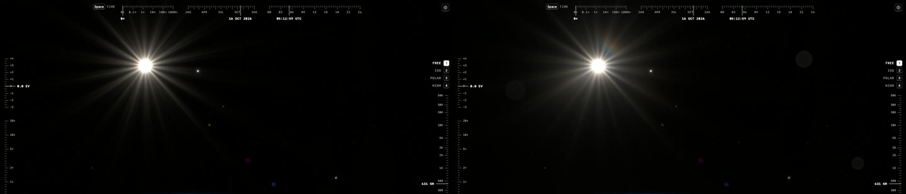

# Lens dirt: uneven veil and dust, 2026-10-16

With the Sun in frame, real ISS footage sits in an uneven haze that grows with
the overexposure but keeps an irregular shape, and heavy flare reveals soft
discs from dust in the optics. The explorer's veil was a perfectly round
two-scale Moffat confined to a few degrees, hidden under the Sun's core and
rays, and the optics were spotless.

The 0.5× view of 2026-10-16T04:48 turned −53° about the camera's vertical
axis, so the Sun sits top left as in the flare reference; left before, right
after.

## References

Viewed in a browser, not downloaded; frames are not committed.

| Observed feature | Reference and context | Mechanism | Discriminating render |
| --- | --- | --- | --- |
| Irregular haze around the core that grows with the source's brightness and keeps its shape | [Sun through the ISS](https://www.youtube.com/shorts/EzPBWvqmfM4), 6.3 s; [Free Lens Flare Overlay](https://www.youtube.com/watch?v=Se2F79r_JTw), 5.9 s | Scatter from smudges and fine dust on surfaces near the pupil depends only on the angle from the source: fixed to the lens, travelling with it | Between rays, 120–180 px from the Sun, eighth-sectors range 14–24 output levels (before: 4–12, mostly noise) |
| The haze is lopsided, a lobe off to one side, with coloured edges | Overlay, 5.9 s (pink lobe beside the core); [Sunset from orbit](https://www.youtube.com/shorts/YQRsRvOySXQ), 0.4 s | Larger smudges act as weak prisms; scatter angles grow with wavelength | Offset lobes, red slightly farther out than blue |
| The haze around the source changes as it crosses the frame | Overlay, 0–7 s | Smudges sit on an element away from the stop; the source's beam crosses it at a spot that moves with the source, and lights only the smudges under it | Offset haze appears and fades with the Sun's position |
| A rainbow ring around the source, red outside | Overlay, 4.6–7 s; [Sunset from orbit](https://www.youtube.com/shorts/YQRsRvOySXQ), 0.4 s | Circular cleaning scratches diffract like a grating: a ring centred on the source with radius ∝ wavelength. Near the stop the beam covers the whole element, so scratches of every direction: the ring is round. Off axis the beam's spot shifts and favours one direction | A round ring about 6° out, up to 2.6× brighter on two opposite sides that turn with the Sun |
| Haze reaches a quarter of the frame | All three | Contamination scatter falls slowly with angle (Harvey-Shack, roughly θ⁻²), not as the clean Moffat's θ⁻⁴ | Mean output level at 150–200 px (about 17°): 7 → 18; at 250–320 px: 1.6 → 4.7 |
| Soft discs and small bright dots, fixed in the frame, only in heavy flare | Sunset from orbit, 0.1–0.8 s | Dust on the window 12–25 cm in front of the lens, lit from behind, forward-scatters into the lens; each speck is far out of focus | Fixed in direction; 2 px dots at 0.5×, 10 px discs at 1×, growing as focal length squared; shown at +4 EV, invisible at the metered exposure |
| A dark-ringed disc | Sunset from orbit, 0.4 s | Shadow of dust on the filter stack, with a Fresnel rim | Shadow depth (d·N/z)²: deeper and smaller when stopped down |

## What changed

- **Scatter budget** (`src/scripts/solar-light.ts`): 3% of the incident
  light instead of 1.5%, in three Moffat kernels of core radius 0.015, 0.08
  and 0.3 rad with shares 0.45, 0.2 and 0.35. The broad one is contamination
  on the lens and on the window the ISS cameras shoot through. A dirty
  window's haze alone is 1–5%. The frame glare pyramid keeps the two narrow
  kernels (1.95% of the light): its coarsest level is narrower than the
  frame, and a 0.3 rad kernel would pile its unresolved mass there, 1.4× too
  bright at 200 px. For anything fainter than the Sun that kernel is a
  near-uniform haze, mostly beyond the frame, so it is left unmoved.
- **Uneven veil** (`src/scripts/lens-dirt.ts`, `veilPatternRGB`): angular
  harmonics of order 1, 2, 3 and 5 with amplitudes summing to 0.9, twisted
  slowly with log radius. Their mean around every circle is zero, so the
  integral is unchanged and the kernel stays positive.
- **Offset lobes** (`veilLobes`): up to 0.12 of the Sun's veil, taken from
  the broad kernel, goes into four normalized elliptical Moffats 5–10° off
  the Sun, without colour. A first version gave them offsets that scaled
  with wavelength. That made a fixed rainbow beside the Sun: always the same
  side, shape and colour order, a decal that only switched on and off.
  Each belongs to a smudge
  on an element away from the stop. The Sun's beam crosses that element at a
  spot that moves one spot radius per 0.3 rad of source angle. A lobe takes
  its share only while the spot covers its smudge; what no smudge takes stays
  in the broad kernel. On 2026-10-17 the lobes and the swirl were moved to take
  from every kernel alike, which restores the θ⁻² tail
  ([flare phases](flare-phases-2026-10-17.md)). The frame glare keeps its radial kernels: a pyramid
  cannot offset them, and their energy is the same.
- **Cleaning swirl** (`swirlRing`): up to 0.08 of the Sun's veil diffracts
  on circular micro-scratches around the element's centre. The result is a
  ring around the Sun of radius 0.1 rad at 540 nm (a scratch period of about
  5 µm) and width 0.02 rad, scaled by wavelength per channel, so red is
  outside and blue inside. The ring is round, modulated by 1 + m·cos 2φ
  along the beam spot's offset from the swirl centre, with m growing with
  that offset to at most 0.45. A first version narrowed it into two opposite
  arcs, assuming the beam saw only a small patch of the swirl. Near the
  stop the beam covers nearly the whole element, so the ring stays a ring.
  The test integrates the whole veil to 1 within 1% at five Sun positions.
- **Haze shape.** The harmonics were first dominated by a second order of
  0.3, which made the overexposed core an ellipse. Now the first order
  (0.38) leads, the second is 0.1, orders 3–5 add 0.37, and the offset
  lobes are nearly round. The contour of a blown-out core moves only as the
  fourth root of the modulation (the kernel falls as 1/r⁴), about ±15%, so
  even a strongly uneven haze keeps a roundish clipped core.
- **Window dust** (`dustGlints`): six specks on the window 12–25 cm in
  front of the lens, fixed in direction. Each is an image of the iris far out
  of focus: entrance pupil over distance across in angle, so its radius in
  the frame is focal² · 24 mm / (2 N z). Zooming in grows it as focal length
  squared and pushes it out of the frame; stopping down shrinks it. It lights
  while the Sun is within a ~20° forward-scatter lobe of its direction, with
  2.5–4·10⁻⁶ of the light entering the lens: visible only in heavy flare.
  Sensor dust is unaffected by zoom: it lies on the sensor.
- **Dust shadows** (`dustShadow`): seven particles on the filter stack,
  1–3 mm above the sensor and 30–80 µm across. The shadow disc is z/N
  across and (d·N/z)² deep: about 5% at f/9.4 and 15% at f/16, with a faint
  bright rim. Shadows only remove light, so they never show on a dark frame.

`scripts/lens-dirt.test.mjs` integrates the dirty veil in polar coordinates
for the three wavelengths: 1 within 1%, never negative. It also bounds the
dust.

## Open questions

- **How strong.** The haze is still fainter than in the references. Those
  were exposed for the night limb with the Sun many stops further over than
  our metered exposure puts it. The 3% budget is a choice within the range
  of a dirty window, not a measurement.
- **Only the Sun is lopsided and broad.** Moon, planets and sunlit Earth
  scatter through the radial pyramid, without the contamination kernel.
- **The zoom lens itself.** In a real zoom the rear groups move, so dust
  on them would change with zoom in a lens-specific way; without a
  prescription only the window and sensor dust are modelled.
- **Streaks.** A wiped smear on glass scatters into a line through the
  source; the vertical streak in the Horizons timelapse may be one. Not
  modelled.
