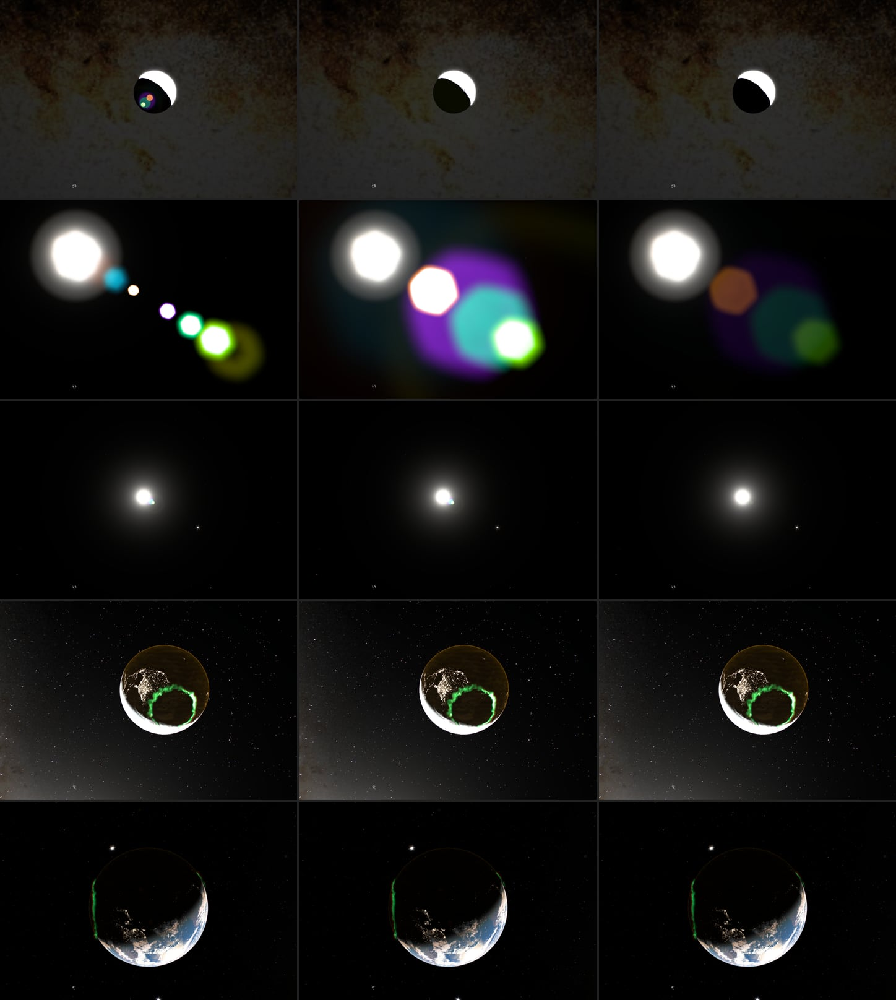

# Lens reflection calibration, 2026-10-16

Lens reflections (ghosts) were tuned on a 1× view of the Sun. Away from that
view they broke in three ways:

- **Zoom stacked energy.** Source flux in the frame grows as focal², but each
  path's kernel had a fixed size in frame units. At 15× the solar ghosts were
  compact white disks; 15 845 pixels clipped only because of them.
- **The Moon was a point.** Its ghosts ignored its 0.26° disk. At 20× they
  were small saturated dots on the Moon's night side.
- **Uncoated reflectance.** The seven paths returned 0.2% of the source
  flux, the strongest 7.3 × 10⁻⁴. A disk-sized solar ghost was then about 25×
  brighter than sunlit cloud, so it clipped at any zoom.

Columns: before, focal-length scaling only, after (all three changes). Rows:
Moon at 20×; Sun at 15×; the same Sun view at 1×; sunlit crescent at +2.4 EV;
Earth and Moon at +2.4 EV.

## Physics behind the changes

A ghost is the source imaged through two internal reflections, defocused by
its path and shaped by the aperture. Its integrated flux is the path's
reflectance times the source flux. Its surface brightness is that flux over
its area, so it can never exceed the reflectance times the source radiance.
Exposure scales direct and reflected light alike. A ghost becomes visible only
when the source clips, and only if the ghost is still above the sky.

- **Kernel follows the entrance pupil.** Defocus blur scales with the pupil
  diameter, f/N. `cameraPupilScale` already carried the f-number;
  `ghostFocalScale` (FOCAL / 1.25) now carries focal length. Flux and kernel
  area both grow as focal², so surface brightness no longer depends on zoom.
  Star and planet ghosts keep their flux, like their direct images, and
  spread with zoom.
- **Finite Moon.** `ghostSourceRadius` is the lunar angular radius × FOCAL,
  with the same variance-matched broadening as the Sun. Its phase shape is not
  modeled; a half Moon's reflection is a soft disk.
- **Coated reflectance.** About 0.5% per multicoated air–glass surface gives
  2.5 × 10⁻⁵ for two reflections. That is the strongest path
  (`LENS_STRONGEST_PATH`). The seven weights scale from it to 6.9 × 10⁻⁵ in
  total, 29× less than before. The lunar factor 18 stays: the direct lunar
  image uses the same factor, so reflections and image share one flux.

## Measurements

The four views were captured in an isolated agent-browser session: 1200 × 800,
DPR 1, grain off, replay paused, 9 s for auto exposure. Each was captured with
reflections on and with `look-ghosts=0`. The meter reads the scene before
reflections, so both images share one exposure, and their luminance
difference isolates the reflections. Peak is that difference after a 9 × 9 box
filter, in 8-bit output levels. Clipped counts pixels that are white only with
reflections. Raw numbers are in
[evidence/lens-reflections-2026-10-16.json](evidence/lens-reflections-2026-10-16.json).

| View | Before peak / clipped | Focal only | After |
| --- | ---: | ---: | ---: |
| Moon 20×, auto | 243 / 0 | 9 / 0 | 0.4 / 0 |
| Sun 15×, auto | 255 / 15 845 | 255 / 38 037 | 72 / 4 |
| Sun 1×, auto | 125 / 111 | (unchanged at 1×) | 15 / 3 |
| Crescent, +2.4 EV | 2 / 0 | 0 / 0 | 0 / 0 |
| Earth + Moon, +2.4 EV | 9 / 0 | 9 / 9 | 13 / 66 |

- Focal scaling alone made the Sun at 15× worse. The same energy had been
  partly hidden in clipped disks; spread out, it covered 69% of the frame.
  That exposed the reflectance as the main error.
- After all three changes the 15× solar reflections are translucent colored
  disks, larger than the Sun and far darker than it, with soft edges. 21% of
  the frame changes by more than 4 levels.
- At 1× the reflections drop to a faint cluster inside the solar veil. That is
  the physical outcome, and the largest visible change to the accepted look.
  The reflections slider still scales them for a deliberately stylized image.
- The Moon at 20× and the Earth views have no visible reflections. The
  Earth + Moon residual is run-to-run noise in city lights and clouds near the
  limb: isolated pixels, present with reflections off as well.

`bun run verify` and `bun run verify:scene` pass. The lens energy fixture now
also integrates a 4× focal scale: energy stays under
`LENS_REFLECTION_FRACTION`, and a point ghost's peak falls more than eightfold.

## Not yet

The model still knows only the Sun, the Moon and three bright points. Extended
regions — sunlit Earth and cloud, the bright limb, sun glint — produce neither
reflections nor veiling glare. Both belong to the next stages: a scene-wide HDR
pyramid, first for glare, then for reflections sampled at `p / conjugate`.
At the coated reflectance above, Earth's own reflections would stay invisible
(~10⁻⁵ of its radiance); its visible lens artifact is glare that lifts the
black sky next to the lit limb.
