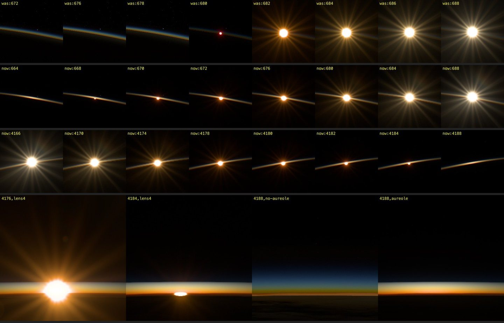

# Sunrise and sunset at the limb, 2026-10-16

The Sun rose in a jump. At `t=680` it was a red dot without rays, at 682 a full
orange star, at 688 a white one. Timelapses from the ISS show the star growing
from the sliver: small, warm and short first, then longer and whiter. At
sunset the Sun goes white, orange, then red and flattened, and the rays and
glow take the same colour. Our orange and red phases lasted seconds.

All tiles are this renderer, 1440 × 900, ISS replay,
`epoch=2026-10-16T04:48:36.687Z&motion=0`, automatic exposure. Row 1: sunrise
before, `lens=0.5`, t = 672–688 s. Row 2: sunrise after, t = 664–688 s. Row 3:
sunset after, `yaw=180`, t = 4166–4188 s. Row 4: sunset at `lens=4`,
`yaw=152&pitch=-14`: the flattened disk (4176, 4184) and the limb after the
Sun has gone, without and with the aureole (4188). The row 4 frames were taken
before the transmission texture became half float.

## References

Viewed in a browser, not downloaded, frames not committed:
[Sun through the ISS](https://www.youtube.com/shorts/EzPBWvqmfM4), 0–7 s (the
Sun emerges from behind a solar array edge);
[Sunset from orbit](https://www.youtube.com/shorts/YQRsRvOySXQ), 0–10 s and
10.5–18 s (two sunsets behind Earth's limb, telephoto, limb vertical in the
frame); ESA Horizons orbital sunrise, frames 127–270. Both shorts are
timelapses with unknown frame rate and lens, so their timing gives the order of
the phases, not their duration. Camera exposure is unknown; the short star
keeps long rays into its red phase, which suggests automatic exposure.

## What made the jump

At this orbit the Sun's true altitude above the solid limb rises 0.057°/s, a
disk diameter in 9.4 s. Three things were wrong, in order of effect:

1. **One ray for the whole disk.** `lensTransmission(sunDirection)` took the
   transmission of the ray to the disk's centre. While the centre was below
   the limb that ray ended on the ground after ~1000 km of the densest air, so
   at 674–678 s the disk was 12–64% above the limb and nothing showed. Once
   the centre cleared the limb, its transmission jumped from ~0 to the value at
   7 km tangent height. Near the limb, transmission changes by orders of
   magnitude across the disk, which spans 22 km of tangent height.
2. **No refraction.** A ray grazing the surface is bent by 1.13°, twice the
   horizon refraction seen from the ground and more than two disk diameters.
   The bending falls with the air's density, so the lower disk is lifted more
   than the upper: the image is flattened by 1 + δ(h)·L/H, 6.8 at the
   surface, 2.6 at 10 km, and its flux is spread over that much larger a cone
   (refractive dilution). The image also hugs the limb: its apparent motion
   near the surface is 4–7 times slower than the true motion. This lengthens
   the warm phases and makes them gradual.
3. **No aerosol.** Rayleigh alone leaves the Sun at 5 km tangent height
   orange. Aerosol adds an optical depth of about 2.6 at 550 nm there and 0.8
   at 10 km, which is what makes the lowest phase red.

Auto exposure does not cause the jump: each frame is metered afresh, and the
meter sees the same transmission as the disk.

Flux of the visible Sun relative to the unobstructed Sun, clear air without
clouds (the model in `limb-refraction.ts` with the shader's columns):

| t (s) | Before: visible area, flux, R/G/B | After: apparent area, flux, R/G/B |
| --- | --- | --- |
| 660 | 0, 0 | 0.15, 5×10⁻⁶, red |
| 668 | 0, 0 | 0.24, 2×10⁻³, 1/0.09/0 |
| 676 | 0.37, (0 with clouds), 1/0.27/0.01 | 0.40, 0.05, 1/0.33/0.03 |
| 680 | 0.88, 0.08, 1/0.17/0 | 0.52, 0.14, 1/0.52/0.13 |
| 684 | 1, 0.41, 1/0.57/0.14 | 0.68, 0.34, 1/0.71/0.33 |
| 688 | 1, 0.74, 1/0.84/0.53 | 0.83, 0.60, 1/0.85/0.59 |
| 696 | 1, 0.97 | 0.97, 0.93 |

Before, the flux went from nothing to 0.4 within 6 s; after, from 10⁻⁵ to
0.9 over 36 s, warm for about 20 s.

## Observations

| Observed feature | Reference and capture context | Mechanism | Discriminating render |
| --- | --- | --- | --- |
| The star grows from the sliver: a small warm point, then short rays, then long white rays | Array short 0.03–3.4 s; ESA sunrise frames 127–270 | Transmission of each part of the visible disk, refractive dilution of the low rows, aerosol extinction | Row 1 against row 2. Before: nothing until 678, a red dot at 680, a full star at 682. After: a red speck at 668, short red-orange rays at 670–676, orange at 680, yellow at 684, white at 688 |
| Before the Sun appears, the limb glows warm where it will rise | ESA sunrise first frames; standard ISS sunrise photographs | Aerosol forward scattering of sunlight that reaches the air near the limb before it reaches the camera | Row 2 at 664; the same frame without the aureole (not committed) shows the same blue band there as elsewhere |
| A setting Sun white → orange → red, rays and glow the same colour | Sunset short 10.4–15.2 s, telephoto | The rays and veil are the PSF of the transmitted disk, so they share its colour; the colour is the grazing extinction | Row 3: white 4166, yellow 4170, orange 4174–4178, red-orange 4180–4182, a red point 4184 |
| The low Sun is flattened | Sunset short 13.5–15.2 s | Differential refraction, flattening 1/(1 + δ·L/H) | Row 4: at 4184 the disk is an oval about a quarter as tall as wide |
| After the Sun disappears, a bright layered arc stays at the place it set: red at the bottom, then orange, yellow, white, blue | Sunset short after 15.2 s; ISS sunset photographs | Aerosol forward scattering along lines of sight through the limb near the Sun; the air there is still sunlit | Row 4, 4188: without the aureole, a blue Rayleigh band with a thin orange base; with it, the layered arc |
| A large, irregular reddish glow around the setting Sun, extending about 1–1.5° from the limb, shrinking with the Sun | Sunset short 12.6–15.2 s; the frame is roughly 4° wide, judging by the 0.5° disk | Not the atmosphere: aerosol lies below ~10–20 km, 0.2–0.5° above the limb, and on the night side the low air below the limb is in Earth's shadow beyond ~0.2° of it. A glow that wide is veiling glare of the camera and the window. It takes the colour of the source because it is the source's light scattered in the lens; its irregular shape is contamination | The aureole at 30× (not committed): a bright line along the limb, ±25° along it and a few pixels across, nothing off the limb. The red veil around 4176–4182 in rows 3 and 4 is the existing glare. The reference's irregular, larger veil belongs to [veiling glare](veiling-glare-2026-10-16.md) |
| A magenta Sun | No reference shows one | Ozone's Chappuis band evaluated at the Rayleigh wavelengths 680/550/440 nm absorbs green ten times more than blue: optical depth about (0.4, 1.0, 0.04) at 20 km | Not adopted. Over camera channels the band is nearly grey across red and green, so three wavelengths misrepresent it. Ozone is still omitted |
| The Sun appears from behind cloud tops, not from the solid limb | Sunset short: the last red disk sinks into a dark band above the solid limb | Clouds along the grazing path to each row | With clouds traced along one ray for the whole disk, the Sun stayed hidden until 672; without clouds a red dot showed at 664. Each row is now traced separately |

## Model

- `limb-refraction.ts` (CPU, once per frame): the true disk is cut into 16
  rows. Each row's apparent tangent height h solves θ_true = θ_straight(h) −
  δ(h), δ(h) = (n₀ − 1)·√(2πR/H)·e^(−h/H), n₀ − 1 = 2.78 × 10⁻⁴, H = 8 km,
  the Rayleigh scale height. A row's weight is its chord over the stretch
  dθ_true/dθ_apparent, zero behind the limb. Their sum is the apparent area,
  `solarVisibility`. The image's centre and its vertical compression place
  and flatten the drawn disk (sampled and resolved), the ghosts and the meter.
- Source transmission (GPU, one pixel): the Sun's texel is the weighted mean
  of `lensAirTransmission × e^(−cloud depth)` over the visible rows. The
  texture is half float where possible: the rising Sun's 10⁻⁴–10⁻³ were
  rounded to zero or 1/255 in RGBA8.
- Air seen by the lens (`limbColumns`, `limbExtinction`): Rayleigh, a
  boundary-layer aerosol (0.06/km at 550 nm, 2 km scale height, Ångström 1.3)
  and a background aerosol (0.004/km at sea level with the air's 8 km
  profile, Ångström 1.0), roughly Elterman's clear profile. Vertical optical
  depth 0.15. Only the beam to the lens and the aureole use them; the sky's
  Rayleigh scattering and the light on the ground do not.
- Aureole (`solar-aureole.ts`): single scattering by both aerosol modes below
  30 km, 16 samples along the view ray dense at its closest approach, sunlight
  along the refracted image's direction with its own aerosol and Rayleigh
  column. Scattering is 0.95 of the aerosol extinction that dims the beam.
  Phase: 0.4·HG(0.95) + 0.6·HG(0.7), the narrow lobe for the coarse mode's
  diffraction peak. Drawn within 25° of the Sun, tapered from 15°. Truncation
  only removes light, so the aureole never carries more than the beam lost.

## Limits

- Refraction ignores dispersion (no green rim) and is horizontally uniform.
  Transmission is uniform across the drawn disk: the lower rows are redder
  and darker than the upper ones, but the disk is drawn with their mean.
- The aureole's sun legs ignore clouds and refraction along their own path,
  and it does not appear in `atmosphericChroma`.
- The Moon and planets are not refracted.
- Cost: 16 row columns and up to 16 cloud traces in the one-pixel program;
  in the scene, up to 16 × 24 column samples per pixel within 25° of the Sun
  and only along rays that cross the lowest 30 km.
- Aerosol amounts are a global-average choice, not weather data.
