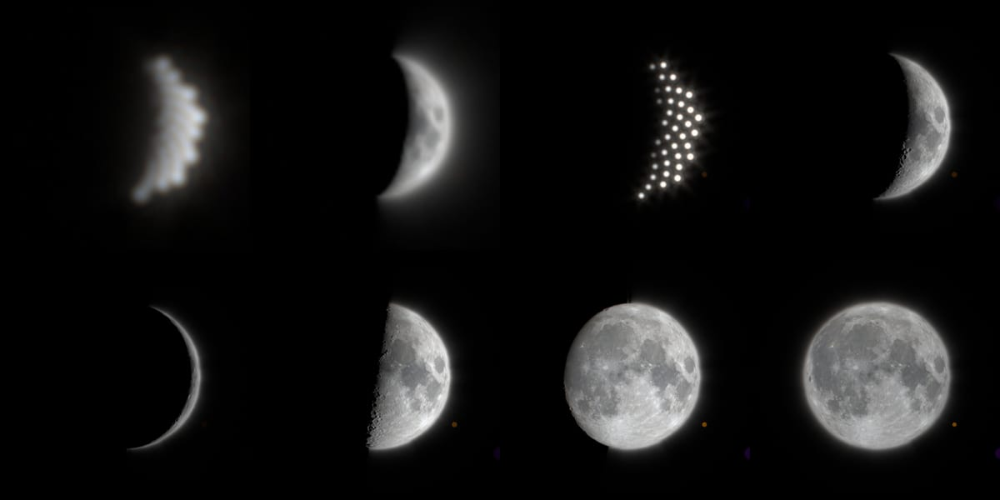
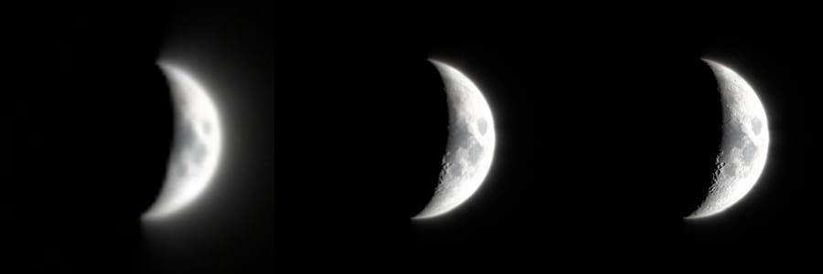

# Resolved lunar surface, 2026-10-16

The Moon was a uniformly lit disk: 128 phase-weighted points, each convolved
with the lens PSF. At 1× its radius is about 4.5 CSS px, and that works. At 5×
(about 22 px) and 20× (about 90 px in an 800 px tall view) the points separate
into visible beads, and there is no surface at all.



Top row: 5× sampled → resolved, 20× sampled → resolved (DPR 2, manual −4 and
−4.5 EV). Bottom row: 20× at phases 30°, 90°, 150° and 180°, set with the
`moon=` parameter. That parameter and the phase slider were removed later the
same day (`55be1ba`); the phase now always follows the date.



Automatic exposure after the glare-pyramid meter (`bde551d`): 5× DPR 1, 20×
DPR 1, 20× DPR 2.

## What changed

- **Resolved pass** (`src/scripts/moon-surface.ts`). Above 5 CSS px in
  radius, a scissored pass draws the Moon as a sphere, blended additively into
  the world buffer before the volume pass. Atmospheric extinction near Earth's
  limb therefore still applies. Between 5 and 9 px it cross-fades with the
  sampled disk. The scene shader skips the 128-sample loop entirely once the
  resolved share reaches 1. The main program already uses all 16 samplers, so
  the pass is separate; it borrows unit 0 and restores Earth's day map.
- **Orientation.** The selenographic frame comes from astronomy-engine's IAU
  rotation (`RotationAxis(Body.Moon)`), converted to the scene's Earth-fixed
  frame with the existing `starToFixed`. Its sub-Earth point matches
  `Libration()` to within 0.03° (tested on four dates), so libration and the
  axis tilt follow. Lighting uses the existing `lunarLight` vector
  (`currentLunarLight`), so the phase follows the date.
- **Surface.** LROC WAC colour and LOLA height from the NASA SVS CGI Moon Kit
  (provenance in `public/media/earthlight/README.md`). The shading uses McEwen's
  lunar-Lambert law: no limb darkening at full Moon, more Lambertian at large
  phase. Relief comes from height gradients over at least one screen pixel.
  Near the terminator (sun elevation below 17°), a 16-step horizon march along
  the great circle toward the Sun includes the sphere's curvature, so peaks
  just past the terminator catch light. The Sun's 0.53° disk sets the penumbra.
  Map fetches use explicit LOD from the projected footprint: implicit
  derivatives are unreliable inside the march and the terminator samples.
- **Lens edge.** The PSF's diffraction edge was measured from
  `optical-psf.bin`: 10–90% over 1.5 px at f/4, 7×10⁻⁴ left at 8 px, nothing
  past about 12 px, the same in all three iris states. A β = 2 Moffat edge
  (a = 0.62 spread) with a Gaussian window reproduces it. The 4% scatter wing
  is the PSF's own Moffat (a = 2 spread). Both scale with the camera's aperture
  state. Both are odd-symmetric about the limb, so they move light without
  adding any. An unwindowed Moffat tail first produced a visible ring around
  an overexposed disk.
- **Terminator anti-aliasing.** Four rotated-grid samples in a 3 px band.

## Flux

The resolved disk is scaled so its integrated flux equals the Lambert disk
that the sampled path convolves. That keeps the auto-exposure meter, the lens
reflections (which use the CPU `lunarFlux`) and Earth's moonlight unchanged.
The scale comes from 2048 equal-area disk points, a bilinear 128 × 64
luminance table shipped in `moon.json`, and the same lunar-Lambert law. It
costs 0.12 ms when its inputs change and is cached otherwise.

GPU integration of the real shader in a float target, against
18 · πR² · ⅔ · Φ(α) (R = 180 px):

| Phase (180 = full) | 20 | 45 | 65 | 90 | 120 | 150 | 180 |
| --- | ---: | ---: | ---: | ---: | ---: | ---: | ---: |
| 2K map, flat | 0.994 | 0.995 | 0.995 | 0.996 | 0.997 | 0.996 | 0.997 |
| 2K map, relief and shadows | 0.969 | 0.989 | 0.993 | 0.997 | 0.996 | 0.996 | 0.997 |

Shadows are not in the normalization. They remove 3% at a thin crescent
(0.045 stop) and under 1% elsewhere. With synthetic albedo the shipped
browser fixture (`scripts/moon-surface-browser-fixture.mjs`, part of
`verify:scene`) agrees within 0.3% at 0°, 60° and 120°. Early builds stored
the map with the sRGB curve while the shader decodes `pow(x, 2.2)`, which
gave +1.3%. The maps are now encoded with a pure 2.2 gamma.

## Loading

- Nothing is fetched at 1× or in the default view. The module (13.1 KB,
  5.5 KB gzip), its shader, `moon.json` (12 KB) and one map load the first time
  a resolved Moon is in front of the camera. The background never constructs
  the pass, and `sceneAssetPlan` never contains a Moon file (tested).
- Map tier: the smallest with one texel per device pixel at the disk centre
  (2πR). 1K (310 KB) at 20× on DPR 1; 2K (1.07 MB) at 20× on DPR 2 in a
  1280 × 800 view; 4K (3.38 MB) only for R > 326 device px. Tiers only
  upgrade. The WebP's alpha channel is the lossless height map and makes up
  about 70% of the bytes (2K: 298 KB RGB, 767 KB alpha).
- The map is uploaded in a single `texImage2D` through the shared upload queue.
  The strip uploader goes through a 2D canvas, which would premultiply the
  height channel. A 4K upload (32 MB) may therefore cost one long frame, but
  only on views that need it.

## Cost

Paired AB/BA GPU frame time from a scratch copy of
`benchmark-candidate-pairs.mjs`, with the candidate being `moonSurface` on
versus `off`: 1440 × 900 CSS, fixed quality, manual −4.5 EV, the example view
at `t=27405.66`, 32 retained pairs. Ratio is candidate/sampled (median, IQR).

| Lens | DPR | Canvas | Map | Sampled | Resolved | Paired ratio (IQR) |
| --- | ---: | --- | --- | ---: | ---: | --- |
| 1× | 1 | 1440 × 900 | none | 4.08 ms | 4.77 ms | 1.036 (0.92–1.09) |
| 5× | 1 | 1440 × 900 | 1K | 4.65 ms | 3.45 ms | 0.840 (0.80–0.89) |
| 20× | 1 | 1440 × 900 | 1K | 5.24 ms | 3.80 ms | 0.733 (0.67–0.79) |
| 5× | 2 | 2771 × 1732 | 1K | 9.09 ms | 8.08 ms | 0.874 (0.84–0.90) |
| 20× | 2 | 2771 × 1732 | 2K | 9.81 ms | 7.02 ms | 0.759 (0.71–0.77) |

Raw pairs: [evidence JSON](evidence/lunar-surface-2026-10-16.json). At 1×
both sides run the identical sampled path; its ratio and wide IQR show the
noise floor. One 20× attempt was rejected by the harness because the lazily
loaded map arrived during sampling and drew an extra frame; the repeat passed.
Earlier runs during development gave 0.80/0.73 (DPR 1) and 0.77/0.735 (DPR 2)
for 5×/20×.

The resolved pass is cheaper than the per-pixel 128-tap convolution it
replaces. At 1× the paths are identical. Desktop only (Apple GPU); phones
not measured.

## Limits

- Exposure. When this work was measured, automatic exposure left a zoomed
  Moon about 4–8 stops over: the point meter rarely sampled it, and the
  automatic floor was −1.5 EV. The surface read well only at manual −4 to
  −5.5 EV, and the cost table above uses manual −4.5 EV. A separate change
  (`2d34ea9`, `bde551d`, see `auto-exposure-zoom-2026-10-16.md`) now meters
  from the glare pyramid and lowers the floor to −3 EV. Rechecked on the
  same view: automatic exposure now keeps maria and terminator craters visible
  at 5× and 20×, at DPR 1 and 2, with only the bright limb near clipping
  (second figure). Because the resolved disk keeps the old disk's flux, the
  meter sees the same light from both paths.
- The resolved pass applies the PSF only at the limb. An overexposed
  terminator therefore has no glow and keeps a one-pixel clipped edge. The
  field-dependent comatic wing is omitted at this scale.
- Earth's limb occludes the resolved Moon with the smooth sphere mask. A
  mountain on the limb does not occlude it.
- Only the `separate` world-buffer profiles use the resolved pass. Float32
  world buffers also need `EXT_float_blend`. The inline profile keeps the
  sampled disk.
- 8-bit heights (78 m) over 5.3 km texels at 2K set the relief scale. Small
  craters are albedo only.
- Polar craters stay dark near the poles because the Sun is always near
  their horizon. This is expected, not a data gap.
- WebP decode with `premultiplyAlpha: 'none'` was checked in Chromium only.

## Reproduce

```bash
bun scripts/build-moon-maps.mjs lroc_color_16bit_srgb_4k.tif ldem_16_uint.tif
```

```bash
bun test scripts/moon-surface.test.mjs
```

Switch: `moonSurface=off` restores the sampled disk at every size.
