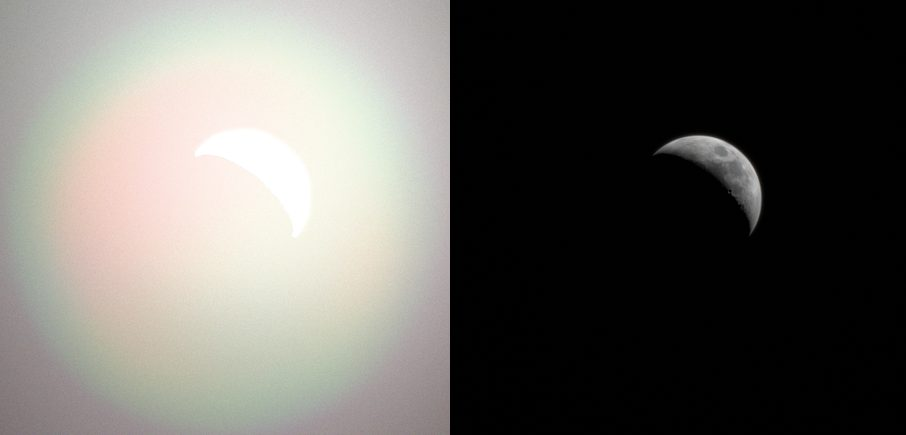

# Meter blend, 2026-10-17

The [pre-exposure lab](pre-exposure-2026-10-17.md) found that in the radiance
ledger's Moon view (lens 20, `night=video`) the pyramid meter amplifies share
errors 30–50 times. Half-float subject shares instead of float32 moved the
settled EV from 16.49 to 16.55, and 0.1% lower shares moved it by about
+0.07. This lab finds the cause and changes how the pyramid meter blends its
two requests. The meter now mixes them as light, not as EV, with weight
(coverage/0.025%)². Every other view keeps its EV.

## Method

Production builds were served by `scripts/preview.mjs` and opened in an
isolated agent-browser session at 1200 × 800. After settled assets, sharp
focus and 12 s, an init script read the meter's state and its 37 × 25 field
from the glare atlas. The pyramid branch of `camera-exposure.ts` was then
replayed in float64 on that field. The replay matches the live state to
0.02 EV, so the result can be split into its terms: the frame target, the
emission target and the coverage blend. Raw values are in
[evidence/meter-blend-2026-10-17.json](evidence/meter-blend-2026-10-17.json).

## Mechanism

It is not a feedback loop. With manual exposure held at 16.3, 16.5 and
16.8 EV, the target replayed from each frame's field is 16.558, 16.554 and
16.552: −0.012 EV per EV. The scene and the shares stay put in scene units.
The settled EV is the open-loop target, and three stages multiply share
errors on the way to it:

1. **The Moon sits in the `METER_LIT` band.** At physical radiance its lit
   pixels peak at 0.083, inside the 0.025–0.10 step. So level-1 lit shares
   are fractional (0–0.8). The 56 subject blocks have input shares of
   0.30–0.61, at the onset of the subject test's `smoothstep(.3,.9)`.
   Lowering level-1 shares by 0.1% lowers the subject area by 0.56%.
2. **Coverage lands low on the blend ramp.** Subjects cover 0.0089% of the
   frame, so the old `smoothstep(.00005,.00025)` weight was 0.10.
3. **The two requests are 19 EV apart.** The frame target is +18.46 (black
   sky) and the emission target −0.45 (the Moon). Mixing EVs linearly with a
   weight of 0.10 put the result at 16.55. The slope was 19 EV × the ramp's
   slope: 8.0 EV per e-fold of coverage.

Combined: 0.1% on level-1 shares gives 0.56% on coverage, and 0.56% × 8
gives +0.045 EV, the live measurement below. The emission target's own
weighting (trust = share², peak = light/max(share, .05)) contributes only
0.0014 EV per 0.1%. The same sensitivity exists in the default program at any
coverage on the ramp. There it peaks at 10 EV per e-fold (requests 8 EV
apart), but no ledger or night view lands on the ramp.

## Change

In the pyramid branch, below full coverage the two requests mix as luminances:

    weight = min(coverage / 0.025%, 1)²
    EV = −log2((1 − weight)·2^−frame + weight·2^−min(frame, emission))

Weight 0 and 1 give exactly the old results. In between, once the subject
dominates, EV = emission − log2(weight): a subject of half the full area is
exposed two stops brighter. The slope is 1.44 × 2 × the subject's share of the
mix, so it never exceeds 2.9 EV per e-fold, however far apart the requests are:

| Requests apart | Worst slope before | After (EV per e-fold of coverage) |
| ---: | ---: | ---: |
| 8.1 EV (default black sky, floor) | 10.0 | 2.87 |
| 19 EV (Moon view) | 23.4 | 2.89 |
| 25.1 EV (physical night, ceiling to floor) | 30.9 | 2.89 |

The point-sample meter keeps its EV ramp. The weight starts at zero coverage
rather than 0.005%. Any onset would put the transition where weight ≈ 2^−gap,
just above the onset, and the slope there grows with the gap. Squaring keeps
specks small: a subject a tenth of full size gets 1% weight.

## Moon view

| Moon view, `night=video` | Before | After |
| --- | ---: | ---: |
| Settled EV (two runs) | 16.548, 16.541 | 2.898, 2.898 |
| Meter-level shares × 0.999 | 16.555, 16.552 (+0.009) | 2.902, 2.902 (+0.003) |
| Level-1 lit shares × 0.999 (propagates through the subject test) | 16.589, 16.589 (+0.045) | 2.915, 2.915 (+0.017) |
| float32 lab build (5e2e5b0) instead of pre-exposed half floats | 16.494, 16.493 (−0.05) | 2.876, 2.877 (−0.022) |

Before, the frame was the 19 EV request diluted by a tenth: a white Moon in a
veil filling the frame. Now the subject dominates the mix and the Moon is
exposed at 2.90, 3.35 stops above its emission target. The share sensitivity
drops 2.7× at every stage. What remains is stage 1, the subject test, which
this change leaves alone. In half floats coverage is 0.7% lower than in
float32, and 2.9 EV per e-fold turns that into 0.02 EV.

## Elsewhere

Metered EV, same views and procedure. Every view but the Moon has coverage 0
or above 0.025% of the frame, where the weight is 0 or 1 as before.

| View | Mode | Coverage | Before | After |
| --- | --- | ---: | ---: | ---: |
| Ledger earthDay | current, video | 83% | −0.732, −0.732 | −0.731, −0.732 |
| Ledger moon (lens 20) | current | 0.91% | −2.999 | −2.999 |
| | video | 0.0089% | 16.548 | 2.897 |
| Moon, lens 10 | current | 0.29% | −2.999 | −2.998 |
| | video | 0.00001% (subject asks for more light) | 17.931 | 17.936 |
| Ledger milkyWay (Moon, lens 5) | current | 0.11% | −2.992 | −2.991 |
| | video | 0 | 17.042 | 17.036 |
| Moon, lens 2 | current, video | 2.8% | 0.972, 1.008 | 0.972, 1.010 |
| Moon, lens 1 | current, video | 9.8% | 0.234, 0.236 | 0.234, 0.235 |
| Ledger cityNight | current | 8.9% | 0.435 | 0.435 |
| | video | 0 | 19.455 | 19.460 |
| Ledger aurora | current, video | 0.65% | −0.622, −0.622 | −0.622, −0.621 |
| Ledger airglowLimb | current, video | 0 | 5.10, 22.10 | 5.10, 22.10 |
| Ledger emptySky | current, video | 0 | 5.10, 22.10 | 5.10, 22.10 |
| night-views full Moon | current | 1.2% | 0.144 | 0.143 |
| | video, still | 0 | 18.690, 18.690 | 18.690, 18.690 |
| night-views new Moon | current | 1.2% | 0.144 | 0.143 |
| | video, still | 0 | 22.10, 22.10 | 22.10, 22.10 |
| night-views quarter Moon | current, video, still | 0 | 5.10, 22.10, 22.10 | 5.10, 22.10, 22.10 |
| night-views Iberia | current | 1.6% | −0.156 | −0.156 |
| | video, still | 0 | 18.294, — | 18.295, 18.295 |

Differences up to 0.006 EV are run-to-run (two runs of the same Moon frame
differ by that). The Iberia still did not load in time in the before run; its
coverage is 0 in every other run and mode, where the rule is unchanged.
`night-views.mjs`' daylit nadir is the ledger's earthDay. Its Iberia
reference uses manual exposure.

## What changes

Subjects below the old 0.005% onset now count with their squared weight. In
the GPU fixture (full chain, 1200 × 800, sky 10⁻⁴, default program):

| Scene | Before | After |
| --- | ---: | ---: |
| Half-lit Moon r = 6 px, radiance 1 | 5.10 | 4.59 |
| Half-lit Moon r = 8 px, radiance 1 | 4.42 | 1.97 |
| Half-lit Moon r = 12 px, radiance 0.08 | 4.74 | 4.08 |
| Half-lit Moon r = 14 px, radiance 0.08 | 3.15 | 2.57 |
| Three 5 × 5 px stars of radiance 50 | 5.10 | 4.86 |
| Three 3 × 3 px stars (existing check) | 5.10 | 5.10 |
| Half-lit Moon r = 20 px, radiance 0.08 (existing check) | 1.00–1.10 | 1.00–1.10 |

Near the old onset the old ramp was flat, so very small subjects there react
more than before. The r = 12 px Moon at 0.08 moves −0.15 EV for 1% more
radiance (−0.08 before). Most of that is stage 1: 1% radiance in the
`METER_LIT` band changes its coverage by about 5%. In physical night the
requests can be 25 EV apart, so a subject of any size outweighs a black sky.
A Moon too small to be a subject at all (lens 5 and 10 above) is unaffected.

`verifyPyramidMeter` gains a check on a synthetic meter field: a subject of
radiance 0.5 at 25, 50 and 75% of full coverage, then 1% larger. With the
change the EV moves −0.023, −0.027 and −0.028. The old blend moved −0.007,
−0.054 and −0.073, so it fails the 0.035 bound.

## Verification

`bun run verify` passes (259 tests, `astro check`, build). `bun run
verify:scene` against the preview of this build passes.

## Next

The remaining amplifier is the subject test. A Moon at physical radiance sits
in the `METER_LIT` band, and its blocks sit at the onset of the 0.3–0.9 share
step. The pre-exposure note already leaves that decision to physical night
becoming the default: express the subject test relative to the exposure, or
move the Moon out of the band. Either would also remove the ~5× coverage
response to radiance and shares.
