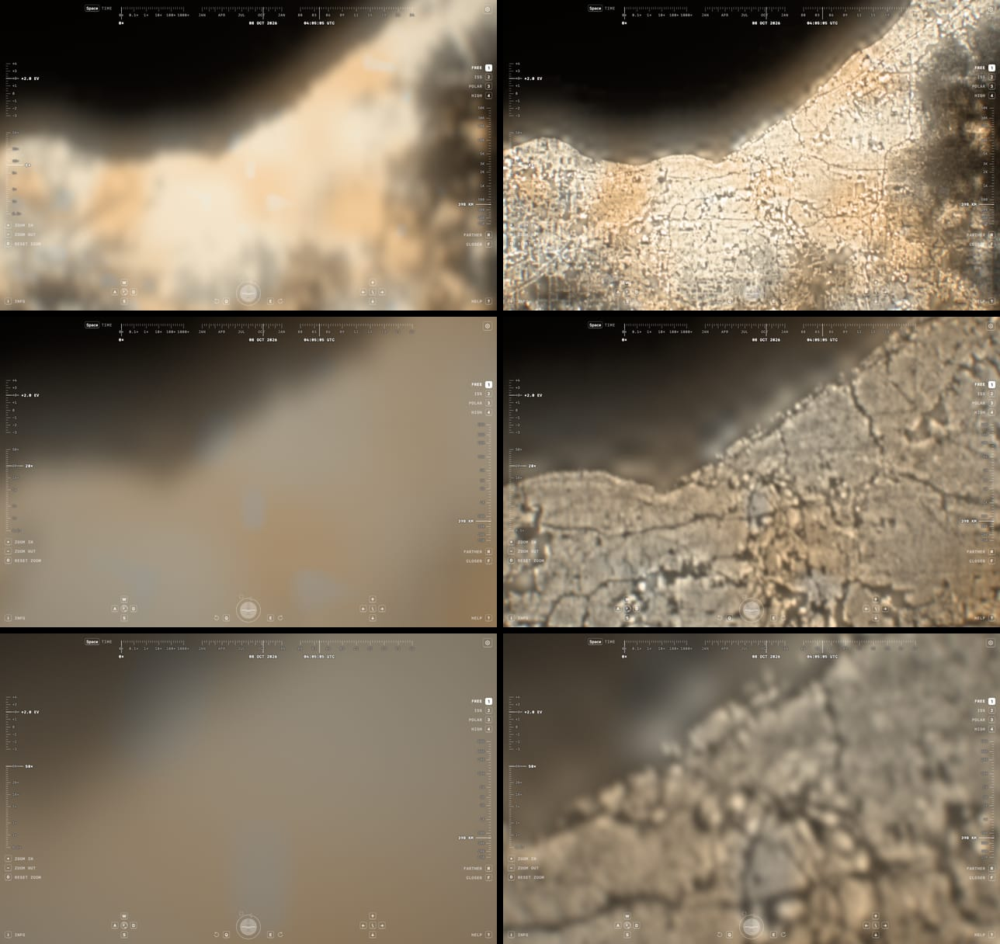
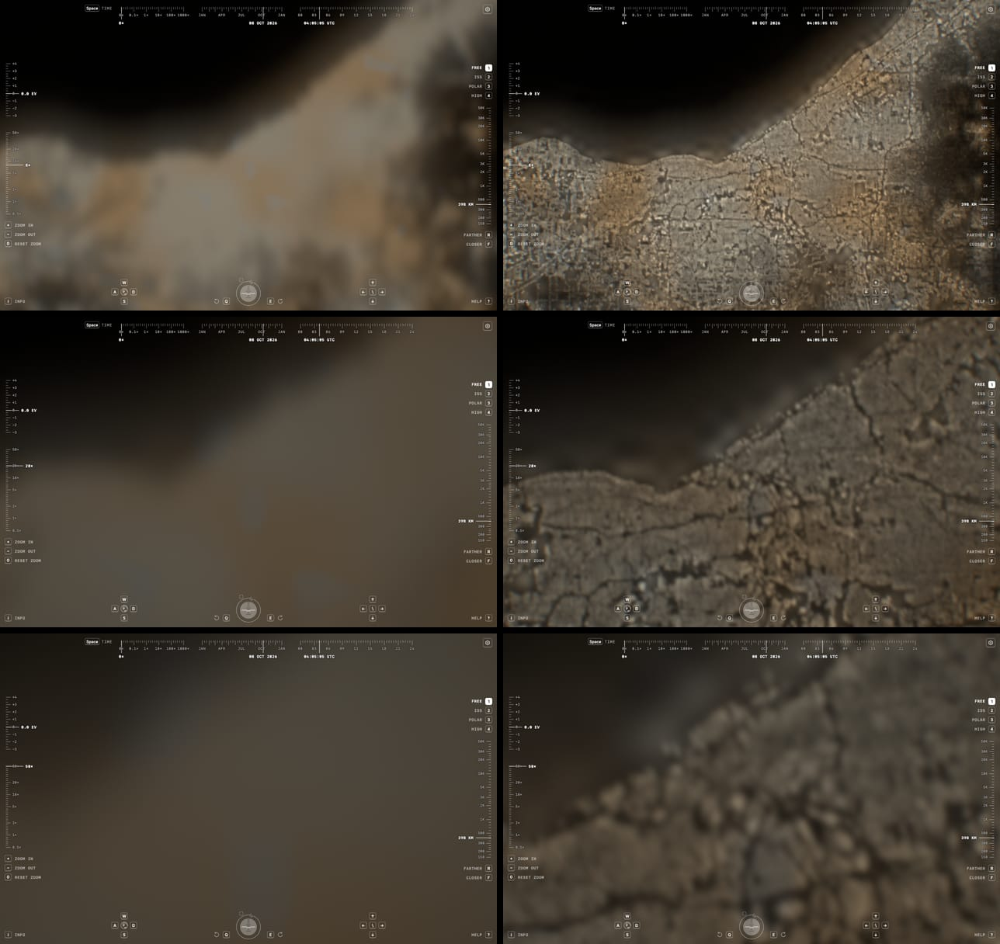
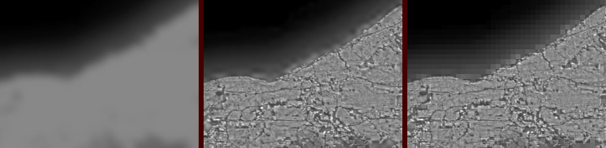

# Built-up night lights, 2026-10-17

Night lights stop at 1 km: Black Marble's 15″ plates carry 30″ samples
(`night-light-reconstruction-2026-10-16.md`), and no global, free night imagery
is finer than about 750 m. This experiment models finer lights for one region:
it spreads each 30″ sample's energy over 3″ pixels in proportion to built-up
surface and keeps every sample's total. It shows **where the measured light
might come from**. It is not measured light.

Verdict: **no-go for built-up surface as the weight.** Totals are conserved and
the renders gain shorelines, rivers and parks. Inside the city, though, they
show the opposite of a night photograph: GHSL measures roofs, so lamps land on
the blocks and the streets go dark. Real long-lens frames show the reverse. The
conservation and rendering machinery are worth keeping for a street-based
weight (see Recommendation).





`/?epoch=2026-10-08T04:00:00Z&t=305.83&flight=free&position=.115,-.7875,.704&heading=0,0,1&elevation=0&roll=0&pitch=-90&motion=0&lens=8&look-exposure=2`,
398 km above Cleveland with Lake Erie at the top, at `lens=8`, `20` and `50`.
The right column adds `nightDetail=built`. 1280 × 800, DPR 1, agent-browser.

## Data

- **Night lights**: the renderer's own night tiles 3403 and 3404 (Black Marble
  2016 grayscale, AVIF). A sample is the mean of its 2 × 2 block, and its energy
  is `encoded^1.3`, the shape of `cityLightEnergy`.
- **Built-up surface**: GHS-BUILT-S R2023A, epoch 2020, the WGS 84 3″ grid
  (`GHS_BUILT_S_E2020_GLOBE_R2023A_4326_3ss_V1_0`), tile R5_C10 only (10° ×
  10°, 47 MB zip, SHA-256 `92454e4f…a1d546`), kept outside the repository.
  Values are square metres of building footprint per cell; the maximum here,
  6,398 m², matches the area of a 3″ cell at 41.5° N (6,426 m²).
- **Licence**: © European Union 1995–2026, CC BY 4.0 under the Commission's
  reuse decision 2011/833/EU, according to the dataset's `copyright.txt`.
  Credit: Pesaresi M., Politis P. (2023), GHS-BUILT-S R2023A, European
  Commission, Joint Research Centre, doi:10.2905/9F06F36F-4B11-47EC-ABB0-4F8B7B1D72EA.
  Changes must be indicated. Both are recorded in the asset README and in the
  build manifest.
- **Not used**: the 10 m GHS-BUILT-S exists only in Mollweide (it would need
  reprojecting), and GHSL has no road layer.

## Method

`scripts/build-night-built.mjs` builds a 204 × 102 sample region
(82.55°–80.85° W, 41.075°–41.925° N; 2,040 × 1,020 pixels at 3″).

1. **Grid.** GHSL's 3″ cells are centred on whole 3″ multiples, so their edges
   are half a pixel off the 30″ grid. Each aligned pixel averages the four GHSL
   cells it overlaps by a quarter. Built-up fraction is footprint / cell area.
2. **Registration.** Night energy and built-up fraction, both aggregated to
   30″, correlate best at zero offset (r = 0.871). One-pixel shifts (6″) score
   0.0004–0.001 lower, so the grids agree to within that step.
3. **Weights.** w = 0.05 + built-up fraction. The floor keeps light where a
   sample is lit but has no buildings: spill over the lake, roads, parking.
4. **Flat redistribution** (the brief's baseline): each pixel gets its sample's
   energy × w / Σw. Totals are exact, but a sample's light per unit of built-up
   surface jumps at every sample edge. Wherever the floor dominates, as in the
   lake spill, the 1 km blocks come back (right panel below).
5. **Smooth redistribution** (rendered): the light per unit of w is a cubic
   B-spline across samples, interpolated **in log space**, and rescaled per
   sample for 48 iterations, pycnophylactic style. A last per-sample factor
   makes every total exact. Interpolating the ratio itself never converged:
   18% of lit samples still needed more than a 2% correction after 120 passes,
   because a positive spline can't pull a dim, barely built sample below its
   bright neighbours. In log space, no lit sample needs more than 2% after
   48 passes, so no step remains.
6. **Storage.** One 8-bit grayscale PNG, 2,048 × 1,028 including a 4-pixel
   margin of real neighbouring data. Concentrated light can be brighter than the
   source's white, so a byte stores `lamp = 4 s²` in the city curve's encoded
   units (energy up to 6×). Quantisation error is diffused within each sample.
   No pixel clips.



## Renderer

`nightDetail=built` (explorer only; `streamDetail` excludes the background):

- `scene-renderer.ts` dynamically imports `night-built.ts`, then compiles the
  scene program with `NIGHT_BUILT` and the layer's GLSL injected after the
  night atlas uniforms. Without the switch, programs, startup and the
  background bundle are unchanged; the night tile shader gains only an
  `#ifdef` hook.
- WebGL 1 leaves no free texture unit. The raster lives in the night tile
  atlas, at rows 6–7, columns 0–3 of the 8 × 8 slots. `SurfaceTiles.reserve`
  keeps tiles out of them (capacity 31 → 25 tile pairs) and refills the raster
  whenever the atlas is reallocated. Atlases smaller than 8 × 8 decline the
  reservation.
- The shader samples the 3″ grid with the same four-tap cubic B-spline as the
  night tiles. Full weight up to 0.3 tile texels per pixel (1.5 fine pixels),
  zero by 0.6, and a 20-pixel fade at the region edge. Minified views keep the
  tiles, because GPU mipmaps of the square-root encoding would not conserve
  energy.

## Results

**Conservation per 30″ sample** in the stored, decoded raster (10,742 samples
with source ≥ 0.02 encoded; below that the source is codec noise):

| | mean | median | p99 | max | clipped pixels |
| --- | --- | --- | --- | --- | --- |
| smooth | 0.012% | 0.008% | 0.063% | 0.15% | 0 |
| flat | 0.012% | 0.008% | 0.053% | 0.11% | 0 |

In the rendered frames, mean linear luminance over the centre 800 × 500 px
(display RGB, after the camera) stays within a few percent:

| lens | current | built | difference | clipped px (built) |
| --- | --- | --- | --- | --- |
| 8× | 0.474 | 0.455 | −3.9% | 3.6% |
| 20× | 0.241 | 0.243 | +1.0% | 0 |
| 50× | 0.219 | 0.226 | +3.6% | 0 |

The interpolation runs on `s`, not on energy, and the camera tone curve is
nonlinear. At 8× the concentrated cores clip.

**Appearance.**

- 8×: the shoreline becomes a line instead of a 2 km glow. The Cuyahoga valley,
  the lakefront airport, parks and rail yards go dark, and suburbs break into
  blocks. The lake spill stays a soft gradient.
- 20×: the same structure, slightly soft (3″ is about 2.5 px).
- 50×: soft again. A 3″ pixel spans about 6 px north–south and 4.5 px
  east–west, and the spline blurs over two of them. Resolving streets at 50×
  would need roughly 10 m data.

**Against ISS photographs** (viewed in a browser, not committed):
[ISS034-E-44575](https://images.nasa.gov/details/iss034e044575), Cleveland,
10 February 2013, and [ISS074-E-334264](https://images.nasa.gov/details/iss074e0334264),
Detroit, 27 February 2026, Nikon Z 9 at 200 mm. In both, light follows the
arterial grid and highways as bright lines (sodium orange in 2013, mostly
white LED by 2026). Blocks between them are dark, and commercial and industrial
sites are bright points. The model inverts this. In Lakewood (lower left at 8×)
the street grid shows as dark lines between lit blocks, and freeways read as
dark seams. The model gets right what has no buildings: water, rivers, parks
and the shoreline. Inside the city it ranks light by roof area, and that is not
where night light comes from at 100 m.

## Cost

- **Bytes**: the PNG is 1,175,272 bytes for 1.7° × 0.85°. WebP lossless would be
  586,628 and AVIF lossless 1,108,795. Lossy AVIF q80 (155,425) would undo the
  per-sample conservation. Plus a 2.5 KB manifest. Two fetches, only with the
  switch.
- **GPU**: no new allocation. 2.1 MB of the existing 20.9 MB night atlas, at the
  cost of six resident tile pairs. Shader: four bilinear atlas fetches and about
  30 ALU operations per ground pixel, only inside the region and only while
  magnified. Frame time was not measured; the scene program does far more work
  per pixel elsewhere.
- **Build**: 4.5 s for the region in Bun, after a 47 MB GHSL tile download.
- **Scale, for reference**: at 3″ one 2.25° night tile is 2,700² pixels. A world set would be thousands of such tiles plus a
  second page table, so it needs its own streaming layer, not atlas rows.

## Recommendation

- **No-go** for GHS-BUILT-S as the redistribution weight. Keep
  `nightDetail=built` as a lab switch. Publish nothing; `assets:prepare` skips
  `night-built/`.
- **Keep the method**: a log-space pycnophylactic spline with per-sample
  rescaling. It conserves to 8-bit precision without steps, and the atlas
  reservation renders a regional raster without a texture unit.
- **Next weight to try**: street lighting. Rasterise OpenStreetMap roads at 3″
  (or finer), weighted by class (motorway, trunk and primary above residential),
  plus GHSL's non-residential surface (`GHS_BUILT_S_NRES`) for the bright
  commercial and industrial points, with the same floor. OpenStreetMap is
  ODbL. A rendered image is a Produced Work that needs attribution, but a
  derived raster that is distributed may count as a Derivative Database under
  share-alike. Check that before publishing assets.
- Resolution beyond 3″ only matters once the weight is right. At 50× the
  frame wants about 10 m.
- Follow-up: `night-streets-2026-10-17.md` tries the street-lighting weight
  (`nightDetail=streets`).

## Reproduce

```sh
curl -LO https://jeodpp.jrc.ec.europa.eu/ftp/jrc-opendata/GHSL/GHS_BUILT_S_GLOBE_R2023A/GHS_BUILT_S_E2020_GLOBE_R2023A_4326_3ss/V1-0/tiles/GHS_BUILT_S_E2020_GLOBE_R2023A_4326_3ss_V1_0_R5_C10.zip
unzip GHS_BUILT_S_E2020_GLOBE_R2023A_4326_3ss_V1_0_R5_C10.zip -d /tmp/ghsl
bun scripts/build-night-built.mjs /tmp/ghsl/GHS_BUILT_S_E2020_GLOBE_R2023A_4326_3ss_V1_0_R5_C10.tif
```

Keep the download outside the repository. The night tiles must be present
under `public/media/earthlight/night-tiles`. `--floor=` and
`--iterations=` override the defaults. Then open the reference URL with
`&nightDetail=built`.
