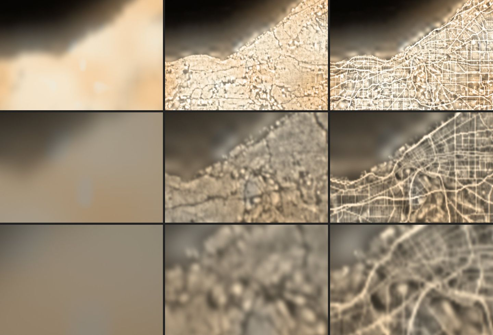
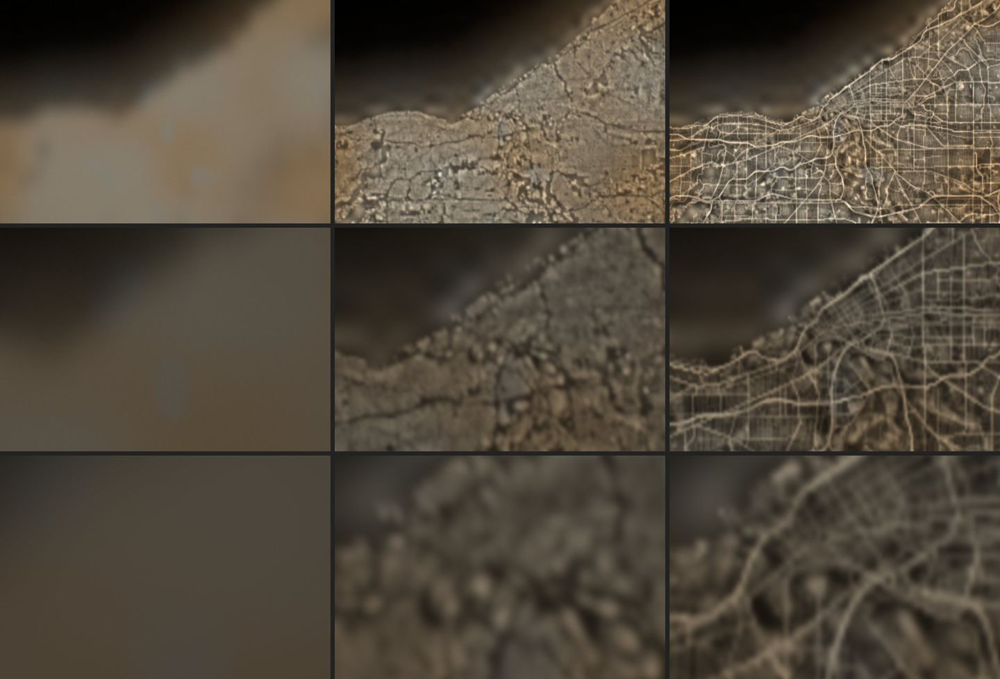
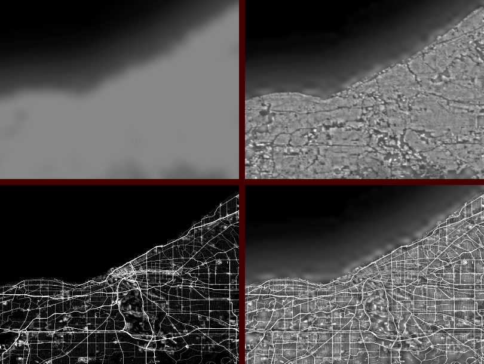

# Street-lighting night lights, 2026-10-17

The follow-up to `night-built-up-2026-10-17.md`. The same region, grid,
log-space pycnophylactic spline and atlas reservation, with a different weight:
each Black Marble 30″ sample's energy now follows **street lighting**.
OpenStreetMap roads, weighted by class, plus GHSL's non-residential surface
supply the bright commercial and industrial sites. As before, this shows where
the measured light **might come from**. It is not measured light.

Verdict: **go for street lighting as the redistribution weight, no-go for
release as it stands.** Inside the city the frames now have the structure of
ISS long-lens photographs: arterials, freeways and the downtown grid are lit
lines with darker blocks between them. That is the inverse of the built-up
weight. Totals stay exact. What blocks release is outside the weight: an ODbL
derived database that a CC BY asset set can't absorb as is (see Licence), a
3″ grid that is still soft at 50×, and one region. Keep `nightDetail=streets` as
the lab's best weight. Publish nothing.





`/?epoch=2026-10-08T04:00:00Z&t=305.83&flight=free&position=.115,-.7875,.704&heading=0,0,1&elevation=0&roll=0&pitch=-90&motion=0&lens=8&look-exposure=2&hud=0`,
398 km above Cleveland with Lake Erie at the top, at `lens=8`, `20` and `50`.
Columns: no switch, `nightDetail=built`, `nightDetail=streets`. Each panel is
the centre 620 × 420 px of a 1280 × 800 frame (DPR 1, agent-browser). The
renders need the B-spline night tiles and `LENS_MAX=50`. Neither had landed on
`main` at the time of writing, so they were applied uncommitted, exactly as for
the built-up lab.

## Data

- **Night lights**: the renderer's night tiles 3403 and 3404, read as in the
  built-up lab: the sample is the 2 × 2 block mean, and energy = `encoded^1.3`.
- **Roads**: OpenStreetMap `highway` ways in 41.06°–41.94° N,
  82.56°–80.84° W, fetched from the Overpass API in four quadrant queries with
  `out geom`. The OSM base is 2026-10-16T21:40:36Z, giving 318,938 ways and
  239 MB of JSON, kept outside the repository. The query:

  ```
  [out:json][timeout:300];
  way[highway~"^(motorway|motorway_link|trunk|trunk_link|primary|primary_link|secondary|secondary_link|tertiary|tertiary_link|unclassified|residential|living_street|service)$"](S,W,N,E);
  out geom qt;
  ```

  The manifest records each file's SHA-256.
- **Non-residential surface**: GHS-BUILT-S R2023A NRES, epoch 2020, the WGS 84
  3″ grid (`GHS_BUILT_S_NRES_E2020_GLOBE_R2023A_4326_3ss_V1_0`), tile R5_C10
  only. The zip is 6.4 MB, SHA-256 `7c88cbd2…8b41f147`; the TIFF is
  `7545d5d2…8a1b31b5`. It shares the total built-up layer's grid, phase and
  licence (© European Union 1995–2026, CC BY 4.0; credit
  doi:10.2905/9F06F36F-4B11-47EC-ABB0-4F8B7B1D72EA).

## Method

`scripts/build-night-built.mjs --weight=streets`. The default `--weight=built`
still reproduces the earlier lab's `cleveland-smooth.png` byte for byte
(SHA-256 `70e8132a…3a6646f1`).

1. **Roads to lit length.** Each way is walked in steps of at most 5 m. A step
   adds `length × class × 40 m` to the 3″ pixel holding its midpoint. Divided by
   the pixel's area, that is a lit fraction on the same scale as built-up
   surface: one arterial crossing a pixel (about 80 m) scores about 0.5. Dual
   carriageways are mapped as two ways and count twice.

   | class | weight |
   | --- | --- |
   | motorway, trunk, primary | 1 |
   | secondary | 0.7 |
   | tertiary, motorway/trunk/primary links | 0.5 |
   | secondary and tertiary links | 0.4, 0.3 |
   | residential, unclassified, living street | 0.1 (`--residential=`) |
   | service: parking aisle, drive-through | 0.3 |
   | service: other, alley | 0.1 |
   | service: driveway | 0 |

   Lit length in the region: 186,702 ways. Residential 15,915 km, lit service
   12,550 km, tertiary 4,297, secondary 1,958, motorway 1,699, primary 1,666,
   unclassified 1,115, motorway links 518, trunk 273. The classes rank roads;
   they don't measure them. Only 1,482 of the 186,705 non-driveway ways
   (0.8%) carry `lit=*` (1,114 yes, 368 no), so the ranking is a prior, not
   an observation.
2. **Commercial and industrial sites.** Plus `1 ×` the GHSL NRES fraction
   (`--nres=`), resampled exactly like the built-up layer.
3. **Weight.** w = 0.05 (the existing floor) + roads + NRES.
4. **Redistribution, storage, renderer**: unchanged. Log-space B-spline of light
   per unit weight, 48 pycnophylactic passes, a final per-sample factor,
   8-bit `lamp = 4 s²` with error diffusion within each sample. The raster
   goes in the same reserved night-atlas rows. `nightDetail=streets` loads
   `night-streets/` instead of `night-built/`, and the layer refuses a manifest
   whose `weight` doesn't match.

Registration: NRES plus roads, aggregated to 30″, still correlates best within
one 6″ step of zero offset (r = 0.748 at zero, 0.749 one pixel east).

**Residential weight and floor.** A first pass with residential at 0.25 lit
the blocks too evenly at 8×: a grey wash under a fine grid. In Detroit's 2026
frame the mile roads and radial avenues carry nearly all the light, and the
blocks between them are close to black. At 0.1 the arterials lead and the
residential grid still shows faintly, as it does in Cleveland's 2013 sodium
frame. On the street-to-block ratio below, that step moves only 6.6 to 7.0.
The floor matters more: 0.02 instead of 0.05 raises the ratio to 10.3. It also
pushes 743 pixels to the 8-bit ceiling and the worst sample's error to 2.3%,
because the light piles onto fewer pixels. The rendered variant keeps the
existing floor of 0.05. A lower floor needs more storage headroom first (see
Recommendation).



## Results

**Conservation per 30″ sample** in the stored, decoded raster. The samples are
the same 10,742 with source ≥ 0.02 encoded:

| | mean | median | p99 | max | clipped pixels |
| --- | --- | --- | --- | --- | --- |
| built, smooth (earlier lab) | 0.012% | 0.008% | 0.063% | 0.15% | 0 |
| streets, smooth | 0.012% | 0.007% | 0.067% | 0.65% | 172 |
| streets, flat | 0.012% | 0.007% | 0.060% | 1.87% | 263 |

Concentrating light onto lines needs more headroom than spreading it over roofs:
172 pixels reach the 8-bit ceiling (6× the source's white). The worst sample is
off by 0.65%. After 48 passes, 0.15% of lit samples still need a final factor
above 2% and none above 5%, so no visible step remains. A larger storage gain should
reduce the clipping, at the cost of a little precision at the dim end (not
tested).

**Street-to-block contrast** in the raster, inside the lit city (s ≥ 0.3):
mean energy on pixels whose street weight is above 0.4, over pixels below 0.05.

| | streets | block interiors | ratio |
| --- | --- | --- | --- |
| source B-spline | 0.79 | 0.59 | 1.35 |
| built | 0.87 | 0.53 | 1.63 |
| streets | 2.31 | 0.33 | 7.0 |

**Rendered frames**: mean linear luminance over the centre 800 × 500 px
(display RGB, after the camera), with the share of pixels clipped in any channel.

| lens | EV | current | built | streets | clipped (streets) |
| --- | --- | --- | --- | --- | --- |
| 8× | +2 | 0.474 | 0.455 | 0.417 | 9.6% |
| 20× | +2 | 0.241 | 0.243 | 0.240 | 0.1% |
| 50× | +2 | 0.218 | 0.226 | 0.223 | 0 |
| 8× | 0 | 0.119 | 0.122 | 0.119 | 0 |
| 20× | 0 | 0.060 | 0.061 | 0.060 | 0 |
| 50× | 0 | 0.055 | 0.056 | 0.056 | 0 |

At 0 EV, nothing clips and every lens stays within 2% of the current
reconstruction. At +2 EV and 8×, the arterials saturate in the camera, and the
mean falls 12% because clipped light is lost. That comes from the exposure, not
from conservation.

**Appearance.**

- 8×: the arterial grid of Cleveland, Lakewood and the east side is visible as
  lines. Freeway curves are the brightest strokes. NRES adds bright patches
  at commercial and industrial sites. The industrial valley of the Cuyahoga
  south of downtown averages 0.096 non-residential fraction, against 0.022
  in Lakewood's residential blocks. Parks and the lake stay dark, as with the
  built-up weight.
- 20×: the clearest gain. Individual arterials and the downtown street grid
  resolve, and blocks are dimmer than the streets around them.
- 50×: the lines are there but soft. A 3″ pixel is still 4.5–6 px, and the
  spline blurs over two of them. Thin roads read as 10–15 px wide glows.

**Against ISS photographs** (viewed in a browser, not committed):
[ISS034-E-44575](https://images.nasa.gov/details/iss034e044575), Cleveland,
February 2013, and
[ISS074-E-334264](https://images.nasa.gov/details/iss074e0334264), Detroit,
February 2026.

- Matches: the light is on the arterial grid and the freeways, blocks are
  darker than their streets, and downtown and the industrial flats are the
  brightest areas. Water, rivers and parks are dark. This is the structure the
  built-up weight inverted.
- Still off:
  - Contrast. Blocks in both photographs, Detroit's LED frame most of all, are
    darker than the model's 7:1 allows. Part of that is the 3″ grid (an
    arterial and the houses beside it share a pixel), and part is the floor.
  - Colour. The photographs separate orange sodium streets from white LED
    commercial points. The model has one luminance channel and the renderer's
    single city colour, so NRES points are brighter but not whiter.
  - Suburbs. Lit-length rank gives every residential street the same light. In
    the photographs, outer suburbs are much darker per kilometre of road than
    the inner city, which the source samples only partly correct.
  - Freeways weigh as much as arterials, or twice as much where both
    carriageways are mapped. In the 2026 Detroit frame the mile roads and
    radial avenues lead, and freeways are no brighter than them.

## Licence: OpenStreetMap and the ODbL

From the ODbL 1.0 text and the OSMF community guidelines (Produced Work,
Substantial, Attribution), read on 2026-10-17. This is a reading, not legal
advice.

- **Substantial.** The guideline treats fewer than 100 features, or an area of
  up to about 1,000 inhabitants, as insubstantial ("village map OK, town map not
  OK"). This uses 186,702 ways across a metro area, which is substantial, so
  the ODbL applies.
- **Rendered images are Produced Works** (ODbL §1, OSMF guideline: "any raster
  image" is usually one). Publicly using one needs a notice that the data comes
  from OpenStreetMap under the ODbL (§4.3). The attribution guideline asks for
  "© OpenStreetMap contributors" with a link to openstreetmap.org/copyright,
  near the image or in the credits. Producing a work doesn't itself create a
  Derivative Database (§4.5). The frames in this note fall under that, which is
  why this note credits OSM.
- **The distributed raster is a Derivative Database.** The guideline's test: a
  result "intended for the extraction of the original data" is a database,
  not a Produced Work. `cleveland-smooth.png` is not a picture for people. It is
  a grid of values the shader samples as data, and with the class table and
  the manifest the road weight can be recovered from it by dividing out the
  source, approximately. It is a database based upon OSM (§1 "Derivative
  Database").
  Publicly using it, or any image produced from it, means:
  - **Share-alike, §4.4.** The raster must be offered under the ODbL (or a
    compatible licence) only. It can't sit in the R2 manifest under the CC BY
    and public-domain terms the other assets use. Its GHSL input is CC BY 4.0,
    so the combined raster would carry both sets of terms: ODbL for the
    database, plus the JRC credit and change notice.
  - **Offer the database or the method, §4.6.** A machine-readable copy of the
    derived database, or of the alterations or the algorithm, free of charge
    over the internet. The build script, the Overpass query, the OSM timestamp
    and the manifest are that method. They would have to ship beside the asset,
    not only in this repository.
  - **Attribution, §4.2 / guideline.** Name OpenStreetMap and the ODbL in the
    database's own notice (README, manifest) and in the explorer's Image
    Credits whenever the switch is on. `nightDetail=streets` adds no credit
    today. It is a local lab switch with an unpublished raster.
- **Avoiding share-alike.** Two layers drawn side by side, without merging
  their data, would form a Collective Database (§4.5). Here the road weight
  sets every pixel's share of Black Marble's energy, so the two are merged.
  There is no way to ship this raster outside the ODbL. The alternative is to
  build it on the client from a separately licensed road layer, which moves the
  cost to the browser.

## Cost

- **Bytes**: the PNG is 1,257,312 bytes (WebP lossless 704,084), about 7% larger
  than the built-up raster. The manifest is 4 KB.
- **GPU and shader**: identical to `nightDetail=built`.
- **Build**: 12.5 s for the region in Bun, after a 239 MB Overpass download and
  a 6.4 MB GHSL tile. The JSON parse dominates. For more regions, a PBF extract
  with a streaming parser would replace Overpass, whose public instance is not
  meant for bulk downloads.

## Recommendation

- **Go** for street lighting (OSM roads by class plus GHSL NRES) as the
  redistribution weight. It replaces built-up surface as the lab's reference.
  `nightDetail=streets` is the switch, and `nightDetail=built` stays for
  comparison.
- **No-go for release now.** Publishing the raster makes it an ODbL Derivative
  Database. First decide whether the asset set may carry an ODbL member with
  its own notice, shipped method and Image Credits line. That is the owner's
  decision.
- Before any release, in order:
  1. Raise the storage gain (lamp up to 6 instead of 4, untested) for the
     172 clipped pixels.
  2. Then lower the floor to about 0.02 (ratio 7.0 → 10.3). Contrast is the
     remaining gap to the photographs.
  3. Go to 1″ (30 m) to sharpen 50×. The 3″ grid is now the limit, not the
     weight.
  4. Calibrate the class weights against at least one more city frame (Detroit
     is in R5_C10 too).
- A white/orange split (NRES and LED-era arterials against sodium residential)
  would need a second channel, which the luminance atlas doesn't have.

## Reproduce

```sh
# GHSL NRES, tile R5_C10 (keep outside the repository)
curl -LO https://jeodpp.jrc.ec.europa.eu/ftp/jrc-opendata/GHSL/GHS_BUILT_S_GLOBE_R2023A/GHS_BUILT_S_NRES_E2020_GLOBE_R2023A_4326_3ss/V1-0/tiles/GHS_BUILT_S_NRES_E2020_GLOBE_R2023A_4326_3ss_V1_0_R5_C10.zip
unzip GHS_BUILT_S_NRES_E2020_GLOBE_R2023A_4326_3ss_V1_0_R5_C10.zip -d /tmp/ghsl-nres
# OSM roads: the query above for each quadrant into /tmp/osm/roads-N.json
#   41.06,-82.56,41.50,-81.70  41.06,-81.70,41.50,-80.84
#   41.50,-82.56,41.94,-81.70  41.50,-81.70,41.94,-80.84
curl --data-urlencode "data=$QUERY" https://overpass-api.de/api/interpreter -o /tmp/osm/roads-1.json
bun scripts/build-night-built.mjs --weight=streets --roads=/tmp/osm /tmp/ghsl-nres/GHS_BUILT_S_NRES_E2020_GLOBE_R2023A_4326_3ss_V1_0_R5_C10.tif
```

The output goes to `public/media/earthlight/night-streets/`, which
`assets:prepare` skips. `--residential=`, `--nres=`, `--floor=` and
`--iterations=` override the defaults. Overpass returns the current OSM, so
a rebuild differs from this one unless an extract at the recorded timestamp is
used. Open the reference URL with `&nightDetail=streets`.
