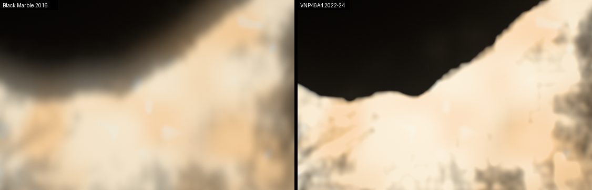
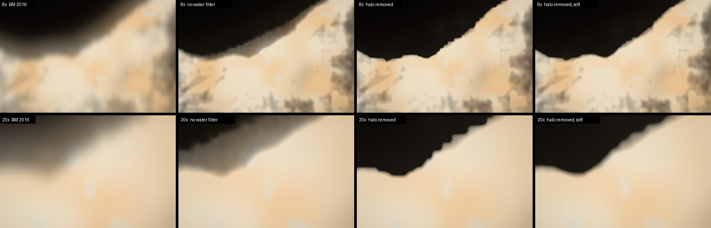
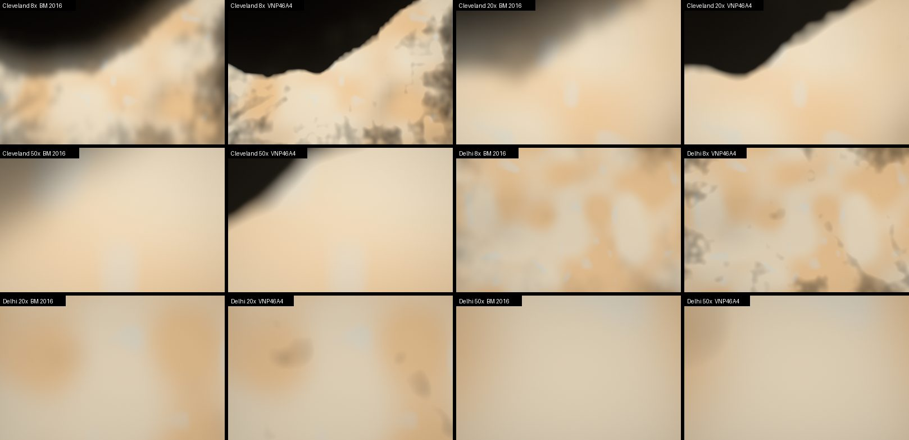
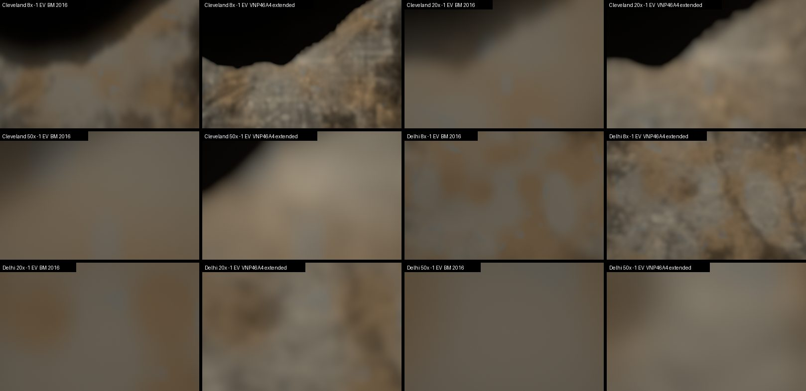
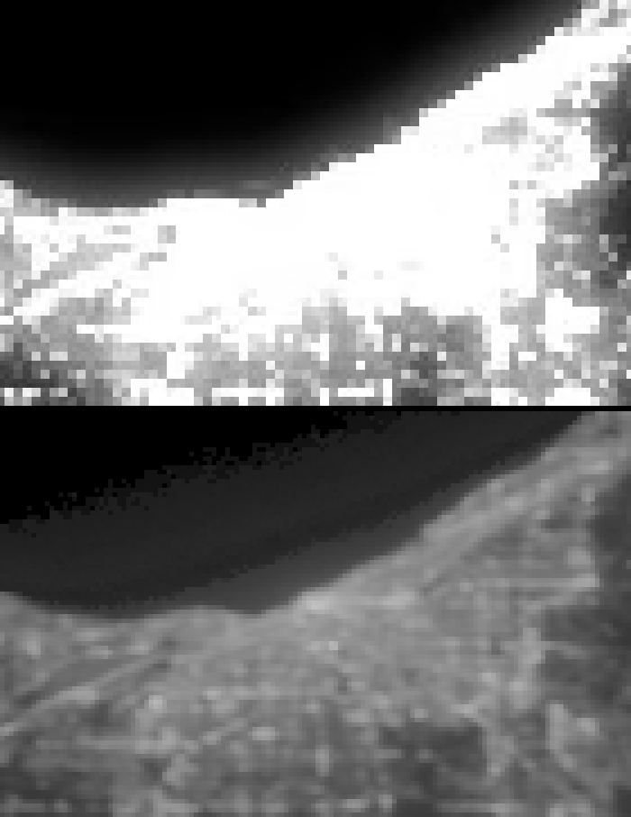

# Measured night lights: Black Marble VNP46A4, 2026-10-17

Can NASA's annual Black Marble composite (VNP46A4 / VJ146A4, Collection 2)
replace the Black Marble 2016 grayscale plates under the night tiles? One
region (Cleveland and Lake Erie) and one megacity (Delhi) were built behind a
URL switch, `nightDetail=vnp46`, and compared with the current map.

**Verdict: go, with the overview rebuilt alongside.** The composite is a
measured radiance on the same 15″ grid. Its 15″ samples are independent: no
2 × 2 repetition, and the detail below 30″ repeats between the two satellites.
It keeps two more decades of range than the 2016 plates, which clip at
about 23 nW cm⁻² sr⁻¹. Mapped onto the 2016 display scale, scene radiance
stays within 6% (p99) and 14% (p90) of today's values, so the photometric
ledger holds. A global set in the current tile format is an estimated
26–46 MB. That is less than a tenth of the 0.3–1 GB expected, because it is
still one 8-bit channel per texel. The 742 m footprint still does not resolve
streets: at 50× a city is a soft glow in both maps.



`/?epoch=2026-10-08T04:00:00Z&t=305.83&flight=free&position=.115,-.7875,.704&heading=0,0,1&elevation=0&roll=0&pitch=-90&motion=0&lens=8&look-exposure=2&nightDetail=vnp46`

## Source

- **Products.** VNP46A4 (Suomi NPP) and VJ146A4 (NOAA-20), Collection 2
  (LAADS collection 5200), "VIIRS Lunar BRDF-Adjusted Nighttime Lights
  Yearly L3 Global 15 arc second Linear Lat Lon Grid". DOIs
  [10.5067/VIIRS/VNP46A4.002](https://doi.org/10.5067/VIIRS/VNP46A4.002) and
  [10.5067/VIIRS/VJ146A4.002](https://doi.org/10.5067/VIIRS/VJ146A4.002).
  Product suite: Román et al. 2018, *Remote Sensing of Environment* 210,
  113–143, [doi:10.1016/j.rse.2018.03.017](https://doi.org/10.1016/j.rse.2018.03.017).
  The NOAA-21 product (VJ246A4) is not published yet; the annual granules'
  platform field already provides for it.
- **Granules.** 2022, 2023 and 2024 for both satellites, tiles h09v04
  (90–80° W, 40–50° N) and h25v06 (70–80° E, 20–30° N): twelve HDF5 files,
  1.82 GB, kept outside the repository. Checksums, production times and input
  counts are in `night-vnp46-tiles/manifest.json` (`sources`).
- **Access.** LAADS needs an Earthdata login token. It also asks each
  account, once, to accept terms for these products before downloading. The
  owner did both. The text of those terms was not recorded here, so check it
  before a global build or a release. NASA Earth science data are otherwise
  open, with citation requested.
- **Layer.** `AllAngle_Composite_Snow_Free`, which uses the most observations
  (120–230 nights per pixel and year here). `AllAngle_Composite_Snow_Covered`
  fills a pixel only if the snow-free one is missing; that happened nowhere in
  these two tiles. The result is the median of the six annual values.

## Effective resolution

Measured as in [night-light-reconstruction-2026-10-16](night-light-reconstruction-2026-10-16.md),
on the full 2400 × 2400 tiles (`scripts/vnp46-measure.py`):

| | Cleveland | Delhi |
| --- | ---: | ---: |
| Shift to the 2016 grid (correlation peak) | 0, 0 px | 0, 0 px |
| Gradient share between texels 2k, 2k+1: 2016 plates | 0.88 / 0.89 | 0.89 / 0.90 |
| Same, VNP46A4 (x / y) | 0.50 / 0.50 | 0.50 / 0.50 |
| Below-30″ RMS on the 2016 scale, 2016 plates on their block phase | 0.012 | 0.012 |
| Same, VNP46A4 | 0.100 | 0.080 |
| Below-30″ component, SNPP vs NOAA-20 correlation | 0.958 | 0.968 |
| High-pass correlation, lag 1 / 2 px, x | 0.70 / 0.20 | 0.61 / 0.00 |
| High-pass correlation, lag 1 / 2 px, y | 0.50 / −0.20 | 0.52 / −0.17 |

- The 2016 plates are 30″ data. Under 2 × 2 averaging aligned to their own
  blocks they lose only codec noise. VNP46A4 has no block phase at all.
- Its detail below 30″ is signal, not noise. Two independent instruments
  reproduce it with r ≈ 0.96, while their overall difference has an RMS of
  0.13–0.17 in log radiance.
- Neighbouring samples are correlated (0.5–0.7) and those two apart are not:
  the 742 m footprint over 15″ texels of 350–460 m. The effective resolution
  lies between 15″ and 30″, roughly the footprint.
- **`sampleSpacing` is 1** for these tiles. The B-spline interpolates level 0
  and reaches full weight at one pixel per texel (`NIGHT_VNP46` in
  `src/scripts/night-tiles.ts`).

## Radiance and city energy

The overview map, city uplight, haze and `cityLightEnergy` all expect the
2016 plates' display scale. The tiles therefore carry measured radiance, and
the shader converts it once, after filtering:

- **Code.** `code = 255 ln(1 + L/0.25) / ln(1 + 5000/0.25)`, L in
  nW cm⁻² sr⁻¹. One step is 3.9% of radiance. Round-trip error before
  compression is 1.1% median and 2.3% at p99.
- **Transfer to the 2016 scale.** A fit to co-located 30″ blocks in both
  regions: `e = 0.328 ln(1 + (L/1.089)^6.84) / 6.84`. That is a soft toe
  near 1 nW, then 0.328 ln(L/1.089), so 1 in the 2016 scale is about 23 nW.
  The fit's RMS over 34 bins is 0.021. The two cities disagree: an encoded
  0.5 matches 6.3 nW in Cleveland but 2.3 nW in Delhi. That is six years of
  real change plus processing, so the new map will not look like the old one
  everywhere.
- **The 2016 plates clip.** Above ~23 nW every 2016 pixel is saturated. That
  covers about 18,000 30″ blocks in Cleveland's tile, whose brightest pixel
  reaches 2,500 nW, and about 16,000 in Delhi's, which reaches 620 nW. The default switch keeps the same
  ceiling. `nightRange=extended` continues the slope instead.

Scene radiance over the frame (the ledger hook from
`scripts/radiance-ledger.mjs`, 1200 × 800, nadir):

| View | 2016 p90 / p99 | VNP46A4 p90 / p99 | extended p99 |
| --- | ---: | ---: | ---: |
| Cleveland 1× | 0.075 / 0.227 | 0.076 / 0.241 | 0.283 |
| Cleveland 8× | 0.249 / 0.272 | 0.257 / 0.273 | 0.406 |
| Delhi 1× | 0.091 / 0.215 | 0.078 / 0.216 | 0.244 |
| Delhi 8× | 0.224 / 0.238 | 0.227 / 0.244 | 0.350 |

With the shared ceiling the ledger holds: p99 is within 6%, p90 within 14%.
The extended range raises p99 by 13–50% with the current curve. The
[ledger](radiance-ledger-2026-10-16.md) puts city cores ~4 × 10³ too bright,
and bringing them down is a separate effort. These tiles give it what it
needs: the shader can take `L` directly, since
0.0036–0.0059 cd m⁻² per nW cm⁻² sr⁻¹ divided by `SCENE_CANDELA` gives
6–10 × 10⁻⁸ scene units per nW. Nothing here changes the curve.

## Filters

Every filter is applied in `scripts/vnp46-composite.py`; the totals are in each
tile's manifest entry.

- **Ephemeral light and fires.** Nothing is added. The annual composite is
  already robust: within a year the per-pixel std/mean stays under 1.1 at
  p99.9, with 120–230 observations per pixel, so no pixel is dominated by a
  short fire. The six-composite median then removes light present in only
  one or two years. 167 (Cleveland) and 277 (Delhi) pixels had one composite
  more than 10× their median; their medians are 0.8–1.2 nW. The Delhi tile
  includes the southern part of the Punjab and Haryana crop-burning belt.
- **Gas flares** are persistent light sources and stay in, as in the 2016
  plates. There are none in these two tiles. A global build should compare
  against the VIIRS Nightfire flare catalogue before deciding otherwise.
- **Dark floor.** Below 0.5 nW the composite is airglow, moonlight residual
  and noise; on the 2016 scale it would be under 0.2%. Setting it to 0 removes
  1.0% (Cleveland) and 1.7% (Delhi) of the tile's radiance sum, and leaves
  dark land empty so sparse tiles stay sparse.
- **Water.** Over open water (land/water classes 2 and 3; the coastal class 5
  is untouched), radiance near a bright shore falls with distance like a
  sensor halo. At 1 px offshore it is a median 5% of the shore (p90 10%); at
  6 px, 1.7% (p90 4.4%); by 20 px, below 1%. Through the 2016 scale's log
  curve, 5% of a 1,000 nW downtown saturates, which reads as a lit lake. The
  filter subtracts the p90 envelope, `0.10 d^−0.6` times the brightest land
  within 3 px of the nearest shore. It fades in with the Gaussian (1 px)
  water fraction, because a hard switch drew the 15″ mask's staircase along
  the shore. Bright points far above the envelope stay: Cleveland has ten
  clusters more than 6 px offshore, up to 65 nW. The filter removes 0.36%
  (Cleveland) and 0.09% (Delhi) of the radiance sum.



## Renderer

`nightDetail=vnp46` loads `night-vnp46-tiles/` instead of `night-tiles/`, in
the same format: 572 px cells, 16 px gutters, single-channel AVIF q80. It also
compiles the scene shader with `NIGHT_VNP46`, which interpolates level 0 and
converts the code to the 2016 scale (`nightVnp46Encoded`).
`nightRange=extended` adds `NIGHT_VNP46_EXTENDED`. Outside the 24 regional
tiles the overview map stays; no 2016 tile is mixed in, so each source is
decoded the way it was encoded. Without the switch nothing changes, and
`assets:prepare` skips the directory.

The tiles are those whose cell, gutters included, lies inside one source
granule: 3 × 4 in each region (Cleveland 2921–3403, Delhi 4432–4914). Their
838 KB is 1.29 times the 2016 tiles' bytes for the same cells.

## Paired renders

Same pose, same scene time, manual exposure 1.5 EV (close to the automatic
+2 EV at 8×), 1280 × 800. The central 960 × 620 is shown. Delhi uses
`epoch=2026-10-08T18:30:00Z`, local midnight, at
`position=.2065,.9097,.5087`.



- **8×.** The Lake Erie shore becomes a line instead of a 3 km glow. Dark
  gaps a few hundred metres wide open inside both cities, where the 2016
  plates blur them into 1 km blocks.
- **20×.** The shoreline stays sharper. Inside the city both maps are flat,
  because both clip at the same ~23 nW.
- **50×.** Both are soft glows. A 15″ sample still spans ~30 pixels; the
  footprint, not the grid, is the limit.



Without the 2016 ceiling, the structure inside the cores appears, and it is
in the data. Cleveland shows its section-line arterials and freeways as a
lattice: they line up with the radiance raster below, not with the tile grid.
Delhi shows linear corridors and darker open ground. This range is what the 2016 plates
cannot provide at any resolution.



## Global build

- **Tiles.** The 2016 set has 3,801 non-empty tiles. The VNP46A4 count will be
  similar, perhaps up to ~4,500: the 0.5 nW floor leaves dark land empty, and
  scattered villages and ships add some tiles. At 1.29 times the bytes per
  tile, q80 gives **26–33 MB**. q90, which lowers radiance error at p90 from
  12% to 8%, gives 35–45 MB. Lossless 8-bit would be 6.3 times the 2016 bytes
  (130–170 MB). None of these comes near the 0.3–1 GB expected; that
  estimate would fit 16-bit radiance, which the display does not need.
- **Overview.** `earth-night.avif` and `earth-night-8k.avif` must come from
  the same composite. Otherwise the fade between detail and overview mixes
  2016 and 2023 lights, and the uplight and haze use the old map.
- **Source.** 540 land granules per product and year: 2 × 3 × ~51 GB ≈ 305 GB
  to download. At the observed ~13 MB/s that is about 6.5 hours sequentially.
  Processing granule by granule needs ~1.2 GB of disk at a time, plus 3.1 GB
  of code rasters to cut tiles across granule edges. Gutters then come from
  real neighbours; this lab skipped cells that straddle granules.
- **Licence.** Record the LAADS terms, then credit NASA Black Marble
  (Román et al. 2018) and the two DOIs next to the asset, as in the README.

## Also found

**The 2016 B-spline interpolates the wrong 2 × 2 phase.** In the shipped tiles
the blocks are texel pairs (2k+1, 2k+2) in cell coordinates: 86–90% of the
gradient lies between 2k and 2k+1 in tiles 3403, 4434, 2961, 7613 and 8252.
Level 1 halves the cell into pairs (2k, 2k+1), so every level-1 texel averages
halves of two different 30″ samples. The spline from
[night-light-reconstruction](night-light-reconstruction-2026-10-16.md) then
interpolates a 30″ grid that is already box-blurred by one 15″ texel.
Building level 1 from pairs (2k+1, 2k+2), or sampling level 0 at block
centres, would remove that blur. It does not shift positions. VNP46A4 tiles
are unaffected.

## Reproduce

```sh
# The six granules per tile from LAADS (collection 5200, day 001), outside the repo.
uv run scripts/vnp46-composite.py ~/earthlight-sources/vnp46a4 /tmp/vnp46 h09v04 h25v06
bun scripts/build-night-vnp46.mjs /tmp/vnp46 h09v04 h25v06
bun scripts/build-night-vnp46.mjs --black-marble /tmp/vnp46 h09v04 h25v06
uv run scripts/vnp46-measure.py /tmp/vnp46 h09v04 h25v06
```

Renders: an isolated `agent-browser` session at 1280 × 800, waiting for
`assetPhase=settled`, `focus=sharp` and no pending or fading night tiles.
The scene-radiance quantiles use the hook from `scripts/radiance-ledger.mjs`.
Nothing is published to R2.
