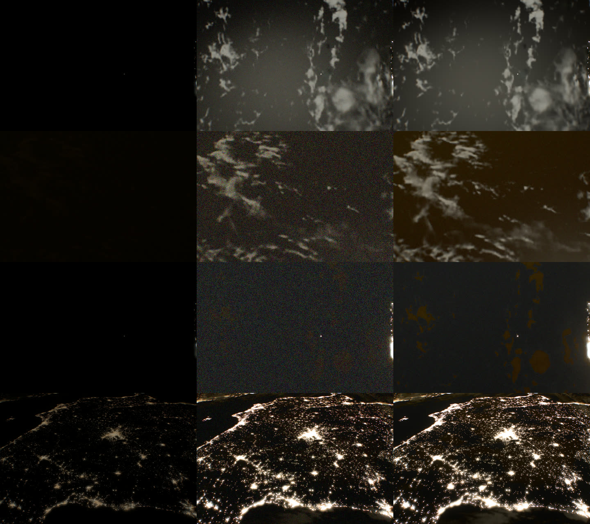
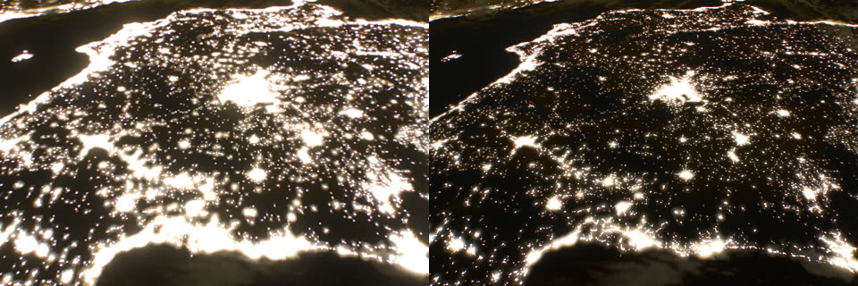

# Physical night, 2026-10-17

ISS night footage shows a faint surface and clouds; ours was near-black away
from cities. The [radiance ledger](radiance-ledger-2026-10-16.md) explains why:
the camera spanned about 6 stops (1/48 s, f/3.18, ISO ≤ 6 150, EV ≤ +5.1),
and the missing 14–17 stops were built into the night emitters instead (city
lights ×4 × 10³, airglow ×1.5 × 10⁴). Airglow then outshone the Moon about 50
times; physically it is about 1/300 of a full Moon. With cities in frame the
meter exposed for lamps at 10⁴ cd/m² and the moonlit ground disappeared.

This lab moves the stops back into the camera. `night=video` or `night=still`
extends the exposure program to ISS night settings, brings the night emitters to
their physical radiance and stores radiance at float precision. Without the
parameter nothing changes.

## Calibration

The display value of a pixel is scene radiance × 2^ev, with 1 the sensor's
white. With the luminance of one scene unit (`SCENE_CANDELA`, 6.06 × 10⁴ cd/m²),
the ISO 12232 saturation exposure 78/S lx·s and the ISO 2720 lens constant
q = 0.65, a camera that records radiance L at white has

  EV100 = log₂(SCENE_CANDELA · q · 100/78) − ev = **15.62 − ev**.

Daylight was already right: the ledger's daylit nadir meters at ev −0.73,
EV100 16.4, against +14.9 and +16.3 for the daylit ISS frames. Only the stated
settings were wrong. f/5.3, 1/48 s, ISO 300 is EV100 8.8, so the base program
behaves as if it carried a **7.54-stop neutral-density filter**. A 24 fps camera
with a 180° shutter needs one in daylight, so the lab states it
(`BASE_ND_STOPS`) and leaves every pixel of daytime unchanged.

Above +1.6 EV (f/3.18, ISO 543) the night programs spend their stops in order:

| Stage | `night=video` (α7S-class) | `night=still` (D3S-class) |
| --- | --- | --- |
| 1 | remove the ND filter, 7.54 stops (to +9.1) | the same |
| 2 | shutter 1/48 → 1/24 s, 360° (to +10.1) | f/3.18 → f/1.4 (to +11.5) |
| 3 | f/3.18 → f/1.4 (to +12.5) | shutter 1/48 → 1.3 s (to +17.5) |
| 4 | ISO 543 → 418 800 (to +22.1) | ISO 543 → 13 400 (to +22.1) |
| Ceiling | **EV100 −6.48** | **EV100 −6.48** |

Both ceilings sit past the ISS night stills (EV100 −3.7 to −4.4) and at
the α7S's ISO 409 600 limit. The still gets there with 5 stops more light
(1.3 s against 1/24 s), so it is 5 stops less noisy at the same exposure.
`scripts/physical-night.test.mjs` checks that every program states
EV100 = 15.62 − ev and is identical to the base program up to f/3.18.

Not sourced: JAXA's exterior α7S II uses a 28–135 mm f/4 zoom
([TechRadar](https://www.techradar.com/news/sony-alpha-a7s-ii-captures-amazing-4k-video-from-space)),
and no published frame states its night settings; one report says ISO 51 200
was needed ([Irish Tech News](https://irishtechnews.ie/?p=49942)). At f/4,
1/24 s that camera's ceiling is EV100 −3.4. The f/1.4 video ceiling is
therefore an assumption, a fast prime as on the stills; the stills settings
are sourced (ISS030-E-102292 at f/1.4, 0.5 s).

## Emitters

`NIGHT_EXCESS` in `src/scripts/physical-night.ts` divides each emitter at the
one place its level is set:

| Emitter | Divisor | Basis |
| --- | ---: | --- |
| City lights (surface, uplight, haze) | 2 × 10⁴ | Black Marble's saturated value at 0.8 cd/m² (~150 nW cm⁻² sr⁻¹ VIIRS), set against ISS030-E-10008 (below) |
| Airglow (limb, nadir column, downward light) | 1.5 × 10⁴ | ledger; zenith column 1.2 × 10⁻⁴ cd/m² (Masana et al. 2021) |
| Milky Way and galactic irradiance | 6 × 10⁴ | ledger |
| Stars and planets (Pogson scale, also lens ghosts) | 8 × 10⁴ | ledger |
| Sky floor | 600 | ledger |
| Aurora | 2.4 × 10⁴ | ledger |
| Lunar disk, sampled and resolved | 200 | ledger; moonlight was already physical |

Moonlight is kept: `fullMoonIrradiance` (2.5 × 10⁻⁶ of the Sun, 0.33 lx) is
physical. Three smaller faults are fixed in the lab:

- **Lunar phase.** Irradiance followed a Lambert sphere, 32% of full at
  quarter. The lab uses the Krisciunas & Schaefer (1991) law that the ledger
  already uses for the disk: 9% at quarter, with the opposition surge.
- **Moonlight on clouds** lacked albedo/π, so it was 3.9× too bright at
  normal incidence. It now uses 0.8/π.
- **The sea got no airglow light** (`*(1.-water)`). It now returns 6% of the
  diffuse sky.

### Cities against ISS030-E-10008

Black Marble is a display-graded image, and its saturated value has to be
placed somewhere. First I tied it to Las Vegas's VIIRS peak, 10 cd/m², the
world maximum: divisor 1 625, ledger city p99 at 7 cd/m², inside the sourced
range. At the photograph's own exposure (Iberia, 2011-12-04 00:13 UTC, 24 mm,
f/2.8, 0.8 s, ISO 12 800, EV100 −3.7; Moon 65% lit at 14° over Madrid) every
town then bloomed into its neighbours. In the frame, towns are amber points,
only Madrid's and the coasts' cores clip, and moonlit cloud shows. At 0.8 cd/m²
for the saturated value the render matches that.
The ledger's city row then reads 0.6 cd/m², at the low end of its
range (whose lower bound is itself an estimate). Black Marble's 500 m pixels
average a city, so they should be compared with VIIRS-scale averages, not
with resolved lamps.

## Storage and metering

Physical night radiance is below what the buffers could hold:

| Signal | Scene units |
| --- | ---: |
| Moonlit cloud, full Moon | 1.4 × 10⁻⁶ |
| Moonlit cloud, quarter Moon | 1.3 × 10⁻⁷ |
| Airglow column seen at nadir | 2 × 10⁻⁹ |
| Airglow-lit sea | ~2⁻³⁴ = 6 × 10⁻¹¹ |
| Half-float, smallest normal / subnormal | 6.1 × 10⁻⁵ / 6 × 10⁻⁸ |

Every scene-radiance target used half floats: the camera's scene buffer and
glare pyramid, the compact world buffer, temporal and half-resolution clouds,
and catalog stars. They lost the whole moonless night and most of the moonlit
one. The lab asks `radianceTarget()` for float32 where the device renders,
blends (`EXT_float_blend`) and, where needed, filters it. That doubles their
bandwidth.

The meter's histogram ended at 2⁻¹⁶, and a 10⁻⁵ floor on measured luminance
capped every automatic target at ev 12.43 (EV100 3.2). The first full-Moon
render stopped exactly there. The lab spreads the 24 bins two stops apart from
2⁻⁴⁰ and lowers the floor to match. The manual-exposure slider takes its range
from the camera model at runtime; the markup is built for the default range.

## Paired renders

`bun scripts/night-views.mjs <base-url> <out>` opens each view with no
parameter, `night=video` and `night=still` in an isolated agent-browser session.
It records the metered ev and the scene radiance quantiles (cd/m²), and saves
screenshots. The production build was served by `scripts/preview.mjs` at
1200 × 800. EV100 below is 15.62 − ev for every mode, including the default
program. Raw values are in
[evidence/physical-night-2026-10-17.json](evidence/physical-night-2026-10-17.json).

Rows: full Moon, quarter Moon, new Moon, Iberia. Columns: default,
`night=video`, `night=still` (the Iberia still at the reference's manual
EV100 −3.7). Crops of the 1200 × 800 frames without the HUD.

| View | Mode | ev | EV100 | Settings | p50 | p90 | p99 (cd/m²) |
| --- | --- | ---: | ---: | --- | ---: | ---: | ---: |
| Full Moon, nadir (2026-10-26 04:12, antisolar point 12° N 67° W) | default | 0.13 | 15.5 | f/4.4, 1/48, ISO 367 | 2.2 | 3.7 | 5 500 |
| | video | 18.69 | **−3.1** | f/1.4, 1/24, ISO 39 300 | 6.0 × 10⁻³ | 2.4 × 10⁻² | 0.29 |
| | still | 18.69 | −3.1 | f/1.4, 1.3 s, ISO 1 260 | | | |
| Quarter Moon (2026-10-18 22:00, 5° N 20° W) | default | 5.10 | 10.5 | f/3.18, 1/48, ISO 6 140 (ceiling) | 2.2 | 2.9 | 4.3 |
| | video | 22.10 | **−6.5** | f/1.4, 1/24, ISO 419 000 (ceiling) | 2.0 × 10⁻⁴ | 8.6 × 10⁻⁴ | 2.9 × 10⁻³ |
| | still | 22.10 | −6.5 | f/1.4, 1.3 s, ISO 13 400 | | | |
| New Moon, as full Moon one lunation earlier (2026-10-10) | default | 0.14 | 15.5 | f/4.3, 1/48, ISO 368 | 2.2 | 3.7 | 5 500 |
| | video | 22.10 | **−6.5** | ceiling | 1.5 × 10⁻⁴ | 2.3 × 10⁻⁴ | 0.28 |
| | still | 22.10 | −6.5 | f/1.4, 1.3 s, ISO 13 400 | | | |
| Iberia, as ISS030-E-10008 (2011-12-04 00:13, from 46° N looking south) | default | −0.16 | 15.8 | f/4.7, 1/48, ISO 344 | 8.0 | 390 | 8 500 |
| | video | 18.68 | **−3.1** | f/1.4, 1/24, ISO 39 300 | 7.8 × 10⁻⁴ | 2.1 × 10⁻² | 0.41 |
| | manual, as the frame | 19.30 | −3.7 | video ISO 60 100; still 1.3 s, ISO 1 930 | | | |
| Daylit nadir (ledger) | default | −0.73 | 16.4 | f/5.3, 1/48, ISO 301 | 4 700 | 10 700 | 24 300 |
| | video | −0.73 | 16.4 | the same with ND 7.54 | | | |

Stills share the video's scene, so their quantiles are the same. The
default program's p50 of 2 cd/m² at night is the inflated sky and airglow.

What the renders show:

- **Full Moon.** The default exposes the night at EV100 15.5, a daylight
  exposure, because city lamps at 10⁴ cd/m² on the frame's edge set the meter.
  The ocean and clouds are black. In the lab the meter lands at EV100 −3.1,
  ISO 39 300. Clouds are clearly lit, the Moon's glint sits on the sea, and
  the cities clip. ISS moonlit video at ISO 25 600, f/1.4, 1/25 s would be
  EV100 −2.4.
- **Quarter Moon** (9% of full). Real-time video runs at its ceiling, and the
  clouds stand out of heavy noise. The still shows them cleanly. The default
  shows nothing.
- **New Moon.** Video at its ceiling is noise over a faint airglow column; no
  surface can be read. In the 1.3 s still, airglow-lit clouds appear faintly.
  So a faint moonless surface appears only at long exposure, as asked.
- **Iberia.** Automatic video meters to EV100 −3.1 against the frame's
  −3.7. At −3.7 the still matches the frame's structure: amber towns as
  points, Madrid and the coasts clipped, moonlit cloud at the edges. The
  frame shows more moonlit ground than ours (the same Moon, 65% lit at 14° over
  Madrid; not yet explained, possibly the dark day-map albedo of dry land at
  night, or the photograph's processing).
- **Day** is unchanged: ev −0.73 in both, now stated as EV100 16.4.

## Ledger with `night=video`

`bun scripts/radiance-ledger.mjs <base-url> <out> night=video` (now takes an
extra query; in the lab it uses pixel classes four decades fainter):

| Source | Default | `night=video` | Physical |
| --- | ---: | ---: | --- |
| Solar disk, sunlit cloud, sunlit Earth | 1.0, 0.8, 0.9 | the same | |
| City lights, bright core (p99) | ×4 × 10³ | 0.58 cd/m², ×0.2 | 0.5–16, in range |
| Airglow at the limb (p99) | ×1.5 × 10⁴ | 4.5 × 10⁻³ cd/m², ×1.0 | 3–7 × 10⁻³ |
| Dark sky above the airglow (p50) | ×600 | 1.3 × 10⁻⁴ cd/m², ×1.0 | 0.5–3 × 10⁻⁴ |
| Lunar surface, lit part (p50) | ×200 | ×2.8, biased | see below |
| Milky Way, aurora | ×6 × 10⁴, ×2.4 × 10⁴ | not isolated | see below |

Raw values are in [evidence/physical-night-ledger-2026-10-17.json](evidence/physical-night-ledger-2026-10-17.json).
The Moon, Milky Way and aurora views no longer isolate their source once the
night is physical. The Moon view's class takes only pixels above 0.002, the
bright part of a disk whose median is now ~0.009. In the Milky Way view the
twilight limb and the Moon's spread light now outweigh the galaxy, so its
p90 does not move. In the aurora view no pixel is green-dominant above the
sky. Their divisors apply at the single gain each source has, so they are
exact by construction, but these three rows need new views before they mean
anything in the lab. The star row is computed in Node, outside the lab.

## Grain

At the default grain (1.1 × 1.3) the sensor model collects 17 600 e⁻ at
white at ISO 400 per CSS pixel: one α7S-sized photosite (~1.4 × 10⁵ e⁻ full
well at ISO 100). Read noise is 0.9 e⁻. At the metered mid-grey (display 0.055):

| Setting | e⁻ at white | e⁻ at mid-grey | SNR |
| --- | ---: | ---: | ---: |
| Full Moon, video, ISO 39 000 | 180 | 10 | 3.0 |
| Iberia at EV100 −3.7, video, ISO 60 000 | 117 | 6.4 | 2.4 |
| Iberia at EV100 −3.7, still, 1.3 s, ISO 1 900 | 3 650 | 200 | 14 |
| Ceiling, video, ISO 419 000 | 17 | 0.9 | 0.7 |
| Ceiling, still, ISO 13 400 | 525 | 29 | 5.3 |

The behaviour is plausible. Shot noise dominates, ISO adds none, the still
is 5 stops cleaner than video at the same EV, and at ISO 419 000 the frame
is mostly noise, as real ISO 409 600 footage is. It is still about 1.8 stops
too noisy for real video at this size. A 12 MP α7S frame shown at 1200 × 800
averages about 13 photosites per CSS pixel, which this model, sized for film
grain, leaves out. Binning photosites per CSS pixel would put the
quarter-Moon video at SNR ~2.5 instead of ~0.7.

## Findings

1. The night was dark because the camera stopped 17 stops short, not because
   the light was missing. With the stops in the camera, moonlit clouds
   are visible in real-time video from about a quarter Moon, and a moonless
   surface appears only in long stills. That is what the ISS record shows.
2. In the default, cities set the exposure of every night view they enter.
   At 10⁴ cd/m² they pull the meter to daylight settings, which is why the
   surface and clouds vanish near cities.
3. Half-float storage cannot hold a physical night. Before this lab it
   flushed quarter-Moon clouds and the whole moonless surface to zero.
4. Absolute radiance thresholds now sit in the wrong place: the meter's
   METER_LIT subject test (0.025–0.10), the glare solar cap and the ledger's
   classes. At night no city or Moon glint counts as a subject. For
   video that is right (ISS footage lets cities clip), but it should be a
   decision, not an accident.
5. Airglow-lit clouds come out orange-brown, from the illustrative
   amber/green palette of `airglow-light.ts`. A reference check of colour is
   still owed.
6. A 1.3 s still at orbital speed smears 10 km on the ground; the renderer
   keeps its fixed motion-blur fraction, so `still` is sharper than a real
   one.
7. Grain is plausible but about 1.8 stops too noisy for downscaled video
   (above).

## Verification

`bun run verify` passes (256 tests, including `scripts/physical-night.test.mjs`).
`bun run verify:scene` against the preview could not complete on the shared
machine: about 40 agent-browser processes from other sessions were running.
This branch passed 42 and then 27 of its checks before timing out at different
waits (touch inspection, then a viewport resize). The unchanged parent commit
timed out at its first settle wait. Rerun it on an idle machine before
building on this.

## Recommendation

Make physical night the default, but not by turning on this switch as it is:

1. **Pre-exposure instead of float32.** Scale scene radiance by the previous
   frame's exposure before it is stored, so half floats hold display-range
   values; the meter and the finish divide it back out. This is the
   engines' standard approach. It keeps mobile (half-float or RGBE) devices
   and the bandwidth budget. Float32 here was for measuring, not shipping.
2. **Then default the emitters and the video program together**, with the
   meter's subject thresholds expressed relative to the exposure. Keep
   `still` as a lab mode until the shutter drives motion blur.
3. **Bin photosites per CSS pixel in the grain model** (~13 at 1200 × 800 for
   a 12 MP sensor), or the quarter-Moon video stays noise-bound at ~SNR 0.7.
4. **Tie the lunar disk to `fullMoonIrradiance`** instead of the ledger
   divisor, and give the ledger views that isolate the Moon, Milky Way and
   aurora at physical levels.
5. **Owner's call: video ceiling f/1.4 or f/4.** JAXA's exterior camera is
   f/4 (ceiling EV100 −3.4): then the quarter Moon is ~3 stops under in
   video and only the stills show it.

Changes here stay off camera-finish's structure; the only line there is the
target type. The lens-reflection and glare work in flight is unaffected
unless the lab is on, where the pupil opens to f/1.4 (`cameraPupilScale` 2.9)
and the ghosts and defocus grow accordingly.
