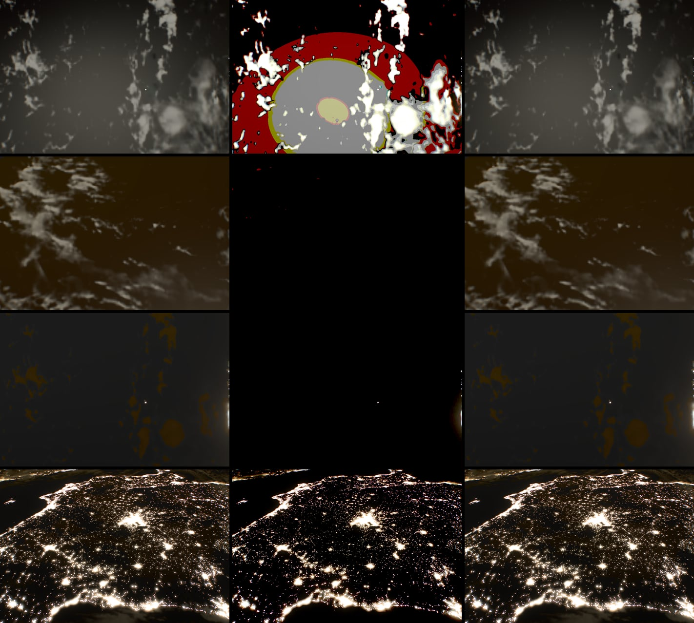

# Pre-exposure, 2026-10-17

The [physical-night lab](physical-night-2026-10-17.md) brought night emitters
to physical radiance, down to about 2⁻³⁴ scene units on airglow-lit sea. Half
floats end at 2⁻¹⁴ (normal) and 2⁻²⁴ (subnormal), so the lab stored every
scene radiance target as float32. Its first recommendation was to replace that
with pre-exposure before physical night can become the default. This lab does
that. `night=video|still` now renders into the same half-float (or RGBE)
targets as the default program, and the float32 switch, `radianceTarget()`,
is gone.

## Method

A frame is rendered with the exposure of the camera state it reads, the
previous frame's metered EV, which the scene shader already decodes for the
pupil. Every pass that stores scene radiance multiplies it by
`sceneExposure()` = 2^ev of that state (`pre-exposure.ts`). The display value
of a pixel is radiance × 2^ev before compensation and the highlight shoulder,
so a pre-exposed value is its display value: metered mid-grey 0.055, white 1,
half-float's maximum 16 stops above white and its smallest normal 10 stops
below mid-grey.

| Pass | Stores (× 2^ev) | Reads (÷ 2^ev) |
| --- | --- | --- |
| Catalog stars | star sprites | |
| Scene, world pass | world buffer, or the scene buffer when single-pass | catalog stars |
| Resolved Moon | its disk, added to the world buffer | |
| Half-resolution and temporal clouds | cloud radiance (not transmittance) | |
| Volume passes | scene buffer | world buffer, cloud radiance |
| Glare pyramid, first level | | caps the Sun's footprint at `GLARE_SOLAR_CAP` × 2^ev, tests `METER_LIT` on radiance ÷ 2^ev |
| Exposure meter | | both meter paths, with the state it updates from |
| Camera finish | | scene image, glare and field reflections, with the state before the meter's update (`CameraExposure.previousTexture`) |

So every absolute threshold keeps its scene units: `METER_LIT`, the glare
solar cap and the meter's 2⁻⁴⁰ luminance floor compare radiance, not stored
values. Analytic light added in the finish (ghosts, veil, dust) is already in
scene units. Passes write at most 65 000, so a Sun at a night exposure clips
while the meter closes down instead of overflowing to infinity.

Temporal clouds reuse the previous frame's columns, which were stored at the
previous exposure. The cloud pass writes its EV into the free z and w of its
depth target, in whole eighths and the remainder (both exact in half floats),
and the resolve scales the history and its change-test neighbours by
2^(ev now − ev then).

Pre-exposure is on with physical night only. In the default program every
shader source is byte-identical to the parent commit: 19 programs in a
daylight view and 21 with the resolved Moon, compared by hash after
`shaderSource`. The radiance ledger's hook now records the state bound with
the scene buffer and divides it out, so `scripts/radiance-ledger.mjs` and
`scripts/night-views.mjs` still report scene radiance.

## Comparison with float32

Three production builds served by `scripts/preview.mjs` at 1200 × 800:

- **float32**: the lab as merged (5e2e5b0), float32 radiance targets.
- **half**: the same with `radianceTarget()` returning half floats, which is
  what a device without float32 blending got from the lab.
- **pre-exposed**: this change, half floats only.

Each view of `night-views.mjs` was opened with `look-grain=0&quality=fixed`
(no grain, no adaptive scale), left to settle for 12 s, then measured: the
metered EV, scene luminance quantiles read from the scene buffer (cd/m²), and
a screenshot cropped to 940 × 630 without the HUD. Raw values are in
[evidence/pre-exposure-2026-10-17.json](evidence/pre-exposure-2026-10-17.json).

Columns: float32, half, pre-exposed. Rows: full Moon, quarter Moon and new
Moon in video, Iberia as the still at EV100 −3.7.

| View, `night=video` | Build | ev | p50 | p90 | p99 (cd/m²) | Stored as 0 |
| --- | --- | ---: | ---: | ---: | ---: | ---: |
| Full Moon | float32 | 18.69 | 5.98 × 10⁻³ | 2.41 × 10⁻² | 0.286 | 0 |
| | half | 22.10 | 7.7 × 10⁻⁴ | 2.12 × 10⁻² | 0.281 | 39.5% |
| | pre-exposed | 18.69 | 5.97 × 10⁻³ | 2.41 × 10⁻² | 0.285 | 0 |
| Quarter Moon | float32 | 22.10 | 2.02 × 10⁻⁴ | 8.56 × 10⁻⁴ | 2.95 × 10⁻³ | 0 |
| | half | 22.10 | 0 | 0 | 0 | 100% |
| | pre-exposed | 22.10 | 2.02 × 10⁻⁴ | 8.56 × 10⁻⁴ | 2.94 × 10⁻³ | 0 |
| New Moon | float32 | 22.10 | 1.52 × 10⁻⁴ | 2.34 × 10⁻⁴ | 0.275 | 0 |
| | half | 22.10 | 0 | 0 | 0.271 | 95.8% |
| | pre-exposed | 22.10 | 1.52 × 10⁻⁴ | 2.34 × 10⁻⁴ | 0.275 | 0 |
| Iberia | float32 | 18.29 | 7.79 × 10⁻⁴ | 1.96 × 10⁻² | 0.425 | 0 |
| | half | 22.10 | 0 | 1.60 × 10⁻² | 0.422 | 81.7% |
| | pre-exposed | 18.30 | 7.79 × 10⁻⁴ | 1.96 × 10⁻² | 0.425 | 0 |
| Daylit nadir | all three | −0.73 | 4 660 | 10 700 | 24 300 | 0 |

`night=still` gives the same quantiles and EV. Without the parameter the
float32 and pre-exposed builds agree to three digits in every view.

Screenshot differences, pre-exposed against float32, in 8-bit levels over the
crop:

| Views | Mean abs. | Pixels > 2 levels | Pixels > 8 levels |
| --- | ---: | ---: | ---: |
| Night views, video and still (10) | 0.013–0.035 | ≤ 0.01% | ≤ 0.005% |
| Default program (5) and daylight video | 0–0.049 | < 0.005% | 0 |
| Half against float32, night views | 20–64 | 95–100% | 81–100% |

The few pixels that differ by more than 8 levels (29 of 590 000 in the new-Moon
frame) are single channels on thin cloud edges. With `cloudReuse=off` the
new-Moon frame keeps one. They come from the temporal clouds' change test
(below). A repeated float32 run differs from itself in one pixel.

Half floats without pre-exposure lose the moonless night and the
quarter-Moon clouds entirely. The meter then runs to the ceiling and bands the
full-Moon frame. With pre-exposure they keep it, which is the point.

### Other paths

| Path | Views | EV | Mean abs. vs float32 | Pixels > 2 levels |
| --- | --- | --- | ---: | ---: |
| Half-resolution clouds (`render=clouds-half`) | full, new, quarter Moon | equal ±0.003 | 0.013–0.044 | ≤ 0.01% |
| WebGL1 (`api=webgl`) | full, new, quarter Moon | equal | 0.013–0.027 | ≤ 0.01% |
| RGBE (float and half-float color buffers hidden), against the parent build in RGBE | full, new, quarter Moon | equal | 0.027–0.063 | 0 |

RGBE could already hold 2⁻³², so pre-exposure changes nothing there. The
scene quantiles of the WebGL1 run match float32 to three digits.

### Temporal history while the exposure moves

Holding manual exposure, then returning to automatic, makes the meter
brighten the full-Moon video over about two seconds. The interpolated columns
come from the previous frame. Stale pre-exposure shows as alternate-column
stripes, measured as the ratio of horizontal to vertical second differences
of luminance (about 1.08 when settled). Over eight frames of the return:

| Build | Peak ratio |
| --- | ---: |
| float32 | 1.28 |
| pre-exposed | 1.32 |
| pre-exposed without the history rescale | 11.7 |

### The Moon in frame

In the ledger's Milky Way view (lens 5) both builds meter EV 17.04 and the
frames agree (mean 0.023 levels). In its Moon view (lens 20, the Moon as the
metering subject) the scene radiance agrees to 0.04% (lit p99 0.0754 scene
units in both), but the meter settles at 16.55 instead of 16.50, so the frame
is 0.05 EV brighter. The point meter gives 18.871 against 18.864. The cause is the
pyramid meter, not pre-exposure. Its subject shares are now stored in half
floats as in the default program, and they sum 0.13% lower. Lowering the
float32 build's shares by 0.1% moves its EV to 16.57. In this view the
subject weighting amplifies share errors 30 to 50 times.

## Behaviour that changed

- **Temporal change test.** Clouds clamp reprojected history when neighbours
  change by more than 0.02 + 0.1 × their value. With float32 night radiance
  everything is far below 0.02, so at night that test never fired and history
  was always reused. Pre-exposed values are display values, as daylight
  radiance roughly is, so the test works at night as it does by day.
- **Clip at 65 000.** Only light 16 stops above the metered white clips: the
  Sun while the meter reacts, or a Moon too small to meter at the video
  ceiling (a full-Moon disk at EV 22.1 is ~3 × 10⁵). Its ghosts and veil are
  analytic and unaffected; its pyramid glare is capped.
- **Bandwidth** is the default program's again: 8 bytes per pixel instead of 16
  for the scene buffer, glare pyramid, compact world buffer, clouds and stars.

## Limits

- The scene passes need the camera state, which needs more than 10 texture
  units (every device that has the world buffer). Without it they store
  radiance unscaled while the meter and the finish still divide, so physical
  night is not supported there.
- The terrain debug view renders the scene straight to the canvas, so in the
  lab it shows pre-exposed values.
- `verify:scene` covers the default program only.

## Verification

`bun run verify` passes (259 tests, `astro check`, build). `bun run
verify:scene` against the preview of this build passes. `scripts/night-views.mjs` with grain on reproduces the
physical-night note's table: full Moon EV 18.69 with p50, p90 and p99 of
5.97 × 10⁻³, 2.41 × 10⁻² and 0.285 cd/m²; quarter Moon 22.10 with 2.02 × 10⁻⁴,
8.56 × 10⁻⁴ and 2.94 × 10⁻³; new Moon 22.10 with 1.52 × 10⁻⁴, 2.34 × 10⁻⁴ and
0.275; day −0.73 in every mode. Iberia meters 18.30 here and 18.29 with the
float32 build of the same merge, against 18.68 in that note, so the change
is not from pre-exposure.

## Next

Physical night no longer needs float32, so the physical-night note's second
step is unblocked: make the emitters and the video program the default.
`METER_LIT` and the glare cap keep their absolute meaning here by design;
expressing the meter's subject test relative to the exposure is that step's
decision. Its sensitivity in the Moon view (above) is worth damping first.
