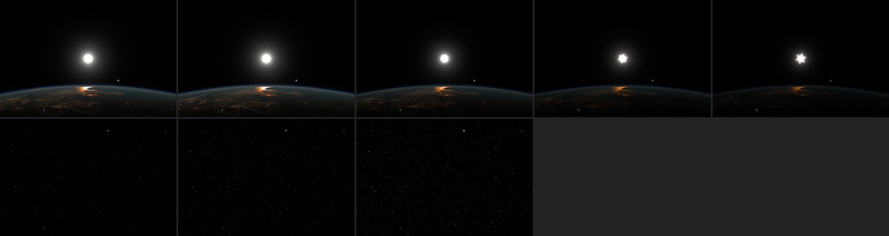
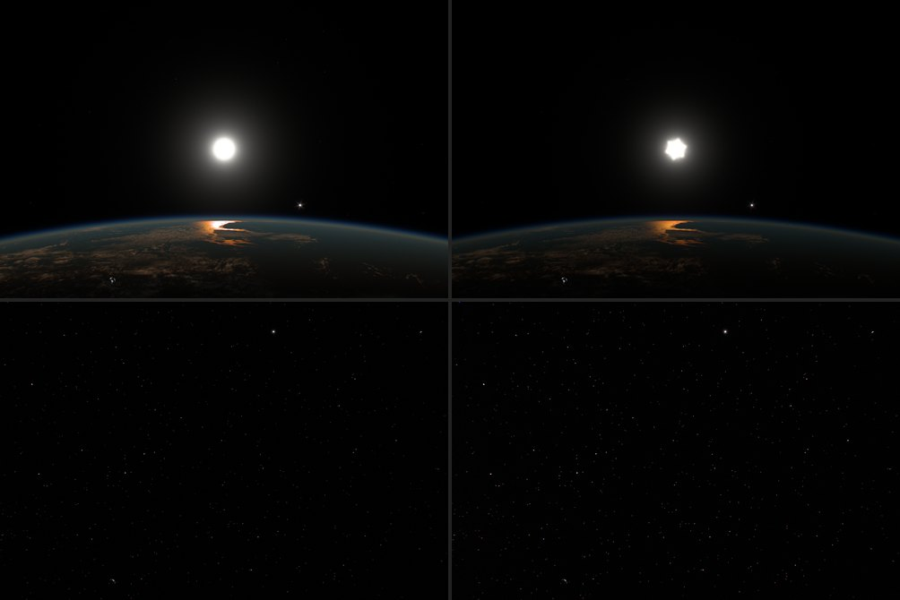

# Metering from the glare pyramid, 2026-10-16

Automatic exposure point-sampled the scene: 32 × 32 taps, each one pixel. A
bright subject counted only through the taps that happened to land on it, and
only from 0.6% of them on, because a lucky tap on a star's core looks as lit
as a tap on the Moon. A half-lit Moon at 5–20× never reached that, so the
camera exposed for the black sky ([previous note](auto-exposure-zoom-2026-10-16.md)).
The meter now reads the area-averaged glare pyramid, and the automatic range
moved from [−1.5, +4.1] to [−3.0, +5.1] EV. The point meter stays available
as `meter=points`.

## Model

- **Order.** `CameraFinish.render` builds the pyramid first, from the focused
  scene, then meters, then defocuses and scatters. Glare and field
  reflections read the same levels; during loading defocus they see the
  sharp scene, not its blur, which glare's width hides. RGBE scenes have no
  pyramid and keep the point meter.
- **Every pixel counts.** The meter reads each texel of the finest level no
  larger than 64 × 64 once: 37 × 25 at 1200 × 800 and 2400 × 1600. Each is a
  box average of its 32 or 64 px square, so coverage no longer depends on
  where taps fall.
- **Subjects versus stars, in the alpha channel.** Level 1 marks lit pixels
  (the same 0.025–0.1 radiance step as before); finer levels average that
  into a lit share; at the subject level (blocks about 1/70 of the frame
  height with the chain's spread, 12 px at 800) a block counts as subject
  when that share passes 0.3–0.9; coarser levels average subjects into an
  area share. A star never fills a subject block however bright it is. On
  the meter level, alpha is the share of the cell inside subjects, and the
  subject's radiance is the cell's light over that share. Cells mostly
  inside a subject weigh more (share²) in the highlight target.
- **Ramp.** With stars excluded, a subject counts from 0.005% of the frame
  and fully from 0.025% (about two subject blocks), instead of 0.6% and 2.5%
  of point samples. The trimmed log mean, the highlight target and the
  clamped blend are otherwise unchanged.

## Results

GPU fixture (`scripts/exposure-browser-fixture.mjs`, float scenes of
1200 × 800, final range):

| Scene | Pyramid | Points |
| --- | ---: | ---: |
| Black sky, three 3 px stars of radiance 50 | +5.10 | — |
| Half-lit Moon, radius 20 px, radiance 0.08, four sub-block offsets | +1.00 to +1.10 | +5.10, +5.10 |
| Uniform radiance 0.1 | −0.86 | −0.86 |

The spread over offsets, 0.10 EV, is the remaining dependence on alignment:
edge blocks carry light without full area. The test bounds it at 0.25 EV.
With the earlier ramp (full from 0.05%) the same Moon sat at weight ~0.85
and spread 0.34 EV once the ceiling rose; the lower ramp removed that.

Scene, metered EV read from the meter's state by a page init script
(1200 × 800, paused, 9 s settle). "Points" is the previous meter and range.

| Subject | Lens | Pyramid, new range | Points, old range |
| --- | ---: | ---: | ---: |
| Sunlit Earth from 955 km, nadir | 1× | −0.74 | −0.66 |
| | 2× | −0.67 | −0.62 |
| | 5× | −0.71 | −0.67 |
| | 10× | −0.93 | −0.90 |
| | 20× | −0.72 | −0.70 |
| Moon (Earth's limb in frame at 1–2×) | 1× | +0.23 | +0.15 |
| | 2× | +0.97 | +0.43 |
| | 5× | −2.99 | +4.10 |
| | 10× | −3.00 | +4.10 |
| | 20× | −3.00 | +3.77 |
| Distant Earth | 0.758× | +0.29 | +3.07 |
| | 1.5× | +0.23 | +0.06 |
| | 3× | +0.19 | +0.10 |
| | 6× (night side, lit limb at the corner) | −0.33 | +4.10 |
| Sun | 1–15× | −3.00 | −1.50 |

The Moon is now metered as a subject and reaches the automatic floor. That
is its radiance in the scene, not the meter: at 20× its lit pixels have a
median of 2.55 and a 90th percentile of 10.3, against 0.09 and 0.20 for the
sunlit Earth at nadir. With albedo 0.12 against Earth's ~0.3, the lunar
surface should be about 0.08, darker than cloud. The scene's Moon is
25–100× too bright; that calibration is outside this change.

## Cost

Timer queries, Apple GPU, median of 40: the meter pass takes 0.70 ms at
1200 × 800 and 0.65 ms at 2400 × 1600, against 1.01 and 1.05 ms for point
samples (one fragment loops over all samples either way; 925 texels without
RGBE decoding are cheaper than 1024 taps). Building the pyramid costs 0.22
and 0.34 ms; it already ran every frame for glare, which is on by default,
and now also runs with `glare=off`.

## The automatic range

Both complaints, an overexposed Sun and an empty sky left too dark, were the
clamps of [−1.5, +4.1] EV, not metering. Measurements before the change:

- **Sun.** A sunrise 11° above the limb from 445 km asks for about −4.2 EV
  (the analytic Sun term) and got −1.5 (f/6.35, ISO 252): a broad clipped
  halo. At −2.5 EV (f/8, ISO 200) the halo is visibly smaller; at −3.5
  (f/10, ISO 159) the disk is compact and the six-blade diffraction star
  appears; at −4.5 (f/12.7, ISO 126) it is crisp. The sunlit limb and the
  glint stay visible down to −4.5; only the night side drops away.
- **Empty sky.** Looking up from 955 km over the antisolar point, the median
  radiance is 1.2 × 10⁻⁶; the meter asks for about +14.7 EV and got +4.1
  (f/3.18, ISO 3070). Compensation shows more stars but no lighter
  background: in that direction there is nothing for a sky to glow with (no
  Milky Way, zodiacal light or airglow), so no reachable exposure greys it.

Applied: floor **−3.0 EV** (f/9, ISO 178) and ceiling **+5.1 EV**
(`EXPOSURE_MAX_EV`, which also bounds manual exposure and the ISO of the
camera program):

| Ceiling | ISO | Shot-noise SNR at output 0.05 |
| ---: | ---: | ---: |
| +4.1 (before) | 3070 | 10.7 |
| +5.1 (now) | 6150 | 7.6 |
| +6.1 (not chosen) | 12 300 | 5.4 |

(17 600 e⁻ at white at the default grain, `sensorChannel`.)

The sunrise meters at −3.0 EV: a compact disk with its diffraction star,
the lit limb and glint kept. The empty sky meters at +5.1 EV: one stop more
stars and grain. A midday view with the Sun beside daylit Earth was not
measured; that Earth is now 1.5 stops darker. The fixture's Sun and black
frame follow the constants.

`AUTO_EXPOSURE_MIN_EV=-3` first reached GLSL as the integer `-3`, which
GLSL ES 1.0 does not convert in `clamp`; WebGL1 pages failed to compile while
the WebGL2 fixtures passed. The meter now writes its range constants with
one decimal.

The defocus check in `verify:scene` measures a sharp and a blurred fixture
point before assets load, when the frame is black and auto exposure sits at
its ceiling. At +5.1 EV the sharp point clipped completely (64 px at 1.0) and
its energy read 15% low. The check now fixes manual exposure at −0.7 EV,
where nothing clips: energy 1.240 sharp, 1.239 and 1.254 blurred.

**Zoomed Sun.** At 15× the meter asks for below −12 EV, and the angular veil
alone is about 20× sunlit cloud, so the −3.0 floor still leaves a washed
frame. Options, none applied:

1. A floor that falls with zoom while the Sun's disk is in frame, e.g.
   −3.0 − log2(zoom) down to the manual −5.5. Earth rarely shares a zoomed
   frame with the Sun, so its visibility is not at stake there.
2. Reach the extra stops with shutter speed only while the Sun is in frame
   (1/48 s → 1/750 s is four stops), keeping f-number and its diffraction
   star. Motion blur stays negligible at those speeds.

Option 2 keeps the look of the aperture; option 1 is a one-line change.
