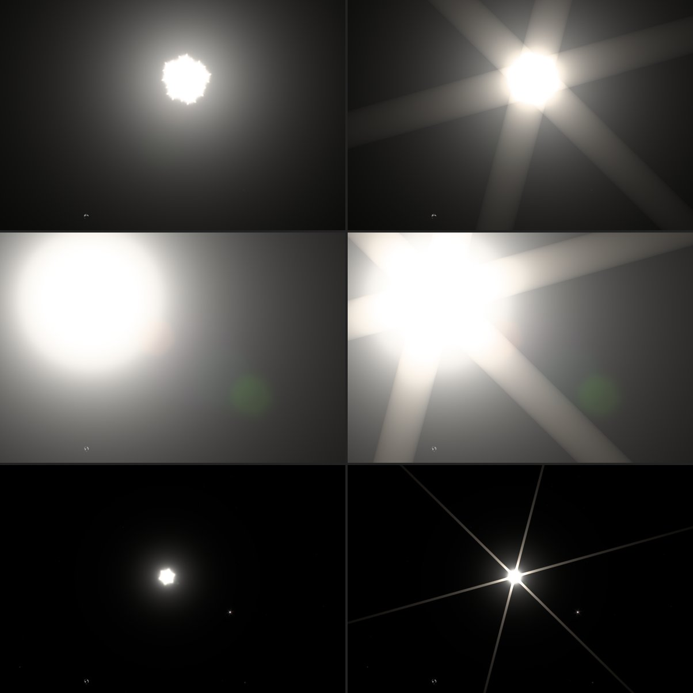

# The Sun as a resolved disk with aperture rays, 2026-10-16

At 14× the Sun was a white blob with a ragged, cauliflower edge. The scene
drew it as 24 points spread over the disk, each convolved with the lens PSF.
At 1× the disk is 4.6 CSS px across and the points merge. At 14× its radius
is about 60 px, the points are about 25 px apart, and each point's PSF core
and short spikes stuck out of the clipped edge. The PSF table also ends its
diffraction spikes about 10 px from a source (its focal-plane window), so
no camera rays ever reached past the glow.

Rows: the reported view (14×, −3 EV compensation), the same Sun at 15× and
at 1×. Left before, right after.

## What changed (`src/scripts/solar-disk.ts`)

- **Resolved disk.** From 5 to 9 CSS px of radius the 24 samples cross-fade
  into an analytic disk, as the Moon does. Its edge is the PSF's own edge
  response: 96% a β = 2 Moffat edge with a = 0.62 × (f/4) px, windowed beyond
  about 8 spreads, plus the 4% scatter wing. Measured from the pupil FFT,
  the core edge leaves 0.16 of the light at 0.5 px, 0.067 at 1 px, 0.028 at
  2 px and 0.008 at 4 px; the fit gives 0.19, 0.075, 0.023, 0.006. Earth's
  limb is a second edge with the same response, so partial occultation stays
  continuous.
- **Limb darkening.** Linear coefficients 0.56, 0.63, 0.76 near 650, 550 and
  450 nm, normalized so the disk keeps its mean radiance. No exposure in the
  camera's range brings the disk below clipping, so this matters only for
  energy bookkeeping.
- **Aperture rays.** The PSF table was regenerated from
  `scripts/build-optical-psf.mjs` without its window and measured. Rays lie
  along the blade normals (15.5° + k·60°) with line density C/r², C nearly
  constant from 6 to 40 px:

  | Iris state | R | G | B |
  | --- | ---: | ---: | ---: |
  | closed (opening 0) | 0.0291 | 0.0261 | 0.0225 |
  | half | 0.0155 | 0.0140 | 0.0122 |
  | open | 0.0032 | 0.0032 | 0.0033 |

  C is in CSS px at f/4 and scales with f-number. A line convolved with a
  disk of radius R is a band as wide as the disk:
  C ∫ ds / (u − s)² over the chord at offset v. Only source points beyond
  the table's window (10.24 × f/4 px) count, so the table's short spikes and
  the analytic rays meet without overlap. Each line carries 2C/window of the
  flux, 1.5% for three lines with a closed iris, and it is taken from the
  disk.

## Checks

`scripts/solar-disk-browser-fixture.mjs` (in `verify:scene`) integrates the
disk and rays in a 2048 px float target, R = 40 px:

| Camera | Disk | Rays | Sum |
| --- | ---: | ---: | ---: |
| f/4, closed iris | 0.983 | 0.015 | 0.998 |
| f/9.5, closed iris | 0.980 | 0.015 | 0.995 |
| f/4, open iris | 0.997 | 0.002 | 0.998 |

The missing 0.2–0.5% are ray tails beyond the canvas. Rays are zero between
the blade normals; stopping from f/4 to f/9.5 makes them 2.4× brighter at
300 px, and the open iris makes them 8× weaker.

## What it looks like

The edge is now round at every zoom. Automatic exposure with the Sun in frame
sits near −3.2 EV, which this camera reaches at about f/9.5 with a closed,
straight-bladed iris: the case where real lenses throw the strongest
starbursts. A ray 200 px from the 1× Sun is about 0.05 of linear white, about
60 of 255 output levels after the display transfer. At 14× each ray is as wide
as the disk and stays visible across the frame over the angular veil.
Whether that strength suits the explorer is a look decision: a rounder iris
or more blades would weaken the rays without breaking the energy accounting.
