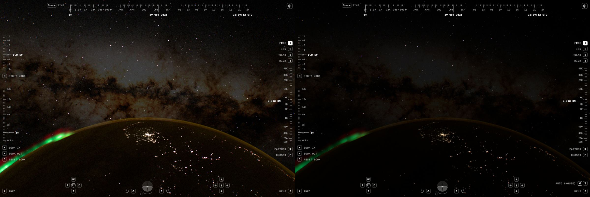

# Subject threshold, 2026-10-20

In free flight at 3,900 km over a night-side city, with an aurora on the limb
and the Milky Way behind it (default program, time at 10×), the exposure kept
rising and falling in smooth waves: EV 0.3 to 5.1 every 8–9 s. The cause was
the meter's subject test. The aurora's peaks lie inside the absolute
`METER_LIT` band, so its metered area breathed with its light, and the
coverage ramp turned that into 4–5 EV. The default program now finds subjects
relative to the frame, as physical night already did, down to two stops
below the day's threshold. The view holds within 0.26 EV. Physical night is
unchanged.

The view:
`t=3523.14&epoch=2026-10-19T21:10:29.313Z&lens=0.996&flight=free&position=0.92729464,1.31228602,-0.15292333&orientation=-0.4975058458,-0.2409757677,-0.3844307526,0.7393453924`.

## Method

Production builds of the working tree before and after the change were served
by Astro's preview and opened in isolated agent-browser sessions at
1200 × 800. An init script read the meter's 1 × 1 state after every update:
the EV, the target and, after the change, the frame EV. A second script read
the 37 × 25 meter field from the glare atlas every 0.5 s. The pyramid branch
of `camera-exposure.ts` was then replayed in float64 on each field. The
replay matched the live target to 0.02 EV. Raw values are in
[evidence/subject-threshold-2026-10-20.json](evidence/subject-threshold-2026-10-20.json).

## Mechanism

It is not a feedback loop. With manual exposure held at EV 1.0 and EV 4.2,
the meter's target swung the same way, from −0.05 to 5.1. Paused
(`motion=0`) it held still. With `aurora=off` it held at 5.1. The aurora
itself pulses (`precipitation` and the travelling folds in `aurora.ts`), by
about 1.6 stops in its subjects' radiance. Three stages turned that pulse into
4.3 EV:

1. **The frame is black.** Its metered mid-grey is 2.5 × 10⁻⁴, a request of
   EV 7.75, so the frame target sits at the 5.1 ceiling.
2. **The aurora sits in the `METER_LIT` band.** Its subject cells peak at
   0.11–0.38, around the 0.025–0.10 step. The subject share of the frame
   followed the light: 0.004% at the trough and 0.021% at the crest, five
   times as much area for three times as much light.
3. **The share lands on the coverage ramp.** Below 0.025% the two requests
   mix with weight (share / 0.025%)², which went from 0.03 to 0.73. The
   emission target moved only from +1.2 to −0.4.

| Replayed frame | Share | Weight | Emission target | Target |
| --- | ---: | ---: | ---: | ---: |
| Trough | 0.0041% | 0.027 | 1.19 | 4.64 |
| Mid | 0.0084% | 0.113 | −0.24 | 2.65 |
| Crest | 0.0214% | 0.733 | −0.09 | 0.35 |

The [meter blend lab](meter-blend-2026-10-17.md) left this stage, the subject
test, as the remaining amplifier. The [night meter lab](night-meter-2026-10-18.md)
already removed it in physical night.

## Change

- **The frame EV is kept in every program.** The meter's second draw now
  runs in the default program too and stores the frame EV in its own range,
  up to `FRAME_EV_MAX` (22.1, the physical-night ceiling). In the default
  program it is the frame's request before the 5.1 ceiling, so a black
  frame keeps the EV it asks for. In physical night the value is unchanged.
  The hand-over writes the frame state in that range.
- **Subjects are relative to the frame.** The glare pyramid's `lit()` and
  the meter's point samples scale `METER_LIT` by min(1, 2^(5.1 − frame EV))
  in both programs. A frame whose mean asks for at most EV 5.1 keeps the
  day's thresholds, so every lit frame meters exactly as before.
- **A floor in the default program.** There the threshold falls at most
  `METER_SUBJECT_DEPTH` = 2 stops below the day's, to 0.00625–0.025. The
  default program's stars and planets are 8 × 10⁴ times their physical
  radiance. With no floor, in the night-limb view (frame EV 9.8, threshold
  4.7 stops down) the lens wings of a bright planet filled a few subject
  blocks, and the exposure fell from 5.10 to 1.16. Physical night has no
  floor: its stars are physical.
- `CameraGlare.build` takes the frame state from the camera in both programs.
  Without one (`render`, fixtures) the threshold stays the day's.

## Choosing the floor

Settled EV in the default program, 1200 × 800. "Running" is the aurora view
with time at 10× for 40 s, minimum to maximum.

| View | No floor | 3 stops | **2 stops** | 1 stop | Before |
| --- | ---: | ---: | ---: | ---: | ---: |
| Aurora view, running | 2.43–2.61 | 2.42–2.61 | **2.10–2.36** | 1.46–1.58 | 0.77–4.98 |
| Aurora view, paused | 2.67 | 2.67 | **2.41** | 1.46 | 5.08 |
| Night limb (bright planet) | 1.16 | 3.60 | **4.67** | 5.10 | 5.10 |
| Full Moon (night-views) | 1.61 | 1.37 | **1.15** | 0.80 | 0.35 |
| Ledger aurora | 0.29 | 0.29 | **0.18** | −0.01 | −0.24 |

Every floor stops the waves. One stop keeps the limb as it was, but leaves the
aurora's trough cells only about twice over the band's top: an aurora a few
times fainter, seen face-on rather than at the limb, would breathe again.
Two stops leave a margin of four. They cost the limb 0.43 EV, a steady offset
for the planet's wings rather than a swing. Three stops cost it 1.5 EV.

## Results

| View | Frame EV | Before | After |
| --- | ---: | ---: | ---: |
| Ledger earthDay | −1.05 | −1.05 | −1.05 |
| Ledger moon (lens 20) | 5.44 | −3.00 | −3.00 |
| Ledger cityNight | 5.50 | 0.66 | 0.83 |
| Ledger aurora | 7.72 | −0.24 | 0.18 |
| Ledger airglowLimb | 8.95 | 5.10 | 5.10 |
| Ledger milkyWay (Moon, lens 5) | 6.16 | −2.99 | −2.97 |
| Ledger emptySky | 11.66 | 5.10 | 5.10 |
| night-views full Moon | 9.88 | 0.35 | 1.15 |
| night-views new Moon | 9.87 | 0.35 | 1.15 |
| night-views quarter Moon | 10.41 | 5.10 | 5.10 |
| night-views city 1× | 3.69 | 0.14 | 0.14 |
| night-views city 8× | −0.02 | −0.02 | −0.02 |
| night-views limb | 9.76 | 5.10 | 4.67 |
| night-views Iberia | 4.19 | −0.16 | −0.16 |
| Aurora view, paused | 7.52 | 5.08 | 2.41 |
| Aurora view, running | | 0.77–4.98 | 2.10–2.36 |

Frames that ask for at most 5.1 are unchanged. On black skies the meter now
counts dimmer extended light as subjects, and these views expose for it:
city lights on a moonless night side 0.8 EV brighter, the aurora views
0.4–0.5 EV brighter. The paused aurora view is 2.7 EV darker. Before, its
aurora counted as a speck on the ramp at this phase. Now it is a subject at
every phase, and the frame is exposed for the aurora and the city. The
Milky Way behind them is dimmer.

In physical night (`night=video`) the targets and frame EVs of all 15 views
are identical to before. Its shader sources differ only in comments and the
frame-state guard. The settled EVs differ by up to 0.21 EV inside the dead
band, as between any two runs.

## Fixture

`verifyPyramidMeter` meters a soft subject on a black sky, a Gaussian of
σ = 14 px with peak radiance 0.05, then 0.10, as the camera does: one update
for the frame EV, then the pyramid built against it.

| Soft subject, 0.05 → 0.10 | EV |
| --- | ---: |
| Day thresholds (before) | 5.10 → 0.01 |
| Relative to the frame, 2-stop floor | 2.47 → 2.17 |

Twice the light of a dim subject now darkens the exposure by 0.3 EV instead
of 5.1. The check bounds the step at 1.1 EV. It also checks that three bright
stars still leave a black frame at the ceiling, and that a uniform frame
within range keeps the day's thresholds exactly.

## Verification

`bun test scripts/night-mode.test.mjs` passes with the new hashes of the
meter and glare-down programs, the only sources that changed, in all three
modes. `astro check` and the build pass. `bun run verify:scene` against the
preview of this build passes every renderer fixture, including lens energy,
glare, field reflections, the solar disk, the Moon, city radiance and
exposure. It then stops at `verifyFlight`, and six tests in
`camera-gesture.test.mjs` fail. Both files belong to concurrent, uncommitted
gesture work in this working tree, not to this change.
