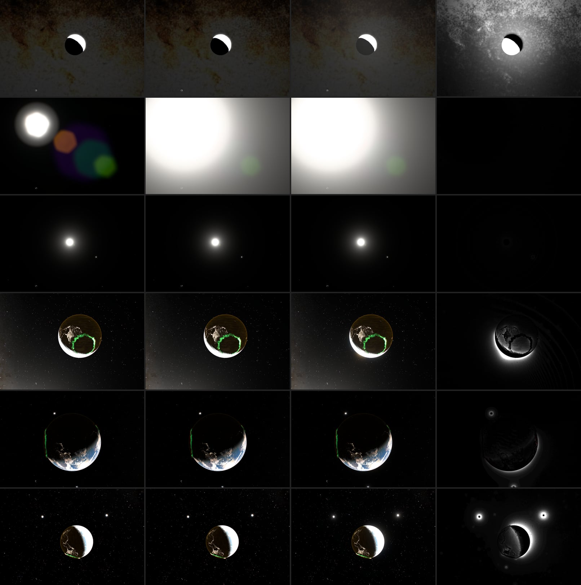

# Veiling glare of the whole frame, 2026-10-16

Only the Sun scattered light through the lens: a two-component Moffat veil
carrying 1.5% of its flux. Sunlit Earth, the bright limb, the Moon and bright
planets scattered nothing, so the black sky stayed black right up to an
overexposed crescent. Their lens reflections are negligible at coated-lens
reflectance ([previous note](lens-reflections-2026-10-16.md)); glare is what
a camera actually shows around them.

Columns: after the reflection calibration; with the angular solar veil only
(`glare=off`); with frame glare; 8× luminance difference between the last two
(red: darker). Rows: Moon 20×; Sun 15×; Sun 1×; sunlit crescent +2.4 EV;
Earth and Moon +2.4 EV; Earth, Moon and a planet at 0.758×, +2 EV.

## Model

Every source scatters with the Sun's kernel: V = 0.8·M(0.015) + 0.2·M(0.08),
M(a) the normalized β = 2 Moffat of core radius a radians, scatter fraction
η = 1.5%. Glare moves light: the frame becomes L + η(L ⊛ V − L).

- **Angular kernel.** Scatter at the window and the front element happens
  before the lens focuses, so V is fixed in object space. In the frame its
  radius is a × focal length. The solar veil divided by the 1× focal length
  instead: at 15× it held 1/137 of its energy in a tight disk. Now the halo
  grows with zoom at constant surface brightness, for the Sun and the scene.
- **Pyramid** (`src/scripts/camera-glare.ts`). Half-float levels down to two
  texels: four bilinear taps average a 4×4 block on the way down, and a 3×3
  tent accumulates on the way up. A β = 2 Moffat is exactly ∫ e^-t G_σ dt with
  σ² = a²/2t, so each level's weight is the Gaussian mass between its
  neighbours' spreads, exp(-a²/2σ_hi²) − exp(-a²/2σ_lo²); the ends take the
  rest and the weights sum to one. Level k spreads about 1.14·2^k pixels.
- **The Sun stays analytic.** Its disk and PSF footprint (disk plus 130 CSS
  px, where the scene stops drawing its PSF) are capped at 16 before the
  pyramid. Sunlit cloud is below 1, glint a few units, the disk ~3·10⁴.
- **Precision.** η is applied when compositing. Weighting half-float levels
  first lost 12% of a point source's glare to underflow.
- **Fallback.** RGBE scene buffers cannot be filtered; there only the analytic
  solar veil remains.

## Measurements

The GPU fixture (`scripts/glare-browser-fixture.mjs`, part of
`verify:scene`) runs the production pyramid on a 2×2 source in a 512 px
float target:

| Check | Result |
| --- | ---: |
| Kernel integral | 0.998 |
| Profile / analytic Moffat at 4, 8, 16, 32, 64, 128, 200 px | 1.10, 0.92, 0.98, 0.98, 1.00, 1.02, 1.10 |
| Source inside the solar footprint (1000 → cap 16) | 0.016 |
| Same source outside it | 0.997 |
| 4× focal: integral; halo width ratio | 0.989; 1.05 of 4× |

At 4× and beyond, light the kernel would carry past the frame edge stays
in frame: the coarsest level is the frame mean.

Scene views, captured as before (1200 × 800, DPR 1, grain off, paused,
9 s exposure settle). Lift is the 9 × 9 box-filtered luminance difference
with glare on and off, in 8-bit output levels; mean level and clipped pixels
are of the whole frame. Raw numbers are in
[evidence/veiling-glare-2026-10-16.json](evidence/veiling-glare-2026-10-16.json).

| View | Dark-sky lift | p99 lift | Frame raised > 2 | Mean level: stage 1 → veil → glare | Clipped: stage 1 → glare |
| --- | ---: | ---: | ---: | ---: | ---: |
| Moon 20× | 17.3 | 43.9 | 97% | 33.4 → 33.4 → 43.5 | 7 332 → 7 334 |
| Sun 15× | 0.0 | 0.3 | 0% | 22.1 → 179.2 → 179.3 | 25 722 → 277 469 |
| Sun 1× | 0.0 | 0.4 | 0% | 6.0 → 6.0 → 6.1 | 1 882 → 1 891 |
| Crescent | 0.9 | 21.6 | 12% | 21.5 → 21.5 → 22.8 | 10 789 → 10 807 |
| Earth + Moon | 0.4 | 7.2 | 4% | 9.1 → 9.1 → 9.5 | 6 146 → 5 943 |
| Wide, 0.758× | 1.5 | 26.8 | 14% | 6.9 → 6.9 → 8.4 | 14 493 → 14 530 |

- **Crescent, Earth + Moon, wide.** A halo hugs every sunlit limb, the night
  side near the terminator lifts, and the Moon and the planet get round halos
  whose centres give up the scattered 1.5% (dark rings in the difference).
  The black sky elsewhere is untouched.
- **Sun 1×** is unchanged: the angular veil equals the old one at 1×, and the
  pyramid adds nothing because the Sun is excluded.
- **Sun 15×.** The angular veil alone fills the frame: at 1° its radiance is
  2·10⁻⁴ of the solar disk, about 20× sunlit cloud, while auto exposure is
  already at its floor. The reflections that stage 1 made visible drown in it.
- **Moon 20×.** The overexposed Moon's glare now spans the 2.2° frame and
  lifts the Milky Way by 17 levels.

Concentric rings in the 8× difference images are 8-bit steps of a smooth
gradient. Stars move by fractions of a pixel between runs; the box filter
removes that from the numbers.

## Cost

`CameraGlare.render` alone, EXT_disjoint_timer_query_webgl2, Apple GPU,
50 samples after 10 warm-up: median 0.38 ms at 1200 × 800, 0.50 ms at
2400 × 1600 and 2880 × 1800. The 90th percentile was 3–8 ms because other
tabs were rendering the scene on the same GPU; it is not a paired A/B of the
frame. Memory: two half-float chains from half resolution, under 0.7× one
full-resolution RGBA16F target.

## Open

The zoomed Sun and Moon views are the physical consequence of an angular
1.5% veil and an exposure floor tuned at 1×. A frame-fixed kernel would keep
them closer to the previous look but makes scattered energy depend on zoom.
Reflections sampled from the same pyramid at p / conjugate are the next stage.
